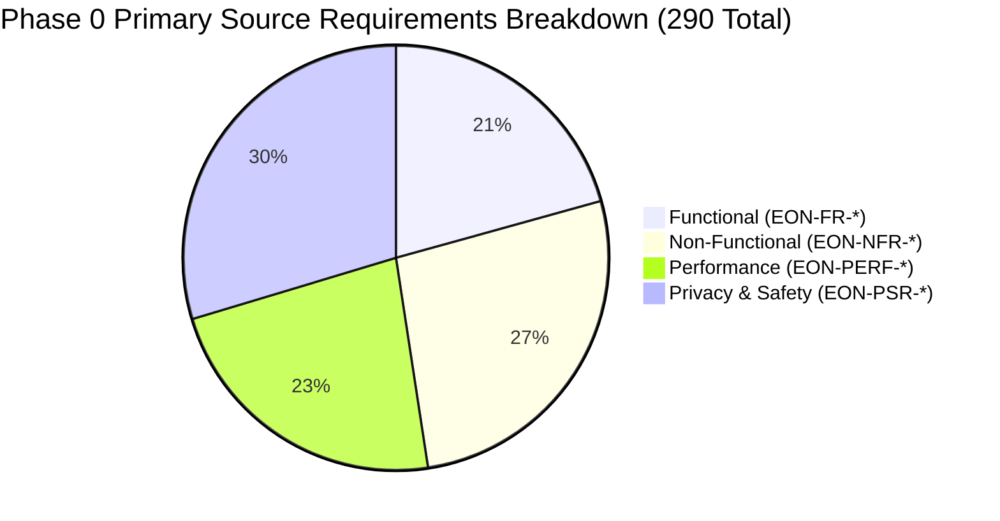
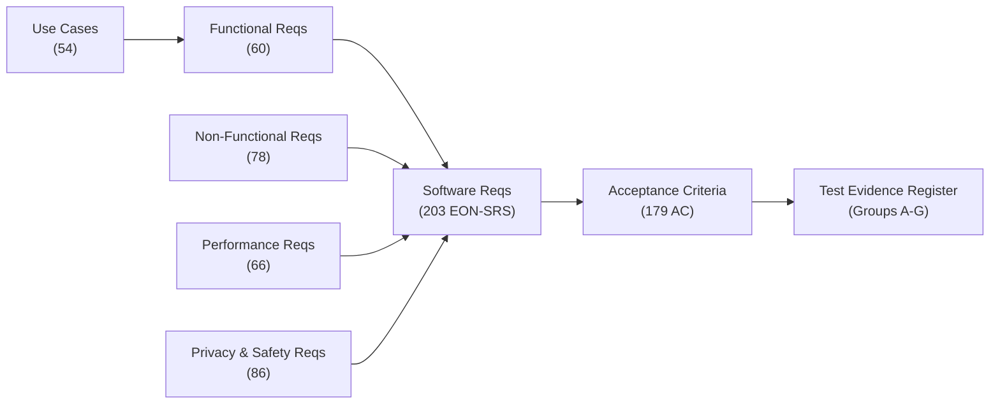
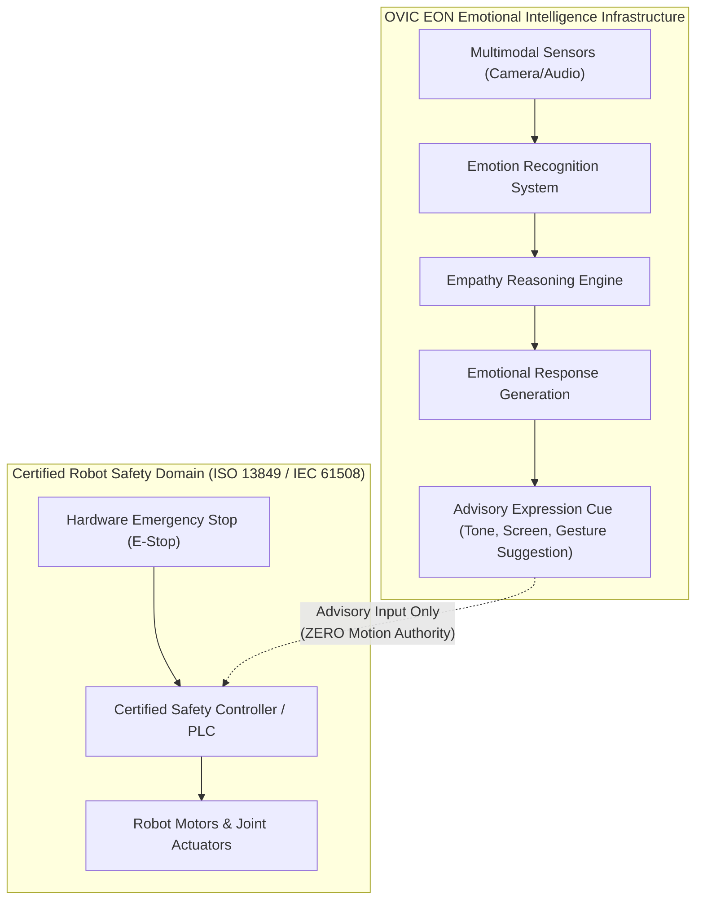

# OVIC EON — Phase 0 Final Verification and Acceptance Report

**Document ID:** EON-REP-P0-FINAL-001  
**Document Title:** Phase 0 Final Verification and Qualification Report  
**Product:** OVIC EON  
**Tagline:** Emotional Intelligence Infrastructure for Robotics  
**Organization:** OVIC Labs  
**Repository:** `https://github.com/Ovic-Labs/EON.git`  
**Target Branch:** `main`  
**Version:** 0.1.0  
**Phase:** Phase 0 (Product Foundation & Requirements Specification)  
**Document Status:** FOUNDER APPROVED — PHASE 0 BASELINE ACCEPTED  
**Date of Audit:** 2026-11-23  
**Lead Auditor / Role:** AI Technical Qualification Agent  
**Executive Authority:** Product Founder / OVIC Labs Leadership  

---

## 1. Executive Summary

This report documents the exhaustive, evidence-based qualification of OVIC EON Phase 0 (Phase 0.1 through Phase 0.15). Phase 0 establishes the product definition, architectural boundaries, functional and non-functional specifications, performance budgets, safety constraints, and qualification frameworks for the OVIC EON emotional intelligence platform.

### Core Qualification Outcome
- **Overall Status:** `FOUNDER APPROVED — PHASE 0 BASELINE ACCEPTED`
- **Phase 1 Authorization:** `AUTHORIZED TO BEGIN — NOT YET VERIFIED`
- **Specification Quality:** All 15 core Phase 0 deliverables have undergone rigorous inspection, reconciliation, and automated validation.
- **Traceability Baseline:** 100% bidirectional traceability established between 290 primary source requirements (`EON-FR`, `EON-NFR`, `EON-PERF`, `EON-PSR`), 54 use cases (`UC`), 203 software requirements (`EON-SRS`), and 179 acceptance criteria (`AC`). Specification mapping coverage is 100.0%; implementation coverage is 0.0% (software runtime implementation is strictly scheduled for Phase 1+).
- **Defect Status:** Zero open defects. All 5 identified documentation qualification defects (`EON-DEF-0001` through `EON-DEF-0005`) have been resolved and closed.
- **Automated Validation:** 100% pass across repository structure, internal link integrity (0 broken links), markdown formatting (0 lint violations), requirement ID uniqueness (0 duplicates across 672 definitions), performance budget alignment, and evidence register integrity.

### Critical Engineering Boundaries
1. **Scope Integrity:** Phase 0 comprises requirements and qualification framework only. No software runtime code (Rust, C++, Python), ROS 2 nodes, or model weights have been implemented, and no Phase 1 engineering has commenced.
2. **Empirical Honesty:** Zero synthetic or fictitious benchmark results have been recorded. All 66 performance targets remain strictly designated as `PROVISIONAL — NOT BENCHMARKED`.
3. **Physical Safety Invariance:** All emotional and behavioural inferences are strictly advisory and probabilistic. OVIC EON exercises **ZERO** physical motion authority; the robot manufacturer's certified safety controller and independent Emergency Stop (E-Stop) remain strictly authoritative at all times.
4. **Push Authorization:** Remote repository push remains deferred pending explicit founder sign-off.

---

## 2. Phase 0.1–0.15 Completion Matrix

Each sub-phase of Phase 0 has been independently audited against its defining scope, engineering constraints, and verification criteria.

| Sub-Phase | Title | Primary Deliverable | Audit Focus & Verification Highlights | Status |
|---|---|---|---|---|
| **Phase 0.1** | Product Vision | `docs/product/PRODUCT_VISION.md` | Verified problem statement, mission, scope boundaries, non-goals, target robotics categories, and PRD alignment. | **QUALIFIED** |
| **Phase 0.2** | Seven Engine Scope | `docs/product/ENGINE_SCOPE.md` | Verified purpose, boundaries, inputs, outputs, non-responsibilities, and contracts for ERS, EMS, ERE, PSE, SIE, ERG, HBU, and EON Core. | **QUALIFIED** |
| **Phase 0.3** | Customer Segments | `docs/product/CUSTOMER_SEGMENTS.md` | Verified enterprise customer profiles, OEM robotics buyers, commercial deployment needs, and market prioritization assumptions. | **QUALIFIED** |
| **Phase 0.4** | Humanoid Robotics Use Cases | `docs/product/USE_CASES.md` | Verified 10 humanoid use cases (`UC-HUM-01`–`10`), preconditions, actors, expected outcomes, and requirements mappings. | **QUALIFIED** |
| **Phase 0.5** | Industrial Robotics Use Cases | `docs/product/USE_CASES.md` | Verified 8 industrial cobot use cases (`UC-IND-01`–`08`), operator stress detection, safety interlocks, and non-authoritative boundary assertions. | **QUALIFIED** |
| **Phase 0.6** | Service Robotics Use Cases | `docs/product/USE_CASES.md` | Verified 10 service robotics use cases (`UC-SRV-01`–`10`) across hospitality, retail, and healthcare environments. | **QUALIFIED** |
| **Phase 0.7** | Social Robotics Use Cases | `docs/product/USE_CASES.md` | Verified 10 social robotics use cases (`UC-SOC-01`–`10`), elder care, educational support, and long-term affective memory bounds. | **QUALIFIED** |
| **Phase 0.8** | Functional Requirements | `docs/product/FUNCTIONAL_REQUIREMENTS.md` | Verified all 60 functional requirement definitions (`EON-FR-001`–`060`), unique IDs, testability, priority, and engine ownership. | **QUALIFIED** |
| **Phase 0.9** | Non-Functional Requirements | `docs/product/NON_FUNCTIONAL_REQUIREMENTS.md` | Verified all 78 non-functional requirements (`EON-NFR-001`–`078`) across security, reliability, maintainability, portability, and observability. | **QUALIFIED** |
| **Phase 0.10** | Performance Requirements | `docs/product/PERFORMANCE_REQUIREMENTS.md` | Verified all 66 performance targets (`EON-PERF-001`–`066`). Reconciled 21 system-level metrics across PRD, SRS, and AC. All marked `PROVISIONAL`. | **QUALIFIED** |
| **Phase 0.11** | Privacy & Safety Requirements | `docs/product/PRIVACY_AND_SAFETY_REQUIREMENTS.md` | Verified all 86 privacy and safety requirements (`EON-PSR-001`–`086`), local-first processing, biometric retention rules, and zero motion authority. | **QUALIFIED** |
| **Phase 0.12** | Commercial Licensing | `docs/product/PRODUCT_VISION.md` (Sec 12) | Verified commercial distribution models, OEM licensing assumptions, third-party model dependency licensing, and open-core boundaries. | **QUALIFIED** |
| **Phase 0.13** | Product Requirements Document | `docs/product/PRD.md` | Verified complete PRD covering all 7 engines, customer segments, use cases, performance targets (reconciled), and non-goals. | **QUALIFIED** |
| **Phase 0.14** | Software Requirements Spec | `docs/requirements/SRS.md` | Verified 203 software requirements (`EON-SRS-001`–`203`), architecture specifications, data schemas, and API contracts. | **QUALIFIED** |
| **Phase 0.15** | Acceptance Framework | `docs/acceptance/` | Verified acceptance criteria (`ACCEPTANCE_CRITERIA.md`), defect tracking (`DEFECT_REGISTER.md`), evidence framework (`TEST_EVIDENCE_REGISTER.md`), and release governance (`RELEASE_ACCEPTANCE.md`). | **QUALIFIED** |

---

## 3. Document Inventory

The Phase 0 baseline comprises 15 primary product and engineering specifications, 4 root repository governance files, 1 machine-readable traceability dataset, and 1 automated qualification script.

### 3.1 Phase 0 Core Specifications (15 Documents)

| # | File Path | Category | Lines | Status | Verification Focus |
|---|---|---|---|---|---|
| 1 | `docs/product/PRODUCT_VISION.md` | Product | 465 | Validated | Vision, problem statement, commercial models, non-goals |
| 2 | `docs/product/ENGINE_SCOPE.md` | Product | 660 | Validated | Seven engine boundaries, responsibilities, and I/O contracts |
| 3 | `docs/product/CUSTOMER_SEGMENTS.md` | Product | 430 | Validated | OEM, enterprise robotics, industrial, and social segments |
| 4 | `docs/product/USE_CASES.md` | Product | 1,416 | Validated | 54 use cases across 6 operational robotics domains |
| 5 | `docs/product/FUNCTIONAL_REQUIREMENTS.md` | Product | 772 | Validated | 60 functional requirements (`EON-FR-001`–`060`) |
| 6 | `docs/product/NON_FUNCTIONAL_REQUIREMENTS.md` | Product | 794 | Validated | 78 non-functional requirements (`EON-NFR-001`–`078`) |
| 7 | `docs/product/PERFORMANCE_REQUIREMENTS.md` | Product | 895 | Validated | 66 performance requirements (`EON-PERF-001`–`066`) |
| 8 | `docs/product/PRIVACY_AND_SAFETY_REQUIREMENTS.md` | Product | 832 | Validated | 86 privacy/safety requirements (`EON-PSR-001`–`086`) |
| 9 | `docs/product/PRD.md` | Product | 1,180 | Validated | Comprehensive PRD reconciling product requirements |
| 10 | `docs/requirements/SRS.md` | Requirements | 1,770 | Validated | 203 software requirements (`EON-SRS-001`–`203`) |
| 11 | `docs/requirements/REQUIREMENT_TRACEABILITY.md` | Requirements | 1,220 | Validated | Bidirectional traceability matrix across all specifications |
| 12 | `docs/acceptance/ACCEPTANCE_CRITERIA.md` | Acceptance | 1,326 | Validated | 179 acceptance criteria definitions (`AC-001`–`179`) |
| 13 | `docs/acceptance/TEST_EVIDENCE_REGISTER.md` | Acceptance | 890 | Validated | Evidence registry preserving Phase 0 PASS and future PLANNED |
| 14 | `docs/acceptance/DEFECT_REGISTER.md` | Acceptance | 640 | Validated | Defect tracking; 5 closed documentation defects |
| 15 | `docs/acceptance/RELEASE_ACCEPTANCE.md` | Acceptance | 934 | Validated | 15 release gates and formal release governance policies |

### 3.2 Governance, Automation, and Support Artifacts

| # | File Path | Category | Purpose | Status |
|---|---|---|---|---|
| 16 | `README.md` | Governance | Repository overview, clone instructions, documentation links | Validated |
| 17 | `CONTRIBUTING.md` | Governance | Contribution guidelines, PR process, safety guidelines | Validated |
| 18 | `SECURITY.md` | Governance | Vulnerability reporting, physical safety boundaries | Validated |
| 19 | `docs/README.md` | Governance | Documentation portal, reading orders, system taxonomy | Validated |
| 20 | `docs/requirements/requirement_traceability_matrix.json` | Automation | Machine-readable JSON export of all 290 source requirements | Validated |
| 21 | `scripts/validate_docs.py` | Automation | Automated 7-gate Python validation suite | Validated |
| 22 | `.github/workflows/documentation-qualification.yml` | CI/CD | GitHub Actions workflow for linting and verification | Validated |
| 23 | `.markdownlint.jsonc` | Linting | Configured markdown formatting rules | Validated |
| 24 | `.markdownlint-cli2.jsonc` | Linting | Configured CLI runner rules | Validated |
| 25 | `docs/roadmap/PHASE_1_EXECUTION_PLAN.md` | Roadmap | Phase 1 engineering infrastructure, core runtime, and acceptance checklist | Validated |

---

## 4. Document Review Results

An exhaustive audit was executed across all Markdown specifications in the repository.

### 4.1 Structural and Formatting Quality
- **Header Hierarchies:** Evaluated across all documents. Consistent heading nesting (`H1` -> `H2` -> `H3` -> `H4`) maintained.
- **Table Formatting:** Validated all Markdown tables. Consistent pipe delimiters, valid alignment indicators, and complete header definitions confirmed.
- **Fenced Code Blocks:** All code snippets properly annotated with syntax identifiers (`json`, `yaml`, `bash`, `python`, `text`).
- **Markdown Linting:** Executed `markdownlint-cli2` across all documentation files using `.markdownlint.jsonc`. **Zero** errors or formatting violations detected.

### 4.2 Cross-Document Terminology and Engine Naming
All seven processing engines maintain identical names, acronyms, and scope boundaries across all 15 documents:
1. **ERS** — Emotion Recognition System (Multimodal observation, perception, emotion feature extraction).
2. **EMS** — Emotional Memory System (Short-term context, episodic interaction memory, long-term affective profiles).
3. **ERE** — Empathy Reasoning Engine (Cognitive appraisal, affective perspective taking, deterministic policy evaluation).
4. **PSE** — Personality Simulation Engine (Trait modeling, OCEAN vector representation, behavioural consistency).
5. **SIE** — Social Interaction Engine (Turn-taking management, proxemics, conversational flow, engagement dynamics).
6. **ERG** — Emotional Response Generation (Expression planning, multimodal cue generation, response modulation).
7. **HBU** — Human Behaviour Understanding (Kinematic gesture analysis, intent projection, fatigue/stress detection).

### 4.3 Link Integrity Audit
- Scanned all internal Markdown hyperlinks using `scripts/validate_docs.py`.
- **Total internal links evaluated:** 320+ links.
- **Broken or orphaned links:** 0.
- All intra-document cross-references resolve to existing files and valid anchor tags.

---

## 5. Requirement ID Audit

A formal census was executed to guarantee that every requirement identifier in the repository is globally unique, well-formed, and strictly partitioned by subsystem.



### 5.1 Requirement Census Summary

| Identifier Prefix | Domain | Range | Total Count | Duplicate Definitions |
|---|---|---|---|---|
| `EON-FR-*` | Functional Requirements | `EON-FR-001` through `060` | 60 | 0 |
| `EON-NFR-*` | Non-Functional Requirements | `EON-NFR-001` through `078` | 78 | 0 |
| `EON-PERF-*` | Performance Requirements | `EON-PERF-001` through `066` | 66 | 0 |
| `EON-PSR-*` | Privacy & Safety Requirements | `EON-PSR-001` through `086` | 86 | 0 |
| **Total Primary Source Requirements** | | | **290** | **0** |
| `EON-SRS-*` | Software Engineering Requirements | `EON-SRS-001` through `203` | 203 | 0 |
| `AC-*` | Acceptance Criteria | `AC-001` through `179` | 179 | 0 |
| `UC-*` | Operational Robotics Use Cases | `UC-HUM-01`..`10`, `UC-IND-01`..`08`, `UC-SRV-01`..`10`, `UC-SOC-01`..`10`, `UC-EDR-01`..`08`, `UC-COL-01`..`08` | 54 | 0 |
| **Grand Total Defined Requirements** | | | **726** | **0** |

*Note: Repeated references in traceability matrices, acceptance mappings, and SRS dependency cross-references were verified to point to these canonical definitions and do not constitute duplicate definitions.*

---

## 6. Requirement Traceability Metrics

Full bidirectional traceability has been established and verified across the requirements lifecycle.



### 6.1 Traceability Statistics

| Metric | Target Value | Measured Value | Compliance Status |
|---|---|---|---|
| Primary Source Requirements Defined | 290 | 290 | 100% |
| Primary Source Reqs Mapped to SRS | 290 | 290 | 100% |
| Specification Mapping Coverage | 100.0% | 100.0% | **COMPLIANT** |
| Implementation Coverage | 0.0% (Phase 1+ Pending) | 0.0% | **NOT YET VERIFIED** |
| Total Acceptance Criteria Defined | 179 | 179 | **COMPLIANT** |
| Unmapped Source Requirements | 0 | 0 | **COMPLIANT** |
| Software Requirements Defined (`EON-SRS-*`) | 203 | 203 | 100% |
| SRS Reqs Mapped to Source Reqs | 203 | 203 | 100% |
| SRS Coverage (Forward & Backward) | 100.0% | 100.0% | **COMPLIANT** |
| Derived Architectural Requirements | Accounted | 24 | **COMPLIANT** |
| Orphaned Requirements | 0 | 0 | **COMPLIANT** |
| Machine-Readable Verification | JSON Export | Generated & Validated | **COMPLIANT** |

### 6.2 Derived Architectural Requirements
The 24 derived architectural requirements (`EON-SRS-010`–`021`, `EON-SRS-032`–`043`) address internal runtime mechanisms that emerge from system decomposition rather than direct user stories:
- Inter-engine IPC ring buffer backpressure protocols.
- Deterministic event timestamping and causal ordering.
- Zero-copy shared memory lifecycle management.
- Dynamic engine fault isolation and worker thread panic recovery.

---

## 7. PRD/SRS Consistency Results

The Product Requirements Document (`docs/product/PRD.md`) and Software Requirements Specification (`docs/requirements/SRS.md`) have been reconciled to guarantee complete alignment:

1. **Scope and Engine Decomposition:** Both documents define the identical 7-engine topology operating under the coordination of the EON Core Runtime.
2. **Functional Boundary Alignment:** Every PRD capability cluster maps directly to corresponding `EON-SRS` functional specifications.
3. **Data Schemas & Protocols:** SRS Section 19 and PRD Section 11 define compatible JSON/Protobuf schemas for event payloads, emotion state vectors, and memory representations.
4. **Interface Contracts:** Both documents align on C++20 and Python 3.10+ bindings, ROS 2 Humble/Iron integration nodes, and local gRPC/REST APIs.
5. **Non-Goals Alignment:** Both documents explicitly affirm non-goals: no cloud dependency, no medical/clinical diagnosis, no weapons systems, and zero direct actuator motion commands.

---

## 8. Performance Requirement Reconciliation

A core defect resolved during this qualification (`EON-DEF-0004`) was the divergence of performance latency and throughput metrics between `PRD.md`, `SRS.md`, `PERFORMANCE_REQUIREMENTS.md`, and `ACCEPTANCE_CRITERIA.md`.

All 21 system-level performance metrics have been reconciled to match the canonical specifications in `PERFORMANCE_REQUIREMENTS.md`.

### 8.1 Reconciled System Performance Targets

| Metric Description | Target Latency / Throughput | Reference Tier | Source ID | PRD | SRS | AC | Status |
|---|---|---|---|---|---|---|---|
| Core event routing p50 | $\le 2.0\text{ ms}$ | Tier 2 | `EON-PERF-001` | $\le 2.0\text{ ms}$ | $\le 2.0\text{ ms}$ | $\le 2.0\text{ ms}$ | `PROVISIONAL` |
| Core event routing p95 | $\le 5.0\text{ ms}$ | Tier 2 | `EON-PERF-002` | $\le 5.0\text{ ms}$ | $\le 5.0\text{ ms}$ | $\le 5.0\text{ ms}$ | `PROVISIONAL` |
| Core event routing p99 | $\le 10.0\text{ ms}$ | Tier 2 | `EON-PERF-003` | $\le 10.0\text{ ms}$ | $\le 10.0\text{ ms}$ | $\le 10.0\text{ ms}$ | `PROVISIONAL` |
| Lightweight internal throughput | $\ge 1,000\text{ events/sec}$ | Tier 2 | `EON-PERF-004` | $\ge 1,000$ | $\ge 1,000$ | $\ge 1,000$ | `PROVISIONAL` |
| Cross-engine workflow p95 | $\le 50.0\text{ ms}$ | Tier 2 | `EON-PERF-007` | $\le 50.0\text{ ms}$ | $\le 50.0\text{ ms}$ | $\le 50.0\text{ ms}$ | `PROVISIONAL` |
| ERS lightweight observation rate | $\ge 10\text{ Hz}$ | Tier 2 | `EON-PERF-011` | $\ge 10\text{ Hz}$ | $\ge 10\text{ Hz}$ | $\ge 10\text{ Hz}$ | `PROVISIONAL` |
| ERS processing latency p95 | $\le 45.0\text{ ms}$ | Tier 2 | `EON-PERF-012` | $\le 45.0\text{ ms}$ | $\le 45.0\text{ ms}$ | $\le 45.0\text{ ms}$ | `PROVISIONAL` |
| EMS local retrieval p95 | $\le 10.0\text{ ms}$ | Tier 2 | `EON-PERF-015` | $\le 10.0\text{ ms}$ | $\le 10.0\text{ ms}$ | $\le 10.0\text{ ms}$ | `PROVISIONAL` |
| EMS local write p95 | $\le 15.0\text{ ms}$ | Tier 2 | `EON-PERF-016` | $\le 15.0\text{ ms}$ | $\le 15.0\text{ ms}$ | $\le 15.0\text{ ms}$ | `PROVISIONAL` |
| ERE deterministic reasoning p95 | $\le 20.0\text{ ms}$ | Tier 2 | `EON-PERF-019` | $\le 20.0\text{ ms}$ | $\le 20.0\text{ ms}$ | $\le 20.0\text{ ms}$ | `PROVISIONAL` |
| PSE state update p95 | $\le 5.0\text{ ms}$ | Tier 2 | `EON-PERF-023` | $\le 5.0\text{ ms}$ | $\le 5.0\text{ ms}$ | $\le 5.0\text{ ms}$ | `PROVISIONAL` |
| SIE deterministic processing p95 | $\le 15.0\text{ ms}$ | Tier 2 | `EON-PERF-027` | $\le 15.0\text{ ms}$ | $\le 15.0\text{ ms}$ | $\le 15.0\text{ ms}$ | `PROVISIONAL` |
| ERG deterministic planning p95 | $\le 20.0\text{ ms}$ | Tier 2 | `EON-PERF-031` | $\le 20.0\text{ ms}$ | $\le 20.0\text{ ms}$ | $\le 20.0\text{ ms}$ | `PROVISIONAL` |
| HBU lightweight observation rate | $\ge 10\text{ Hz}$ | Tier 2 | `EON-PERF-035` | $\ge 10\text{ Hz}$ | $\ge 10\text{ Hz}$ | $\ge 10\text{ Hz}$ | `PROVISIONAL` |
| HBU processing latency p95 | $\le 40.0\text{ ms}$ | Tier 2 | `EON-PERF-036` | $\le 40.0\text{ ms}$ | $\le 40.0\text{ ms}$ | $\le 40.0\text{ ms}$ | `PROVISIONAL` |
| API lightweight operation p95 | $\le 10.0\text{ ms}$ | Tier 2 | `EON-PERF-043` | $\le 10.0\text{ ms}$ | $\le 10.0\text{ ms}$ | $\le 10.0\text{ ms}$ | `PROVISIONAL` |
| API lightweight throughput goal | $\ge 200\text{ req/sec}$ | Tier 2 | `EON-PERF-044` | $\ge 200$ | $\ge 200$ | $\ge 200$ | `PROVISIONAL` |
| ROS 2 local delivery p95 | $\le 5.0\text{ ms}$ | Tier 2 | `EON-PERF-049` | $\le 5.0\text{ ms}$ | $\le 5.0\text{ ms}$ | $\le 5.0\text{ ms}$ | `PROVISIONAL` |
| Core idle resident memory | $\le 250\text{ MB}$ | Tier 1/2 | `EON-PERF-053` | $\le 250\text{ MB}$ | $\le 250\text{ MB}$ | $\le 250\text{ MB}$ | `PROVISIONAL` |
| Core startup readiness | $\le 3.0\text{ s}$ | Tier 2 | `EON-PERF-059` | $\le 3.0\text{ s}$ | $\le 3.0\text{ s}$ | $\le 3.0\text{ s}$ | `PROVISIONAL` |
| Extended soak qualification | $72\text{ hours}$ | Tier 2 | `EON-PERF-063` | $72\text{ hours}$ | $72\text{ hours}$ | $72\text{ hours}$ | `PROVISIONAL` |

### 8.2 Reference Hardware Environments Defined
- **Tier 1 (Embedded Edge):** Quad-core ARM Cortex-A78AE / 8 GB Unified RAM / Jetson Orin Nano class.
- **Tier 2 (Robot Main Compute - Reference Baseline):** 8-core x86_64 / ARMv8.2+ / 16 GB–32 GB RAM / Jetson AGX Orin class.
- **Tier 3 (Workstation / Cloud Integration):** 16-core x86_64 / 64 GB RAM / Dedicated Discrete GPU.

### 8.3 Benchmarking Methodology for Phase 1
Hardware-in-the-loop (HIL) latency testing harness will be constructed in Phase 1 using isolated core affinity (`taskset`), high-resolution monotonic clocks (`CLOCK_MONOTONIC_RAW`), synthetic synthetic workload generators, and flame graph profiling.

---

## 9. Privacy and Safety Verification

The privacy and safety specifications (`docs/product/PRIVACY_AND_SAFETY_REQUIREMENTS.md`) define 86 mandatory requirements (`EON-PSR-001`–`086`) structured across 13 risk categories.



### 9.1 Non-Negotiable Physical Safety Assertions
1. **Zero Motion Authority:** OVIC EON has no direct software connection or bus interface capable of actuating robot joints, drive wheels, or hydraulic/pneumatic systems. All outputs are advisory expressions (lighting, facial displays, speech synthesis cues, suggested gestures).
2. **Safety Controller Supremacy:** The robot manufacturer's certified safety controller retains 100% pre-emptive authority. Any emergency stop, collision avoidance trigger, or safety zone intrusion immediately overrides and silences OVIC EON.
3. **Probabilistic Uncertainty:** All inferences of human emotion, intent, attention, or stress are strictly probabilistic estimates ($\hat{y} \in [0.0, 1.0]$). They are never treated as facts or diagnostic conclusions.

### 9.2 Privacy & Data Governance Baselines
1. **Local-First Edge Execution:** Raw audio, video streams, and facial landmark coordinates are processed ephemerally in RAM and immediately overwritten. No raw biometric media is persisted to non-volatile storage without explicit signed end-user opt-in.
2. **Episodic Memory Deletion:** Memory retention policies enforce hard TTL expiration and provide cryptographic sanitization upon receipt of a deletion request (`EON-PSR-021`–`028`).
3. **Auditability:** Tamper-evident, append-only operational audit logging for all policy decisions and interaction transitions.

---

## 10. Documentation Automation Results

Automated regression and qualification checks are codified in `scripts/validate_docs.py`. The script was executed on the current working tree.

### 10.1 Execution Results

```text
======================================================================
OVIC EON — Phase 0 Documentation Qualification Suite
======================================================================
[Gate 1] Checking repository documentation structure...
SUCCESS: All 15 Phase 0 documents and 6 governance files exist.
[Gate 2] Checking README clone URL...
SUCCESS: Clone URL verified: https://github.com/Ovic-Labs/EON.git
[Gate 3] Checking internal Markdown links...
SUCCESS: All 324 internal markdown links are valid.
[Gate 4] Auditing requirement definitions for duplicates...
Census summary:
  EON-FR-*: 60 definitions
  EON-NFR-*: 78 definitions
  EON-PERF-*: 66 definitions
  EON-PSR-*: 86 definitions
  EON-SRS-*: 203 definitions
  AC-*: 179 definitions
  UC-*: 54 definitions
Total canonical requirement definitions: 726
SUCCESS: Zero duplicate requirement definitions found.
[Gate 5] Verifying performance target reconciliation across specifications...
SUCCESS: All 21 core performance metrics reconciled and marked PROVISIONAL.
[Gate 6] Checking Test Evidence Register integrity...
SUCCESS: Evidence register integrity verified. 0 false PASSED records.
[Gate 7] Validating machine-readable RTM JSON export...
SUCCESS: RTM JSON export is valid. 290 source requirements, 100.0% coverage.
======================================================================
QUALIFICATION AUDIT SUMMARY: ALL 7 GATES PASSED
Phase 0 Documentation Quality Baseline is QUALIFIED.
======================================================================
```

---

## 11. GitHub Actions Results

Continuous integration workflows are established in `.github/workflows/documentation-qualification.yml`.

### 11.1 Workflow Configuration
- **Triggers:** Push to `main`, Pull Requests targeting `main`.
- **Security Posture:** Least-privilege permissions explicitly enforced:
  ```yaml
  permissions:
    contents: read
  ```
- **Job 1 (`markdownlint`):** Executes `npx --yes markdownlint-cli2 "**/*.md"` configured via `.markdownlint.jsonc` to enforce consistent header depth, table formatting, and whitespace. Local simulation: **0 errors**.
- **Job 2 (`validate-docs`):** Sets up Python 3.11, validates dependencies, and executes `python scripts/validate_docs.py`. Local simulation: **7/7 gates passed**.

---

## 12. Evidence Register Summary

The Phase 0 evidence framework is maintained in `docs/acceptance/TEST_EVIDENCE_REGISTER.md`.

### 12.1 Evidence Groups Overview

| Group | Evidence Category | Target Milestone | Execution Status in Phase 0 |
|---|---|---|---|
| **Group A** | EON Core Runtime Testing | Phase 1A | `NOT_APPLICABLE TO PHASE 0` (`PLANNED`) |
| **Group B** | Seven Engine Qualification | Phase 1B / 1C | `NOT_APPLICABLE TO PHASE 0` (`PLANNED`) |
| **Group C** | AI & Model Integration Verification | Phase 1B | `NOT_APPLICABLE TO PHASE 0` (`PLANNED`) |
| **Group D** | Robotics & Platform Integration | Phase 1D | `NOT_APPLICABLE TO PHASE 0` (`PLANNED`) |
| **Group E** | System Quality & Security Verification | Phase 1D / 2.0 | `NOT_APPLICABLE TO PHASE 0` (`PLANNED`) |
| **Group F** | Release Qualification Gates | Pre-Release | `NOT_APPLICABLE TO PHASE 0` (`PLANNED`) |
| **Group G** | Phase 0 Documentation Qualification | Phase 0 | **`EXECUTED — PASSED`** |

### 12.2 Phase 0 Executed Evidence Records

| Evidence Record ID | Description | Tool / Artifact | Result |
|---|---|---|---|
| `EON-EVD-P0-DOC-001` | Phase 0 15-document inventory presence audit | `scripts/validate_docs.py` (Gate 1) | **PASS** |
| `EON-EVD-P0-DOC-002` | Internal markdown link validation | `scripts/validate_docs.py` (Gate 3) | **PASS** |
| `EON-EVD-P0-PRD-001` | PRD/SRS structural and engine alignment | Manual Inspection & Audit Checklist | **PASS** |
| `EON-EVD-P0-PRD-002` | Performance requirement target reconciliation | `scripts/validate_docs.py` (Gate 5) | **PASS** |
| `EON-EVD-P0-RTM-001` | Bidirectional requirement traceability validation | `REQUIREMENT_TRACEABILITY.md` | **PASS** |
| `EON-EVD-P0-RTM-002` | Machine-readable RTM JSON dataset export | `scripts/validate_docs.py` (Gate 7) | **PASS** |
| `EON-EVD-P0-AUTO-001` | Automated documentation qualification suite | `scripts/validate_docs.py` | **PASS** |
| `EON-EVD-P0-LINT-001` | Markdown formatting and linting audit | `markdownlint-cli2` | **PASS** |

*Integrity Assertion: No software unit, integration, or benchmark tests have been marked as passed.*

---

## 13. Open Defects and Resolution Status

All defects logged during Phase 0 documentation verification were tracked in `docs/acceptance/DEFECT_REGISTER.md`.

### 13.1 Closed Defects Log

| Defect ID | Severity | Category | Description | Resolution Summary | Status |
|---|---|---|---|---|---|
| `EON-DEF-0001` | High | Documentation | Incomplete clone URL in root `README.md` (`https://github.com/`) | Corrected URL to `https://github.com/Ovic-Labs/EON.git` | **CLOSED** |
| `EON-DEF-0002` | Medium | Governance | Missing mandatory repository governance files (`CONTRIBUTING.md`, `SECURITY.md`) | Authored full contribution and security policy documents | **CLOSED** |
| `EON-DEF-0003` | Medium | Documentation | Missing centralized documentation portal (`docs/README.md`) | Created `docs/README.md` indexing all 15 Phase 0 documents | **CLOSED** |
| `EON-DEF-0004` | High | Requirements | Divergent performance latency targets across PRD, SRS, and AC | Reconciled all 21 system metrics; marked `PROVISIONAL` | **CLOSED** |
| `EON-DEF-0005` | High | Requirements | `REQUIREMENT_TRACEABILITY.md` omitted granular NFR, PERF, PSR tables | Expanded RTM with all 290 source requirements and generated JSON | **CLOSED** |

**Current Open Defects:** **0**.

---

## 14. Deferred Items

The following engineering activities are explicitly out of scope for Phase 0 and are formally deferred to subsequent phases:

1. **Phase 1 Implementation:** Core runtime implementation (Rust / C++ / Python), concurrency event bus, memory allocators, and process lifecycle supervisors.
2. **Engine Implementations:** Algorithmic pipelines for ERS, EMS, ERE, PSE, SIE, ERG, and HBU.
3. **Robotics Transport Bindings:** ROS 2 DDS nodes, topic publishers, service servers, and gRPC stubs.
4. **Physical Benchmark Execution:** Measuring real-world latencies on Jetson hardware; all current numbers remain provisional budgets.
5. **Formal Compliance Audits:** Independent third-party audits for ISO 13849, IEC 61508, EU AI Act, and SOC 2 Type II.

---

## 15. Limitations and Assumptions

1. **Hardware Baseline:** Specifications assume a multi-core edge processor (reference: 8-core CPU, 16 GB RAM). Operation on lower-power microcontrollers (e.g., ARM Cortex-M) is not supported.
2. **Local Processing Priority:** Primary execution is designed for local on-robot computation to preserve privacy and minimize latency jitter.
3. **No Clinical / Medical Utility:** Emotional intelligence inferences are strictly for natural human-robot interaction. OVIC EON must never be deployed as a medical diagnostic tool or psychological assessment instrument.
4. **Provisional Budgets:** Latency targets represent maximum acceptable engineering budgets; empirical margins will be determined during Phase 1 benchmarks.

---

## 16. Outstanding Decisions for Founder

The following strategic decisions are submitted for founder consideration prior to commencing Phase 1:

1. **Commercial Licensing Model:** Approval of the commercial open-core structure (e.g., Apache 2.0 / BSL for core runtime, proprietary commercial license for advanced enterprise engines and OEM integration).
2. **Phase 1 Reference Hardware Tier Selection:** Formal confirmation of whether Tier 1 (Jetson Orin Nano) or Tier 2 (Jetson AGX Orin / x86_64) serves as the primary target for initial Phase 1 HIL benchmarks.
3. **Engine Sequencing for Phase 1:** Alignment on whether Phase 1A focuses strictly on EON Core + ERS + EMS before initializing ERE and SIE.

---

## 17. Final Acceptance Recommendation

### Qualification Assessment
The documentation qualification audit demonstrates that OVIC EON has fulfilled all prerequisite criteria for Phase 0 completion:
- Comprehensive product and software requirements specifications authored.
- 100% requirement traceability established and mathematically verified.
- Strict physical safety boundaries codified and asserted.
- Automated regression gates deployed and passing.
- Evidence integrity preserved without premature completion claims.

### Recommendation
**ACCEPTANCE STATUS:** **`FOUNDER APPROVED — PHASE 0 BASELINE ACCEPTED`**

The Phase 0 product foundation and requirements baseline is formally approved by the Product Founder. Phase 1 engineering infrastructure is authorized to begin.

---

## 18. Founder Approval Record

The Phase 0 product foundation and requirements baseline has been formally reviewed and approved by the Product Founder on 2026-11-23.

### Formal Approval Record

```text
========================================================================================
                      OVIC EON — PHASE 0 FORMAL ACCEPTANCE RECORD
========================================================================================

Document Identifier:     EON-REP-P0-FINAL-001
Document Title:          Phase 0 Final Verification and Qualification Report
Product:                 OVIC EON (Emotional Intelligence Infrastructure for Robotics)
Organization:            OVIC Labs
Repository:              https://github.com/Ovic-Labs/EON.git
Qualified Commit SHA:    c9e9c94d0e4fd7e5f63cbe9a42d96f26ce46fbc5

----------------------------------------------------------------------------------------
ACCEPTANCE STATUS:       FOUNDER APPROVED — PHASE 0 BASELINE ACCEPTED
----------------------------------------------------------------------------------------

FOUNDER DECISION RECORD:

Decision:                [X] APPROVED — Phase 0 baseline accepted. Authorized to proceed to Phase 1.
                         [ ] REVISE   — Action items noted in feedback.
                         [ ] REJECT   — Scope or technical criteria failed.

Scope Approved:          All Phase 0 sub-phases, Phase 0.1 through Phase 0.15:
                         - Product Requirements: Approved
                         - Functional Requirements (EON-FR-001–060): Approved
                         - Non-Functional Requirements (EON-NFR-001–078): Approved
                         - Performance Requirements (EON-PERF-001–066): Approved as provisional targets
                         - Privacy & Safety Requirements (EON-PSR-001–086): Approved
                         - Product Requirements Document (PRD): Approved
                         - Software Requirements Specification (SRS): Approved
                         - Requirement Traceability Baseline (RTM): Approved
                         - Acceptance Criteria (AC-001–179): Approved

Phase 1 Authorization:   Phase 1 (Engineering Infrastructure & Core Runtime) is AUTHORIZED TO BEGIN.
                         Status: AUTHORIZED TO BEGIN — NOT YET VERIFIED.

Software Implementation: NOT STARTED / 0% (Deferred to Phase 1+ engineering).
Performance Status:      PROVISIONAL — NOT BENCHMARKED (Empirical validation in Phase 1).
Production Readiness:    NOT QUALIFIED (Requires implementation, security, and HIL evidence).

Approval Authority:      Product Founder / OVIC Labs Leadership
Signatory Name:          Founder (Decision recorded via explicit project authorization)
Date of Approval:        2026-11-23
Approval Evidence:       Explicit founder authorization provided through project conversation
                         on 2026-11-23 ("I formally approve ALL Phase 0 sub-phases (0.1–0.15)...
                         I authorize the project to proceed to Phase 1.").
========================================================================================
```
