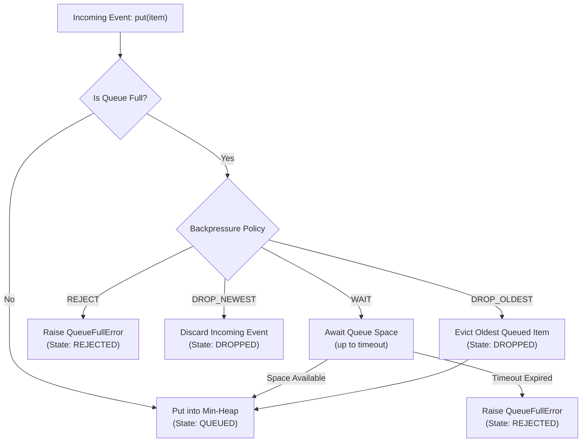

# OVIC EON — Backpressure and Priority Policy

**Document ID:** EON-ARCH-CORE-003  
**Document Title:** Backpressure and Priority Policy Specification  
**Product:** OVIC EON  
**Tagline:** Emotional Intelligence Infrastructure for Robotics  
**Organization:** OVIC Labs  
**Repository:** `https://github.com/Ovic-Labs/EON.git`  
**Milestone:** Phase 1.3 — Core Event Bus  
**Status:** `QUALIFIED AND VERIFIED`  
**Classification:** `INTERNAL ARCHITECTURAL SPECIFICATION`  

---

## 1. Backpressure Management

In edge robotics computing environments, producer components (e.g. high-framerate camera sensor feeds) can easily overwhelm downstream perception or reasoning engines. The OVIC EON Core Event Bus provides explicit, configurable queue-full backpressure policies:



### 1.1 Backpressure Policies

1. **`WAIT` (Default Safe Policy):**
   - The publisher asynchronously awaits queue capacity up to `publish_timeout_seconds`.
   - If capacity becomes available, the event is enqueued (`QUEUED`).
   - If the timeout expires without capacity, a `QueueFullError` is raised and the event is recorded as `REJECTED`.
   - Prevents immediate event loss while enforcing a strict upper bound against indefinite publisher stalling.

2. **`REJECT` (Lossless Strict Policy):**
   - If the subscriber queue is at capacity, the bus immediately raises `QueueFullError`.
   - The event is recorded as `REJECTED` in operational telemetry.
   - Recommended for critical advisory streams or health telemetry that must never silently fail or drop.

3. **`DROP_NEWEST` (Lossy Perception Policy):**
   - If the queue is at capacity, the incoming event is dropped without raising an exception.
   - Returns a `DeliveryOutcome` with `state=DeliveryState.DROPPED`.
   - Increments the `dropped_events` telemetry counter.
   - Recommended for high-rate sensor feeds (e.g. video frames) where stale data is immediately superseded by newer data.

4. **`DROP_OLDEST` (Sliding Window Policy):**
   - If the queue is at capacity, the oldest queued item is dequeued and discarded.
   - The incoming event is enqueued into the vacated slot.
   - Increments the `dropped_events` telemetry counter.
   - Recommended for temporal buffers where only the latest observations are relevant to downstream inference.

---

## 2. Event Priority Scheduling

### 2.1 Priority Enumeration

```python
class EventPriority(IntEnum):
    LOW = 10
    NORMAL = 20
    HIGH = 30
    CRITICAL = 40
```

- **`LOW (10)`:** Background diagnostics, periodic housekeeping, cached summary synchronization.
- **`NORMAL (20)`:** Standard perception streams, contextual interaction updates, dialogue inputs (default).
- **`HIGH (30)`:** Real-time affective state transitions, participant engagement shifts.
- **`CRITICAL (40)`:** Urgent safety advisories, degraded component health alarms, operational heartbeat failures.

### 2.2 Deterministic Ordering Guarantee
The queue stores items wrapped as `PrioritizedItem`:
- Heap sort key: `(-priority.value, sequence, timestamp)`
- **Precedence:** Items with higher priority values sort with a smaller negative key (e.g. $-40 < -20$), ensuring they are popped first from Python's min-heap.
- **FIFO Stability:** If two events have identical priority, the monotonically increasing `sequence` counter breaks the tie, guaranteeing strict FIFO arrival order.

### 2.3 Non-Authority Notice
Priority scheduling governs execution precedence within the Python asyncio event loop. **CRITICAL priority does NOT confer safety authority, hardware emergency-stop overrides, or physical motion authorization.**
