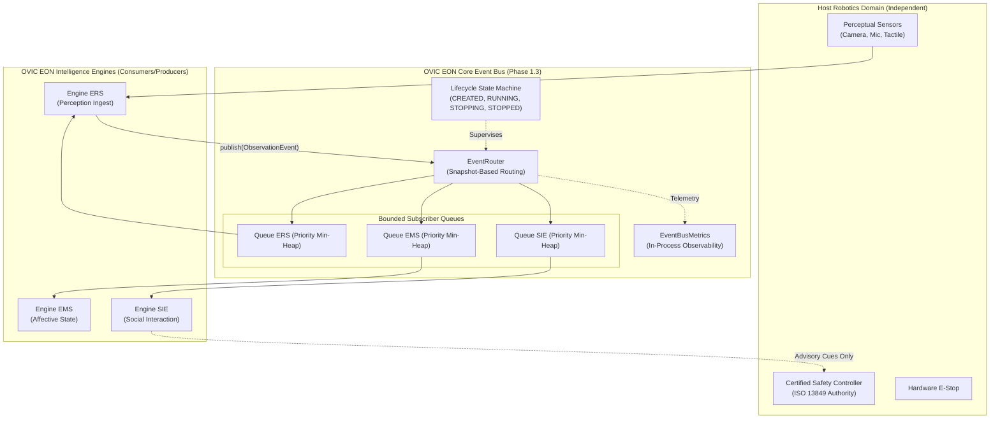
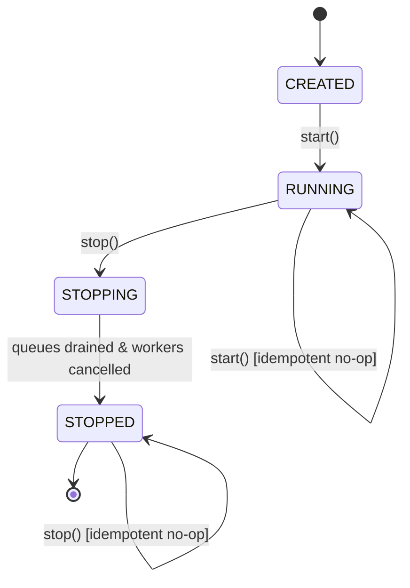

# OVIC EON — Core Event Bus Architecture

**Document ID:** EON-ARCH-CORE-001  
**Document Title:** Core Event Bus Architecture Specification  
**Product:** OVIC EON  
**Tagline:** Emotional Intelligence Infrastructure for Robotics  
**Organization:** OVIC Labs  
**Repository:** `https://github.com/Ovic-Labs/EON.git`  
**Milestone:** Phase 1.3 — Core Event Bus  
**Status:** `QUALIFIED AND VERIFIED`  
**Classification:** `INTERNAL ARCHITECTURAL SPECIFICATION`  

---

## 1. Executive Summary

The OVIC EON Core Event Bus is a CPU-first, in-memory, asynchronous communication substrate engineered specifically for robotic emotional intelligence runtimes.

Operating under strict architectural discipline, the Core Event Bus decouples perception engines, affective state engines, memory models, and external transport adapters without external message broker dependencies (such as Redis, Kafka, RabbitMQ, or MQTT). It provides deterministic event routing, bounded memory utilization, per-subscriber failure isolation, priority scheduling, and observable in-process telemetry.

---

## 2. Architectural Role and System Context

The Event Bus resides within the `eon.core` runtime package and serves as the central circulatory system for all Phase 1.2 `EventEnvelope` data contracts:

---

## 3. Strict Safety and Privacy Boundaries

### 3.1 Non-Authoritative Safety Guarantee
The Event Bus is a software communication transport. It is **NOT** a certified robot safety controller under ISO 13849 or ISO 10218, possesses **ZERO** physical actuator authority, and cannot command robot movement, manipulator velocities, or emergency-stop overrides. All safety-related payloads (`SafetyAdvisoryPayload`) strictly preserve `is_authoritative_stop=False`.

### 3.2 Privacy and Biometric Protection
The Event Bus strictly prohibits logging, serializing, or retaining raw biometric embeddings, unredacted face frames, or audio PCM waveforms. Error logs and metrics are bounded to prevent sensitive payload leaks during subscriber failures.

---

## 4. Key Subsystem Modules

| Module | Responsibility | Key Interfaces |
|---|---|---|
| `eon.core.event_bus` | Public facade, lifecycle supervision, worker tasks, graceful shutdown | `EventBus`, `EventBusConfig`, `EventBusLifecycleState` |
| `eon.core.event_router` | Snapshot-based subscriber registration and routing | `EventRouter`, `get_subscribers()`, `get_all_subscribers()` |
| `eon.core.queue_manager` | Bounded priority queue per subscriber with FIFO sequence stability | `SubscriberQueue`, `put()`, `get()`, `drain()` |
| `eon.core.priority` | Min-heap prioritized item wrapper and scheduling priority enum | `EventPriority` (LOW, NORMAL, HIGH, CRITICAL), `PrioritizedItem` |
| `eon.core.backpressure` | Queue saturation handling | `BackpressurePolicy` (WAIT, REJECT, DROP_NEWEST, DROP_OLDEST) |
| `eon.core.delivery` | Delivery outcome tracking and sanitized diagnostic records | `DeliveryState`, `DeliveryOutcome` |
| `eon.core.subscription` | Subscriber registration model, handler execution, worker tasks | `Subscription`, `SubscriptionId`, `EventHandler` |
| `eon.core.metrics` | Lightweight rolling latency and throughput telemetry | `EventBusMetrics`, `EventBusMetricsSnapshot` |
| `eon.core.exceptions` | Typed exception hierarchy for failure modes | `EventBusError`, `QueueFullError`, `EventBusNotRunningError` |

---

## 5. Lifecycle State Machine

The Event Bus implements an explicit, unidirectional lifecycle state machine:

- **`CREATED`:** Initialized with configuration. Subscriptions can be registered. Publishing is rejected (`EventBusNotRunningError`).
- **`RUNNING`:** Background worker tasks are running. Events are routed, enqueued, and dispatched asynchronously.
- **`STOPPING`:** Shutting down. New events are rejected. Queues are drained up to `shutdown_timeout_seconds`. Remaining workers are cancelled cleanly.
- **`STOPPED`:** Terminal clean state. No background tasks or lingering coroutines remain.

---

## 6. Ordering and Concurrency Guarantees

1. **FIFO Ordering within Equal Priority:** Bounded subscriber queues order events by `(-priority.value, sequence, timestamp)`. Events of identical priority are guaranteed to be dispatched in strict FIFO sequence.
2. **Prioritization Precedence:** Higher priority events (`CRITICAL`, `HIGH`) preempt lower priority events (`NORMAL`, `LOW`) within subscriber queues.
3. **No Mutated Envelopes:** Original `EventEnvelope` instances are never mutated during routing or dispatch.
4. **Failure Isolation:** Each subscriber operates an isolated queue and worker loop. A crash or timeout in one subscriber handler cannot crash the bus or delay other subscribers.

---

## 7. Synchronous Handler Thread Isolation

The Event Bus supports both asynchronous coroutines and synchronous callables as event handlers:

1. **Bounded Thread Pool Execution:** Synchronous handlers are executed within a dedicated, bounded `ThreadPoolExecutor` (configured via `sync_executor_workers`, default: 4 threads). This ensures that blocking I/O or CPU operations in synchronous subscribers never block the primary `asyncio` event loop thread.
2. **Cancellation Boundaries and Limitations:** Standard Python threads cannot be preempted or forcibly terminated from outside once executing. If an asyncio worker awaiting a synchronous handler is cancelled (e.g. on timeout or bus shutdown), the asyncio task unblocks immediately, but the underlying thread continues running until the handler function returns. Developers of synchronous handlers should implement cooperative flags or bounded timeouts.

---

## 8. Strict Configuration Validation

All configuration parameters for `EventBusConfig`, `SubscriberQueue`, and `EventBus.subscribe()` are strictly validated:
- `default_queue_capacity`, `publish_timeout_seconds`, `handler_timeout_seconds`, `shutdown_timeout_seconds`, `max_workers_per_subscription`, `sync_executor_workers`, and `starvation_threshold` must be strictly positive (`gt=0`).
- Falsy or non-positive values (such as `0` or negative numbers) are explicitly rejected with `ValueError` or Pydantic `ValidationError` rather than falling back silently to defaults.

---

## 9. Shutdown and Backpressure Unblocking

1. **Queue Closure Semantics:** When `stop()` is invoked, the event bus transitions to `STOPPING` and immediately marks all subscriber queues as closed (`close()`).
2. **Immediate Publisher Unblocking:** Closing subscriber queues immediately awakens all publishers awaiting queue space under the `WAIT` backpressure policy, raising `QueueClosedError` to prevent publishers from hanging during shutdown.
3. **Queue Draining:** Active handlers and in-flight queue items are given up to `shutdown_timeout_seconds` to drain cleanly before worker tasks are cancelled.
4. **Evacuation:** Any items remaining in queues after worker cancellation are drained and marked with `DeliveryState.CANCELLED`.

---

## 10. Complete Unsubscription Lifecycle

When `unsubscribe(subscription_id)` is invoked:
1. The subscriber is removed from the `EventRouter` snapshot registry.
2. The subscriber queue is closed, waking any waiting putters or getters.
3. Dedicated worker tasks are cancelled and awaited using `asyncio.gather(*workers, return_exceptions=True)`.
4. Any remaining items in the subscriber queue are drained, counted in `cancelled_deliveries`, and resolved with `DeliveryState.CANCELLED`.
5. Repeated unsubscription calls for an already removed subscription safely return `False`.
