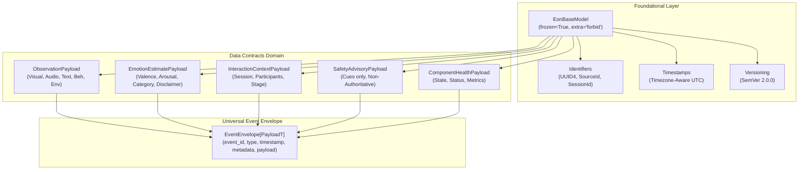

# OVIC EON — Data Schema Architecture Specification

**Document ID:** EON-ARCH-SCHEMA-001  
**Product:** OVIC EON  
**Tagline:** Emotional Intelligence Infrastructure for Robotics  
**Organization:** OVIC Labs  
**Target Milestone:** Phase 1.2 — Data Schemas and Event Envelopes  
**Status:** `QUALIFIED AND VERIFIED`  
**Date:** 2026-11-23  

---

## 1. Executive Overview

The OVIC EON data schema architecture establishes the foundational data contracts, serialization boundaries, and structural typing guarantees for inter-engine communication and external interfaces.

In modular robotics architectures, unvalidated or loosely typed dictionaries produce silent schema drift, catastrophic runtime errors in event loops, and untraceable telemetry bugs. OVIC EON addresses this by enforcing **strict, immutable, typed contracts** using Pydantic v2.



---

## 2. Core Architectural Principles

### 2.1 Immutability by Default (`frozen = True`)
Events, observations, and context snapshots are temporal records of state. Allowing mutation of an event in-flight corrupts causal history and introduces race conditions across asynchronous listeners. All EON models inherit from `EonBaseModel`, configuring `frozen = True` to prevent attribute reassignment post-validation.

### 2.2 Strict Rejection of Unknown Fields (`extra = "forbid"`)
Models reject unknown inputs with an explicit validation error. This eliminates silent schema drift, prevents accidental leakage of uninspected payload fields, and ensures that upstream producers cannot bypass schema governance.

### 2.3 Strict Timezone-Aware UTC Timestamping
Naive datetime objects (`tzinfo is None`) are strictly prohibited and rejected upon ingestion. All timestamps are automatically normalized to Coordinated Universal Time (UTC) to guarantee monotonic temporal ordering across distributed robotics hardware.

### 2.4 Cryptographic Event Identity & Causality Tracking
Every event carries a unique UUID4 `event_id`. Complex workflows track distributed causality using:
- `correlation_id`: Shared across all events within an end-to-end multi-engine workflow or user engagement turn.
- `causation_id`: Explicitly links an event to the direct parent event that provoked its publication.
- `session_id`: Correlates events within an active interaction session.

### 2.5 Separation of Perceptual Ingest from Behavioral Inference
Raw sensor streams are normalized into structured `ObservationPayload` contracts. These observations are decoupled from affective inferences (`EmotionEstimatePayload`) and conversational state (`InteractionContextPayload`).

---

## 3. Package Structure

The schema architecture is implemented in the `src-layout` Python package:

```text
src/eon/schemas/
├── __init__.py           # Unified public exports and __all__ catalog
├── base.py               # EonBaseModel root class with Pydantic v2 ConfigDict
├── common.py             # Enums, scalar bounds, and Provenance models
├── context.py            # Interaction context and participant session models
├── emotions.py           # Affective dimensional estimates and ethical disclaimers
├── events.py             # Universal EventEnvelope[PayloadT] and metadata
├── health.py             # Component lifecycle status and diagnostic heartbeats
├── identifiers.py        # Strongly typed UUIDs, SourceId, and generator helpers
├── observations.py       # Modality-specific perceptual observation payloads
├── safety.py             # Safety advisory cues and validation status models
├── serialization.py      # Safe JSON/dict round-trip and event polymorphism
├── timestamps.py         # Timezone-aware UTC timestamp normalization
└── versioning.py         # Semantic Versioning validation and compatibility
```

---

## 4. Subsystem Contracts

| Schema Module | Core Model | Responsibilities & Invariants |
|---|---|---|
| `base.py` | `EonBaseModel` | Strict validation, immutable attributes, extra='forbid', whitespace trimming. |
| `identifiers.py` | `EventId`, `SourceId` | Canonical 36-char lowercase UUID4 strings, hierarchical dot-separated producer IDs. |
| `timestamps.py` | `UtcTimestamp` | Strict timezone validation, UTC conversion, ISO 8601 formatting with trailing 'Z'. |
| `versioning.py` | `SchemaVersion` | SemVer 2.0.0 parsing, major version breaking change detection, supported versions guard. |
| `observations.py` | `ObservationPayload` | Perceptual data across 5 modalities (Visual, Audio, Text, Behaviour, Environment); staleness tracking. |
| `emotions.py` | `EmotionEstimatePayload` | Dimensional valence/arousal in [-1.0, 1.0], confidence, uncertainty, mandatory ethical disclaimer. |
| `context.py` | `InteractionContextPayload` | Session context, pseudonymized participant profiles, interaction stage, expiration tracking. |
| `safety.py` | `SafetyAdvisoryPayload` | Non-authoritative social advisories; strict prohibition of hardware stop authority (`is_authoritative_stop=False`). |
| `health.py` | `ComponentHealthPayload` | Health states (`HEALTHY`, `DEGRADED`, etc.), lifecycle status, diagnostic codes, and KPI metrics. |
| `events.py` | `EventEnvelope[T]` | Universal outer envelope wrapping any typed payload with tracing metadata and schema version. |
| `serialization.py` | `serialize_to_json` | Deterministic JSON conversion, safe polymorphic event deserialization, 10MB payload size guard. |

---

## 5. Security and Privacy Invariants

1. **Zero Raw Biometric Storage:**  
   Raw binary image buffers, facial feature embeddings, and raw audio PCM waveforms must never be stored in event metadata, logs, or persistent context snapshots. Only derived categorical and geometrical descriptors are permitted.
2. **Pseudonymization:**  
   Participant identifiers within `ParticipantContext` must be session-ephemeral or pseudonymized hashes. Direct personal identifiable information (PII) is forbidden.
3. **No Pickle or Unsafe Deserialization:**  
   Serialization is strictly restricted to valid, standards-compliant JSON. Arbitrary executable object loading is forbidden.
4. **Denial-of-Service Defense:**  
   Payloads exceeding 10 MB are rejected at the parsing boundary prior to model validation.
