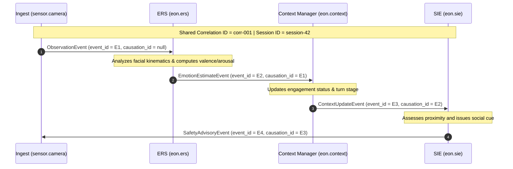

# OVIC EON — Event Envelope Specification

**Document ID:** EON-SPEC-ENV-001  
**Product:** OVIC EON  
**Tagline:** Emotional Intelligence Infrastructure for Robotics  
**Organization:** OVIC Labs  
**Target Milestone:** Phase 1.2 — Data Schemas and Event Envelopes  
**Status:** `QUALIFIED AND VERIFIED`  
**Date:** 2026-11-23  

---

## 1. Overview

The OVIC EON Event Envelope provides a standardized outer container for all asynchronous messages, perceptual observations, cognitive inferences, safety cues, and diagnostic heartbeats exchanged across the EON Event Bus and external middleware bridges.

---

## 2. Event Envelope Structure

The envelope is formalized by `eon.schemas.events.EventEnvelope[PayloadT]`:

```json
{
  "event_id": "a1b2c3d4-e5f6-4a7b-8c9d-0e1f2a3b4c5d",
  "event_type": "eon.observation",
  "schema_version": "1.0.0",
  "source": "sensor.camera.rgb",
  "timestamp": "2026-11-23T12:00:00.000000Z",
  "metadata": {
    "correlation_id": "99887766-5544-3322-1100-aabbccddeeff",
    "causation_id": "11223344-5566-7788-99aa-bbccddeeff00",
    "session_id": "session_ward_101",
    "trace_id": "trace-span-001",
    "classification": "internal"
  },
  "payload": {
    "...": "Modality-specific or domain-specific typed payload"
  }
}
```

### Field Definitions

| Field Name | Type | Requirement | Description |
|---|---|---|---|
| `event_id` | `UUID4 String` | **Required** | Globally unique identifier generated automatically for each event instance. |
| `event_type` | `EventType (Enum)` | **Required** | Canonical event category identifier (e.g. `eon.observation`, `eon.emotion_estimate`). |
| `schema_version` | `SemVer String` | **Required** | Version of the contract (defaults to `1.0.0`). Rejects unsupported versions. |
| `source` | `SourceId (String)` | **Required** | Dot-separated producer identifier (e.g. `eon.ers`, `sensor.mic.array`). |
| `timestamp` | `UtcTimestamp` | **Required** | Timezone-aware UTC timestamp recording the creation time of the envelope. |
| `metadata` | `EventMetadata` | **Required** | Contextual tracing, causality tracking, and privacy classification metadata. |
| `payload` | `PayloadT (Generic)` | **Required** | Strongly typed payload conforming to its specific schema model. |

---

## 3. Distributed Causality and Tracing



1. **Correlation Tracking (`correlation_id`):**  
   Retained across all downstream events spawned by a single originating human action or conversational turn.
2. **Causation Tracking (`causation_id`):**  
   Points directly to the immediate predecessor event, establishing a verifiable directed acyclic graph (DAG) of system decisions.
3. **Session Tracking (`session_id`):**  
   Binds all events to an ongoing user interaction or operational deployment session.

---

## 4. Concrete Event Implementations

| Event Class | Payload Type | Typical Producer | Primary Consumer |
|---|---|---|---|
| `ObservationEvent` | `ObservationPayload` | Sensor Ingest, Hardware Adapters | ERS, HBU |
| `EmotionEstimateEvent` | `EmotionEstimatePayload` | ERS | ERE, PSE, SIE, EMS |
| `ContextUpdateEvent` | `InteractionContextPayload` | EON Core Context Manager | SIE, ERG |
| `SafetyAdvisoryEvent` | `SafetyAdvisoryPayload` | Safety Interlock, SIE, EON Core | ROS 2 Bridge, Host Robot PLC |
| `ComponentHealthEvent` | `ComponentHealthPayload` | All Engines and Transports | Lifecycle Supervisor |

---

## 5. Polymorphic Deserialization

The `deserialize_event(json_str: str) -> EventEnvelope[Any]` function provides safe polymorphic deserialization:
1. Validates that the input is a valid JSON string and under the 10 MB payload limit.
2. Inspects `event_type` without arbitrary dynamic imports.
3. Routes the payload dictionary to the appropriate strongly typed event model.
4. Raises explicit, human-readable errors if the event type or schema version is unrecognized.
