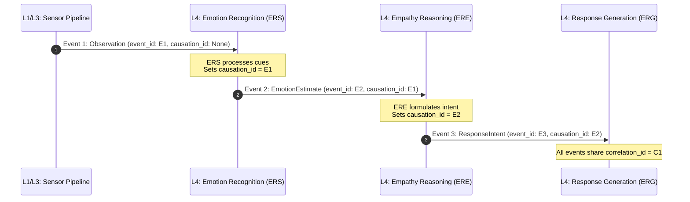

# OVIC EON — Event Envelope Specification

**Document ID:** `EON-SPEC-ENV-001`  
**Product:** OVIC EON  
**Tagline:** Emotional Intelligence Infrastructure for Robotics  
**Organization:** OVIC Labs  
**Phase:** Phase 1.2 (Qualified Base) & Phase 2.5 (Extended Specification)  
**Status:** `QUALIFIED AND VERIFIED`  
**Version:** 2.0.0  
**Date:** 2026-11-23  

---

## 1. Overview

The OVIC EON Event Envelope provides a standardized, versioned outer container for all asynchronous messages, perceptual observations, cognitive inferences, safety cues, and diagnostic heartbeats exchanged across the EON Event Bus and external middleware bridges.

---

## 2. Event Envelope Structure and Schema

The envelope is formalized by `eon.schemas.events.EventEnvelope[PayloadT]`:

```json
{
  "event_id": "a1b2c3d4-e5f6-4a7b-8c9d-0e1f2a3b4c5d",
  "event_type": "eon.observation",
  "schema_version": "1.0.0",
  "source": "sensor.camera.rgb",
  "destination": "eon.engine.ers",
  "timestamp": "2026-11-23T12:00:00.000000Z",
  "expires_at": "2026-11-23T12:00:00.500000Z",
  "priority": "NORMAL",
  "metadata": {
    "correlation_id": "99887766-5544-3322-1100-aabbccddeeff",
    "causation_id": "11223344-5566-7788-99aa-bbccddeeff00",
    "session_id": "session_ward_101",
    "trace_id": "trace-span-001",
    "classification": "internal"
  },
  "payload": {
    "...": "Modality-specific or domain-specific typed payload"
  }
}
```

### Field Definitions and Mandatory Rules

| Field Name | Type | Requirement | Semantics & Validation Rules |
|---|---|---|---|
| `event_id` | `UUID4 String` | **Mandatory** | Globally unique identifier generated automatically for each event instance. |
| `event_type` | `EventType (Enum)` | **Mandatory** | Canonical event category identifier (e.g. `eon.observation`, `eon.emotion_estimate`). |
| `schema_version` | `SemVer String` | **Mandatory** | Version of the contract (defaults to `1.0.0`). Rejects unsupported versions. |
| `source` | `SourceId (String)` | **Mandatory** | Dot-separated producer identifier (e.g. `eon.ers`, `sensor.mic.array`). |
| `destination` | `String` | Optional | Optional routing target or specific engine recipient. |
| `timestamp` | `UtcTimestamp` | **Mandatory** | Timezone-aware UTC timestamp recording the creation time of the envelope. |
| `expires_at` | `UtcTimestamp` | Optional | Explicit freshness deadline; envelopes older than this are dropped as stale. |
| `priority` | `EventPriority` | **Mandatory** | Scheduling priority: `CRITICAL`, `HIGH`, `NORMAL`, `LOW`. |
| `metadata` | `EventMetadata` | **Mandatory** | Contextual tracing, causality tracking, and privacy classification metadata. |
| `payload` | `PayloadT (Generic)`| **Mandatory** | Strongly typed payload conforming to its specific Pydantic v2 schema model. |

### Prohibited Fields
- Raw byte buffers (`bytes` or `bytearray`) must **never** be placed directly into JSON envelope fields without typed base64 or tensor schema wrapping.
- Unredacted personal identifiable information (PII) is strictly prohibited in `metadata`.

---

## 3. Distributed Causality and Tracing


