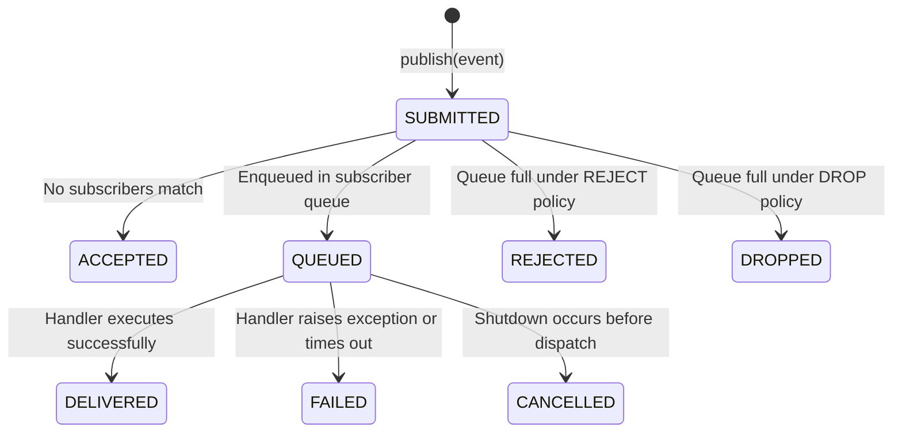

# OVIC EON — Event Routing and Delivery Specification

**Document ID:** EON-ARCH-CORE-002  
**Document Title:** Event Routing and Delivery Specification  
**Product:** OVIC EON  
**Tagline:** Emotional Intelligence Infrastructure for Robotics  
**Organization:** OVIC Labs  
**Repository:** `https://github.com/Ovic-Labs/EON.git`  
**Milestone:** Phase 1.3 — Core Event Bus  
**Status:** `QUALIFIED AND VERIFIED`  
**Classification:** `INTERNAL ARCHITECTURAL SPECIFICATION`  

---

## 1. Event Routing Model

The OVIC EON Event Bus uses snapshot-based routing to ensure deterministic delivery across independent subscribers without concurrency deadlocks or race conditions.

### 1.1 Exact Event-Type Matching
Subscribers register interest in a specific `EventType` (e.g. `eon.observation`, `eon.emotion_estimate`, `eon.safety_advisory`). When an event is published, the bus queries the `EventRouter` for subscribers exactly matching the event's `event_type` property.

### 1.2 Wildcard Subscriptions
Subscribers may register using the wildcard identifier `*`. A wildcard subscriber receives every event flowing through the event bus regardless of event type. Wildcard subscribers are commonly used for telemetry loggers, system health supervisors, and audit tap recorders.

### 1.3 Snapshot Isolation
When `publish()` or `publish_and_wait()` is called:
1. `EventRouter.get_subscribers(event.event_type)` generates a shallow-copy snapshot (`list[Subscription]`) of currently active subscribers.
2. If a subscriber handler unregisters itself or adds a new subscriber during active dispatch, the current dispatch iteration remains unaffected.
3. If no matching subscribers exist, the event is marked `ACCEPTED`, telemetry counters are updated, and the publisher returns without blocking.

### 1.4 Concurrency and Thread Safety
`EventRouter` synchronizes all internal subscription maps, index mutations, and snapshot queries (`register`, `unregister`, `get_subscribers`, `get_all_subscribers`, `clear`, `get_subscription`, `subscription_count`, `event_types_registered`) using a reentrant lock (`threading.RLock()`). This guarantees genuine thread safety across multithreaded producers and concurrent asyncio tasks, eliminating race conditions during dynamic subscription changes.

---

## 2. Delivery States and Outcome Tracking

Every event dispatched to a subscriber transitions through explicit delivery states:



### 2.1 State Definitions
- **`ACCEPTED`:** Event was accepted by the event bus routing layer. Recorded when zero subscribers match or when immediate ingestion completes.
- **`QUEUED`:** Event was successfully placed into an individual subscriber's bounded priority queue.
- **`DELIVERED`:** Event was dequeued by the subscriber's worker task and the handler completed execution without error.
- **`FAILED`:** Subscriber handler raised an unhandled exception or exceeded its configured timeout.
- **`REJECTED`:** Event was rejected because the subscriber queue was saturated under the `REJECT` backpressure policy.
- **`DROPPED`:** Event was dropped without error under `DROP_NEWEST` or `DROP_OLDEST` backpressure policies.
- **`CANCELLED`:** Event was cancelled during graceful shutdown while still awaiting dispatch in the queue.

---

## 3. Delivery Outcome Contract

Every delivery attempt generates an immutable `DeliveryOutcome` record:

```python
@dataclass(frozen=True)
class DeliveryOutcome:
    event_id: str
    subscription_id: str | None
    state: DeliveryState
    timestamp: datetime.datetime
    duration_ms: float = 0.0
    error_message: str | None = None
    diagnostic_id: str | None = None
```

### Privacy Guarantee and Error Sanitization
- The `DeliveryOutcome` never stores event payloads, raw perception data, or personal biometrics.
- The `error_message` field never copies raw `str(exc)` from exceptions. Exceptions are strictly categorized into safe descriptions (e.g. `HandlerException[ValueError]`, `HandlerTimeout`, `QueueFull`) accompanied by unique diagnostic identifiers (`ERR-XXXXXXXX`).
- Synthetic secret tokens or private keys present in exception messages are guaranteed zero leakage into telemetry or delivery outcomes.

---

## 4. Terminal Outcome Resolution in publish_and_wait

The `publish_and_wait()` method guarantees deterministic completion:
1. **Dedicated Per-Delivery Futures:** Each matching subscriber delivery creates a dedicated `asyncio.Future[DeliveryOutcome]`.
2. **Every Terminal Outcome Resolved:** Futures are resolved on all terminal states:
   - `DELIVERED`: Handler finished successfully.
   - `FAILED`: Handler threw an exception or timed out.
   - `CANCELLED`: Unsubscription or bus shutdown cancelled delivery.
   - `DROPPED`: Queue dropped or evicted event under lossy backpressure.
   - `REJECTED`: Queue rejected event under full capacity.
3. **No Indefinite Hanging:** If `publish_and_wait()` times out, remaining unresolved futures are marked `FAILED` with `HandlerTimeout` and cleaned up safely. Key collisions from repeated event IDs are eliminated.
