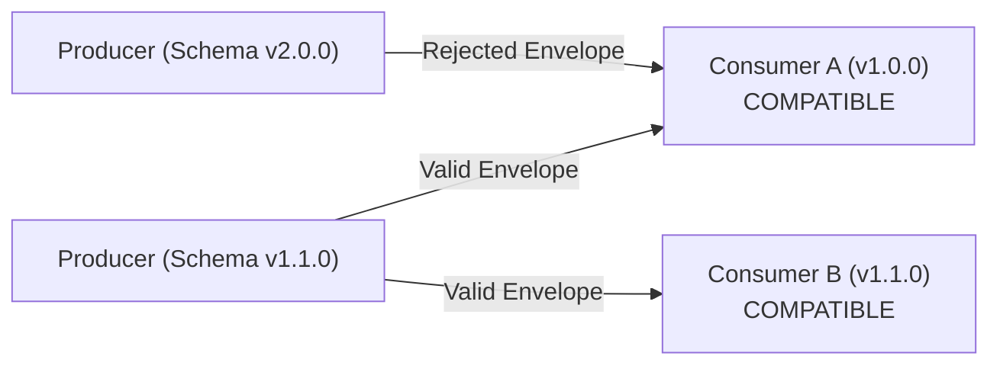

# OVIC EON — Schema Versioning & Compatibility Policy

**Document ID:** EON-POL-VER-001  
**Product:** OVIC EON  
**Tagline:** Emotional Intelligence Infrastructure for Robotics  
**Organization:** OVIC Labs  
**Target Milestone:** Phase 1.2 — Data Schemas and Event Envelopes  
**Status:** `QUALIFIED AND VERIFIED`  
**Date:** 2026-11-23  

---

## 1. Purpose and Scope

This policy governs the evolution, versioning, and deprecation of data schemas, event envelopes, and public contracts within OVIC EON.

In distributed robotics systems, multiple engines and external client SDKs may execute at different release versions. Adhering to strict Semantic Versioning rules prevents payload incompatibility from causing crashes or silent behavioral degradation on physical hardware.

---

## 2. Versioning Specification (SemVer 2.0.0)

All public EON schemas declare their version following Semantic Versioning (`MAJOR.MINOR.PATCH`):

$$\text{Version} = \text{MAJOR}.\text{MINOR}.\text{PATCH}$$

- **MAJOR ($X.0.0$):** Incompatible API and contract changes.
- **MINOR ($x.Y.0$):** Backward-compatible feature additions and optional field extensions.
- **PATCH ($x.y.Z$):** Backward-compatible bug fixes and documentation clarifications.

The current baseline schema version for all Phase 1 contracts is **`1.0.0`**.

---

## 3. Classification of Schema Changes

### 3.1 Breaking Changes (Requires MAJOR Bump)
Any modification that prevents an existing consumer from validating or interpreting a payload:
1. Removing an existing field.
2. Renaming a field.
3. Changing the datatype of a field (e.g. `int` $\rightarrow$ `str`).
4. Narrowing numerical boundaries (e.g. changing allowable valence from $[-1.0, 1.0]$ to $[-0.5, 0.5]$).
5. Making an optional field mandatory.
6. Removing or altering enum member values.
7. Modifying the serialization representation (e.g. timestamp format).

### 3.2 Backward-Compatible Extensions (Requires MINOR Bump)
Modifications that allow existing consumers to continue processing payloads without error:
1. Adding a new optional field with a sensible `default` or `default_factory`.
2. Broadening allowable bounds where safe.
3. Adding new enum values (provided consumer models implement fallback handling).
4. Adding new non-breaking validation helper methods.

### 3.3 Patch Changes (Requires PATCH Bump)
1. Clarifying documentation or field descriptions.
2. Internal validator optimization that does not alter data shape or contract semantics.

---

## 4. Consumer Compatibility Invariants

- **Major Version Strictness:** Consumers must reject payloads declaring a `major` version different from their supported major version.
- **Forward Compatibility:** Consumers on minor version $Y_1$ can parse payloads from producers on minor version $Y_2$ ($Y_2 \ge Y_1$), ignoring added optional fields if configured, but EON default `extra="forbid"` mandates that producers and consumers agree on the active minor version baseline.
- **Unsupported Version Handling:** The deserializer raises `ValueError("Unsupported schema version: ...")` when encountering unrecognized versions.

---

## 5. Deprecation Policy

1. **Advance Notice:** Schema fields designated for retirement must be marked deprecated in documentation and docstrings for at least **two minor release cycles** prior to removal.
2. **Migration Path:** Every breaking release ($X+1.0.0$) must publish an explicit field migration guide detailing equivalent replacements.
3. **No Silent Reinterpretation:** Deprecated fields must never be repurposed to convey different semantic meanings.
