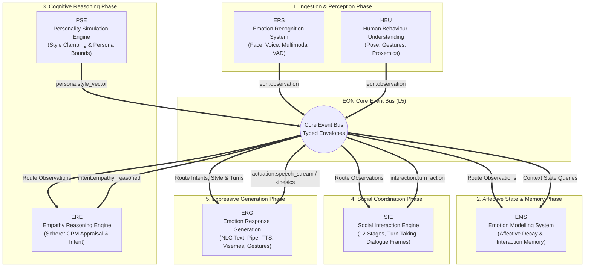

# OVIC EON — Seven Intelligence Engines: Architectural Overview

**Document ID:** `EON-ARCH-ENG-001`  
**Phase:** Phase 2 — System Architecture and Engineering Design  
**Sub-phase:** 2.2 — Seven-Engine Boundary Design  
**Status:** Approved Engineering Architecture Specification  
**Version:** 1.0.0  
**Classification:** Technical Architecture Specification  
**Document Owner:** Principal Software Architect  
**Related Documents:**
- `docs/architecture/ENGINE_BOUNDARY_SPECIFICATIONS.md` (`EON-SPEC-ENG-001`)
- `docs/architecture/ENGINE_DEPENDENCY_MATRIX.md` (`EON-ARCH-DEP-002`)
- `docs/architecture/ENGINE_INPUT_OUTPUT_CONTRACTS.md` (`EON-SPEC-ENG-IO-001`)
- `docs/architecture/SYSTEM_LAYERED_ARCHITECTURE.md` (`EON-ARCH-LAYERS-001`)
- `docs/architecture/CORE_EVENT_BUS_ARCHITECTURE.md` (`EON-ARCH-CORE-001`)

---

## 1. Executive Summary

This specification establishes the architectural foundation for the **Seven Intelligence Engines** of **OVIC EON** (Emotional Intelligence Infrastructure for Robotics).

OVIC EON decouples emotional perception, memory dynamics, empathetic reasoning, personality simulation, interaction coordination, expressive response generation, and human behavior interpretation into seven discrete, autonomous, and replaceable engines:
1. **ERS — Emotion Recognition System**
2. **EMS — Emotion Modelling System**
3. **ERE — Empathy Reasoning Engine**
4. **PSE — Personality and Social Engine**
5. **SIE — Social Interaction Engine**
6. **ERG — Emotion Response Generation Engine**
7. **HBU — Human Behaviour Understanding Engine**

These engines operate within **Layer 4 (Intelligence Engine Layer)** of the EON architecture. To guarantee maximum modularity, fault tolerance, and independent testability, engines never communicate via direct in-process function calls. All coordination, state hand-offs, and synchronization occur via strongly typed event envelopes (`EventEnvelope[T]`) brokered by the asynchronous, in-memory **EON Core Event Bus (Layer 5)**.

---

## 2. Seven-Engine Roster and Core Mission

```text
+==========================================================================================+
| Engine | Formal Name                      | Primary Functional Mission                   |
+==========================================================================================+
| ERS    | Emotion Recognition System       | Observable cue processing & continuous VAD   |
| EMS    | Emotion Modelling System         | Affective state dynamics & memory governance |
| ERE    | Empathy Reasoning Engine         | Cognitive appraisal (CPM) & supportive intent|
| PSE    | Personality and Social Engine    | Parameterized persona & anti-drift clamps    |
| SIE    | Social Interaction Engine        | 12-stage interaction HFSM & turn-taking (TRP)|
| ERG    | Emotion Response Generation      | Surface NLG dialogue & neural TTS speech     |
| HBU    | Human Behaviour Understanding    | 3D posture, gestures & spatial proxemics     |
+==========================================================================================+
```

---

## 3. Architectural Principles of the Seven Engines

### 3.1 Strict Component Independence
Every engine is implemented as a standalone Python module under `src/eon/engines/<engine_id>`. An engine must be instantiable in complete isolation within unit test fixtures with no dependencies on running sibling engines.

### 3.2 Decoupled Asynchronous Messaging
No engine maintains a direct pointer or object reference to any other engine. Communication is strictly mediated by the L5 Core Event Bus. An engine subscribes to event topics and publishes result envelopes. If an engine is disabled or crashes, other engines continue operating without unhandled exceptions.

### 3.3 Strict Separation Between Observations and Inferred States
- **Perception (L3 / ERS / HBU):** Produces purely descriptive, observable data (e.g., Action Unit 12 intensity = 0.82; $F_0$ pitch delta = +15 Hz; pointing gesture coordinate = $[1.2, 0.4, 0.9]$).
- **Cognition & Modelling (EMS / ERE):** Synthesizes observable cues into internal affective states and empathetic hypotheses.
- **Rule:** Perception engines must never assert ground-truth human emotional states (e.g., `"The human is definitely happy"`). They assert calibrated observations with explicit uncertainty.

### 3.4 Non-Authoritative Physical Actuation
Engines formulate communicative intents, expressive speech, screen visemes, and advisory gesture trajectories. **No engine has physical motion authority.** Every outgoing actuation event carries `is_authoritative_stop=False`. The host robot's independent, certified safety controller (ISO 13849-1 / ISO 10218-1) retains sole authority to execute, clamp, or discard motion.

### 3.5 Bounded Local Execution (CPU-First)
All seven engines are designed for real-time edge CPU execution. Heavy machine learning models (quantized ONNX models, `llama.cpp` SLMs, Piper TTS) are encapsulated in L7 Model Adapters with strict CPU thread limits and fallback to deterministic templates.

---

## 4. Engine Coordination and Event Flow Model

Inter-engine communication follows a Directed Acyclic Graph (DAG) across five logical coordination phases:



### 4.1 Event Causality Sequence
1. **Sensory Ingestion (ERS & HBU):**
   - ERS ingests visual Action Units and acoustic prosody; publishes `eon.observation` with `ObservationPayload(modality=MULTIMODAL)`.
   - HBU ingests 3D skeletal landmarks; publishes `eon.observation` with `ObservationPayload(modality=BEHAVIOURAL)`.
2. **Affective State & Context Updating (EMS & SIE):**
   - EMS consumes observations, applies temporal decay to current valence/arousal, and updates the affective state vector.
   - SIE evaluates person tracking distance and gaze to update the 12-stage interaction state machine (`ATTENTION_ENGAGED` -> `CONVERSING`).
3. **Cognitive Appraisal & Personality Shaping (ERE & PSE):**
   - ERE subscribes to affective states and active dialogue frames, evaluating Scherer CPM cognitive appraisal checks (Goal Relevance, Goal Congruence, Coping Potential).
   - ERE publishes `intent.empathy_reasoned` (`ResponseIntentPayload`).
   - PSE evaluates active conversational context and clamps behavioral style parameters (formality, verbosity, speaking pace) into a `PersonaStylePayload`.
4. **Turn-Taking Coordination (SIE):**
   - SIE monitors multimodal transition relevance places (TRP), speech silence, and user gestures.
   - SIE publishes `interaction.turn_action: "take_floor"`.
5. **Surface Response Generation (ERG):**
   - ERG consumes `ResponseIntentPayload`, `PersonaStylePayload`, and turn signals.
   - Selects generation route: deterministic safety template ($<5\text{ms}$) or local quantized SLM ($<350\text{ms}$).
   - Piper TTS vocoder streams 16kHz PCM audio; ERG publishes advisory visemes and gesture coordinates.

---

## 5. Engine Lifecycle and Supervision

All engines implement the uniform `EonEngineInterface` managed by the L5 Core Runtime:

```text
[ UNINITIALIZED ]
       │  initialize(config, event_bus, context)
       ▼
  [ CREATED ]
       │  start()
       ▼
  [ RUNNING ] ◄────────────┐
   │       │               │
   │       │ pause()       │ resume()
   │       ▼               │
   │   [ PAUSED ] ─────────┘
   │
   │ stop(timeout)
   ▼
[ STOPPED ]
```

### Health Supervision and Fault States
- **`HealthState.HEALTHY`:** All worker tasks active, processing latency within budget, error rate 0%.
- **`HealthState.DEGRADED`:** Minor model timeout, non-critical sensor missing, fallback heuristic active.
- **`HealthState.FAILED`:** Unhandled internal crash, memory quota exceeded, inability to consume queues.
- **Supervision Rule:** When an engine enters `FAILED`, L5 Core notifies the host system via `SafetyAdvisoryEvent` and attempts graceful restart up to 3 times before isolating the engine.

---

## 6. Security, Privacy, and Actuation Governance

1. **Zero Biometric Identity Profiling:** No engine maintains or generates biometric face embeddings or acoustic speaker identification models. All tracking IDs are ephemeral, session-scoped integers.
2. **Ephemeral Memory Enforcement:** If explicit long-term storage consent is absent, all interaction state in EMS expires immediately upon session close.
3. **Non-Authoritative Actuation:** ERG and HBU outputs are purely advisory. Hardware motion controllers retain absolute safety jurisdiction.
