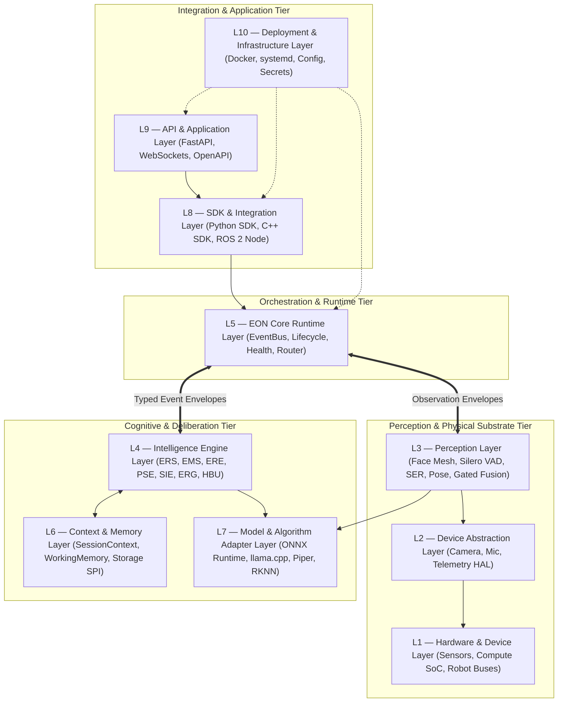

# OVIC EON — System Layered Architecture Specification

**Document ID:** `EON-ARCH-LAYERS-001`  
**Phase:** Phase 2 — System Architecture and Engineering Design  
**Sub-phase:** 2.1 — System Layered Architecture  
**Status:** Approved Engineering Architecture Specification  
**Version:** 1.0.0  
**Classification:** Technical Architecture Specification  
**Document Owner:** Principal Software Architect  
**Related Documents:**
- `docs/architecture/INTER_LAYER_INTERFACES.md` (`EON-ARCH-INT-001`)
- `docs/architecture/ARCHITECTURE_CONSTRAINTS.md` (`EON-ARCH-CONST-001`)
- `docs/architecture/SEVEN_ENGINE_ARCHITECTURE.md` (`EON-ARCH-ENG-001`)
- `docs/architecture/CORE_EVENT_BUS_ARCHITECTURE.md` (`EON-ARCH-CORE-001`)
- `docs/architecture/DATA_SCHEMA_ARCHITECTURE.md` (`EON-ARCH-SCHEMA-001`)

---

## 1. Executive Summary

This specification establishes the authoritative, layered architectural model for **OVIC EON** (Emotional Intelligence Infrastructure for Robotics). Building upon the verified requirements baseline of Phase 0 and the technical research conclusions of Phase 1 (Sub-phases 1.1–1.18), this architecture establishes strict component ownership, failure containment boundaries, inter-layer dependency constraints, and end-to-end data pipelines.

OVIC EON is architected as an edge-first, CPU-optimized, asynchronous emotional intelligence infrastructure for robotics. It provides software capabilities that ingest sensory cues, maintain context-aware interaction states, synthesize empathetic reasoning, coordinate conversational turn-taking, and propose expressive behaviors without ever assuming direct physical motion authority over the robot host.

---

## 2. Evaluation and Justification of Proposed Layers

The initial architectural concept proposed ten discrete functional layers (`L1` through `L10`). An engineering evaluation was conducted to determine whether each layer should remain independent, whether any should be merged, and how strict separation protects system integrity.

```text
+-------------------------------------------------------------------------------+
|                        PROPOSED TEN-LAYER STACK                              |
+-------------------------------------------------------------------------------+
|  L10: Deployment and Infrastructure Layer                                     |
|  L9:  API and Application Layer                                               |
|  L8:  SDK and Integration Layer                                               |
|  L7:  Model and Algorithm Adapter Layer                                       |
|  L6:  Context and Memory Layer                                                |
|  L5:  EON Core Runtime Layer                                                  |
|  L4:  Intelligence Engine Layer (Seven Engines)                                |
|  L3:  Perception Layer                                                        |
|  L2:  Device Abstraction Layer (HAL)                                          |
|  L1:  Hardware and Device Layer                                               |
+-------------------------------------------------------------------------------+
```

### 2.1 Layer Independence vs. Consolidation Evaluation

1. **L1 (Hardware & Devices) vs. L2 (Device Abstraction):**
   - *Option Evaluated:* Merge L1 and L2 into a single "Hardware Access Layer".
   - *Architectural Risk:* Merging would couple low-level Linux V4L2, ALSA, and serial drivers directly with EON data transformation logic, breaking unit testing in virtualized CI environments where physical sensors are absent.
   - *Decision:* **Maintain Strict Separation.** L1 encapsulates physical silicon, sensors, and host buses. L2 provides clean, mockable Hardware Abstraction Layer (HAL) interfaces.

2. **L2 (Device Abstraction) vs. L3 (Perception Layer):**
   - *Option Evaluated:* Merge L2 into L3 (Perception acquires devices directly).
   - *Architectural Risk:* Perception pipelines (MediaPipe, Silero VAD) would become tightly coupled to specific camera resolutions, frame rates, and audio hardware interfaces, preventing replay of offline dataset benchmarks.
   - *Decision:* **Maintain Strict Separation.** L2 exposes normalized byte streams; L3 transforms raw sensor frames into structured, ephemeral observation payloads.

3. **L3 (Perception) vs. L4 (Intelligence Engines):**
   - *Option Evaluated:* Treat Perception as an internal sub-engine within L4.
   - *Architectural Risk:* Perception operates at high frame rates (30–60 fps for vision, 50 fps for audio frames) with heavy numerical SIMD processing. Conflating perception with cognitive deliberation (ERE, SIE) violates the Single Responsibility Principle and degrades event loop predictability.
   - *Decision:* **Maintain Strict Separation.** L3 processes sensory streams and publishes `ObservationEvent` payloads. L4 contains the cognitive, social, and emotional deliberation engines.

4. **L4 (Intelligence Engines) vs. L5 (Core Runtime):**
   - *Option Evaluated:* Embed engine orchestration logic directly into the engines.
   - *Architectural Risk:* Direct engine-to-engine coupling introduces cyclic dependencies, spaghetti call graphs, and cascading runtime failures.
   - *Decision:* **Maintain Strict Separation.** L5 Core Runtime serves as the neutral, decoupled broker providing event routing, engine lifecycle coordination, backpressure management, and health supervision. Engines never invoke one another directly.

5. **L4 (Intelligence Engines) vs. L6 (Context and Memory):**
   - *Option Evaluated:* Merge L6 into EMS (Episodic Memory System) entirely.
   - *Architectural Risk:* While EMS is one of the seven engines in L4, the platform requires generic session context, ephemeral turn buffers, and cross-engine working memory that must exist even if long-term persistent episodic memory is disabled or stripped in privacy-restricted deployments.
   - *Decision:* **Maintain Strict Separation.** L6 defines the Context and Memory abstraction interfaces (session context, working memory SPI, long-term storage providers). EMS is the cognitive custodian of affective memories that operates via L6 interfaces.

6. **L7 (Model and Algorithm Adapters) Placement:**
   - *Option Evaluated:* Embed model execution directly inside L3 Perception and L4 Engines.
   - *Architectural Risk:* Hardcoding ONNX Runtime, `llama.cpp`, or Piper vocoder invocations inside cognitive engines prevents model replacement, prohibits switching between CPU and NPU/GPU backends, and complicates licensing compliance auditing.
   - *Decision:* **Maintain L7 as an Independent Adapter Substrate.** L7 encapsulates local inference runtimes, hardware backend discovery (OpenVINO, RKNN, CUDA), and model lifecycle management.

7. **L8 (SDK & Integration) vs. L9 (API & Application):**
   - *Option Evaluated:* Merge SDK and REST/WebSocket APIs into a single integration tier.
   - *Architectural Risk:* Robot applications (ROS 2 nodes, C++ native controllers) require zero-overhead, in-process bindings or IPC without HTTP/WebSocket networking overhead. Conversely, remote monitoring tools require web-standard REST/WebSocket interfaces.
   - *Decision:* **Maintain Strict Separation.** L8 provides programmatic in-process and IPC SDKs (Python, C++, ROS 2). L9 provides network-accessible application protocols (FastAPI, WebSockets).

8. **L10 (Deployment & Infrastructure):**
   - *Evaluation:* Encapsulates OS execution models, systemd supervision, container runtimes, configuration files, and secrets.
   - *Decision:* **Retain as Foundation Substrate.**

### 2.2 Final Architectural Conclusion

The **ten-layer architecture is retained as ten distinct logical layers**, organized into four operational tiers:



---

## 3. Comprehensive Layer Specifications

Every layer in OVIC EON is specified below across fifteen mandatory architectural criteria:

```text
1. Purpose                   6. Outputs                  11. Security Boundary
2. Responsibilities          7. Upstream Dependencies    12. Failure Boundary
3. Owned Components          8. Downstream Dependencies  13. Resource Requirements
4. Public Interfaces         9. Allowed Communication    14. Testing Requirements
5. Inputs                   10. Prohibited Communication 15. Deployment Considerations
```

---

### Layer 1: Hardware and Device Layer (L1)

1. **Purpose:** Provide physical sensors, execution processors, and physical communication buses that interface the robot hardware platform with the computing environment.
2. **Responsibilities:**
   - Optical photon capture via image sensors (RGB, RGB-D).
   - Acoustic waveform transduction via microphone elements and arrays.
   - Inertial and odometry telemetry capture via IMUs, wheel encoders, and motor controllers.
   - High-throughput execution silicon (ARM64/x86_64 host CPUs, optional NPUs/GPUs).
   - Physical interconnect transport (USB 3.0, MIPI-CSI2, I2S, CAN, Ethernet).
3. **Owned Components:** Physical hardware assets, USB host controllers, camera modules, microphone arrays, audio DACs/codecs, SoC silicon, hardware clock generators.
4. **Public Interfaces:** Physical pinouts, standard Linux kernel character devices (`/dev/video*`, `/dev/snd/*`), standard bus protocols.
5. **Inputs:** Environmental photons, sound waves, physical motion, power rails, robot hardware bus frames.
6. **Outputs:** Analog and digitized hardware signals, bus interrupts, raw frame and PCM data streams over hardware buses.
7. **Upstream Dependencies:** Robot physical chassis, environmental stimuli, power distribution system.
8. **Downstream Dependencies:** L2 (Device Abstraction Layer) via kernel drivers.
9. **Allowed Communication:** Direct communication with Linux kernel device drivers and physical robot controllers.
10. **Prohibited Communication:** Direct communication with any software layer above L2 (e.g., L3 Perception, L4 Engines, L5 Core). Hardware has no knowledge of emotional intelligence concepts.
11. **Security Boundary:** Physical hardware tamper resistance; bus-level access controls; kernel-enforced device permissions (`udev` rules restricting access to group `dialout` / `video` / `audio`).
12. **Failure Boundary:** Hardware disconnection, sensor brownouts, USB bus resets, sensor lens occlusion, microphone clipping. Failures are reported via hardware interrupts and kernel I/O errors.
13. **Resource Requirements:** Typical edge power budget: 15–35 W. Sensor bandwidth: 60–150 MB/s for video; 1.5 MB/s for multichannel audio.
14. **Testing Requirements:** Hardware Loop-Back Testing, signal integrity verification, thermal environmental chamber testing (-10°C to +50°C), bus voltage drop tests.
15. **Deployment Considerations:** Mounting orientation, vibration dampening against robot motor shudder, acoustic isolation from internal cooling fans.

---

### Layer 2: Device Abstraction Layer (L2 — HAL)

1. **Purpose:** Shield EON software from physical hardware variations, vendor-specific SDKs, and driver quirks by providing uniform, mockable interfaces for all sensor streams.
2. **Responsibilities:**
   - Provide hardware-independent abstractions for cameras, microphones, speakers, and telemetry.
   - Detect connected device capabilities (resolution, pixel formats, sample rates, channel counts).
   - Normalize hardware timestamps to monotonic and UTC reference clocks.
   - Provide device health monitoring, heartbeat detection, and hot-plug event dispatching.
   - Enforce ephemeral buffer management: raw buffers are held in volatile ring buffers with zero disk writes.
3. **Owned Components:**
   - `CameraDeviceInterface` and `V4L2CameraDevice` / `MockCameraDevice`.
   - `AudioInputDeviceInterface` and `AlsaAudioDevice` / `MockAudioDevice`.
   - `AudioOutputDeviceInterface` and `AlsaPlaybackDevice` / `MockPlaybackDevice`.
   - `RobotTelemetryInterface` and `CanOdometryDevice` / `MockOdometryDevice`.
   - `DeviceCapabilityRegistry` and `DeviceHealthMonitor`.
4. **Public Interfaces:**
   - `async read_frame() -> VideoFrameBuffer`
   - `async read_audio_chunk() -> AudioChunkBuffer`
   - `async write_audio_chunk(chunk: AudioPlaybackChunk) -> PlaybackStatus`
   - `async get_odometry() -> OdometryState`
   - `get_device_capabilities() -> DeviceCapabilities`
   - `subscribe_device_events(callback: Callable[[DeviceStatusEvent], None])`
5. **Inputs:** Kernel driver streams (`/dev/videoX`, ALSA PCM handles, CAN/Serial streams).
6. **Outputs:** Typed, in-memory buffer wrappers (`VideoFrameBuffer`, `AudioChunkBuffer`, `OdometryState`).
7. **Upstream Dependencies:** L1 (Hardware & Devices).
8. **Downstream Dependencies:** L3 (Perception Layer).
9. **Allowed Communication:** Calls kernel I/O APIs (ioctl, mmap, libuvc, ALSA API); serves buffer streams to L3.
10. **Prohibited Communication:** No access to L4 (Engines), L5 (Core Event Bus), or L9 (APIs). No emotional or cognitive business logic.
11. **Security Boundary:** Runs within the host process under non-root service credentials (`eon-service`) constrained by Linux capabilities (`CAP_SYS_NICE` for real-time audio threads; no raw disk or network root privileges).
12. **Failure Boundary:** Device disconnections or read timeouts yield `DeviceDisconnectedException` or `DeviceFrameTimeoutException`. Ring buffers drop oldest unread frames rather than blocking or exhausting memory.
13. **Resource Requirements:** RAM: <16 MB for pre-allocated zero-copy volatile circular ring buffers. CPU: <3% of a single Cortex-A76 core for buffer demuxing and format conversion.
14. **Testing Requirements:** 100% mock-driven unit testing without physical sensors; synthetic frame generators; hot-unplug simulation tests; timestamp drift validation.
15. **Deployment Considerations:** Configured via declarative device paths in `eon_config.yaml`; automatic fallback to software loopback mocks when physical devices are absent.

---

### Layer 3: Perception Layer (L3)

1. **Purpose:** Transform raw, ephemeral sensor frames and audio buffers into structured, calibrated, non-authoritative observation payloads.
2. **Responsibilities:**
   - Visual landmark extraction (MediaPipe Face Mesh: 468 3D vertices; Action Units: 12 FACS intensities).
   - Audio processing: adaptive spectral noise filtering (cancelling motor/fan harmonics), voice activity detection (Silero VAD), speech emotion feature extraction.
   - Kinematic pose and activity tracking: MediaPipe 3D Pose (33 skeletal landmarks), ego-motion subtraction using robot odometry, ST-GCN action classification.
   - Multimodal reliability and quality gating: dynamic modality weighting based on SNR, lighting lux, and tracking confidence.
   - Uncertainty calibration: heteroscedastic regression and temperature scaling producing explicit aleatoric and epistemic uncertainty scores.
   - Ephemeral memory enforcement: raw video frames and audio chunks are immediately zero-overwritten after feature extraction.
3. **Owned Components:**
   - `VisionPerceptionPipeline` (Face Detector, Face Mesh Extractor, AU Estimator).
   - `AudioPerceptionPipeline` (Adaptive Wiener Filter, Silero VAD, SER Feature Extractor).
   - `PosePerceptionPipeline` (Skeletal Extractor, Ego-Motion Compensator, ST-GCN Classifier).
   - `MultimodalFusionGate` (Modality Quality Evaluator, Cross-Attention Gate, Conflict Flag Detector).
4. **Public Interfaces:**
   - `async process_visual_observation(frame: VideoFrameBuffer) -> ObservationPayload`
   - `async process_audio_observation(chunk: AudioChunkBuffer) -> ObservationPayload | None`
   - `async process_pose_observation(frame: VideoFrameBuffer, odom: OdometryState) -> ObservationPayload`
   - `async fuse_observations(observations: list[ObservationPayload]) -> ObservationPayload`
5. **Inputs:** `VideoFrameBuffer`, `AudioChunkBuffer`, `OdometryState` from L2.
6. **Outputs:** Validated, strongly typed `ObservationPayload` wrapped in `EventEnvelope[ObservationPayload]` (Phase 1.2 contracts).
7. **Upstream Dependencies:** L2 (Device Abstraction Layer), L7 (Model & Algorithm Adapters).
8. **Downstream Dependencies:** L5 (Core Runtime Event Bus).
9. **Allowed Communication:** Consumes normalized buffers from L2; calls local inference adapters in L7; publishes `ObservationEvent` to L5 Core Event Bus.
10. **Prohibited Communication:** No direct invocation of L4 Intelligence Engines. No direct access to L6 persistent memory. No persistence of raw biometric media to disk or database.
11. **Security Boundary:** Operates strictly on in-memory buffers; strictly zero disk I/O; stripped of biometric identity templates (does not perform face recognition or voiceprint matching).
12. **Failure Boundary:** Model inference crashes or invalid frames are trapped within pipeline try-except blocks, emitting `QualityStatus.UNRELIABLE` or `QualityStatus.MISSING` rather than raising unhandled exceptions into the core runtime.
13. **Resource Requirements:** CPU budget: 20–25 ms total processing latency on 4x Cortex-A76 cores @ 2.4 GHz. RAM: <128 MB heap for pipeline model buffers.
14. **Testing Requirements:** Deterministic test fixtures with static input frames and synthetic audio samples; regression tests verifying output numerical tolerances; benchmark tests verifying sub-30ms latency.
15. **Deployment Considerations:** Inference models are loaded as quantized INT8 ONNX or TFLite models; CPU thread affinity configured to prevent contention with real-time audio threads.

---

### Layer 4: Intelligence Engine Layer (L4)

1. **Purpose:** Host the seven decoupled, autonomous intelligence engines that interpret emotional observations, reason about empathy, maintain personality consistency, manage social interaction states, and plan expressive responses.
2. **Responsibilities:**
   - **ERS (Emotion Recognition System):** Consolidate multimodal cues into continuous Valence-Arousal-Dominance (VAD) trajectories and discrete emotion distributions.
   - **EMS (Emotion Modelling System):** Maintain affective state dynamics, emotional decay over time, and governed interaction history.
   - **ERE (Empathy Reasoning Engine):** Evaluate cognitive appraisal (Scherer CPM), perspective-taking, and formulate supportive communicative strategies.
   - **PSE (Personality and Social Engine):** Maintain configurable persona profiles, apply anti-drift mathematical style clamps, and resolve behavioral traits.
   - **SIE (Social Interaction Engine):** Coordinate the 12-stage interaction state machine, manage multimodal turn-taking (TRP), and resolve conversational repairs.
   - **ERG (Emotion Response Generation Engine):** Synthesize surface natural language dialogue, generate neural TTS speech audio, and schedule visemes and kinesic gestures.
   - **HBU (Human Behaviour Understanding Engine):** Interpret 3D gestures, posture semantics, spatial proxemics, and non-verbal human actions.
3. **Owned Components:** The seven discrete engine runtime instances: `ERS_Engine`, `EMS_Engine`, `ERE_Engine`, `PSE_Engine`, `SIE_Engine`, `ERG_Engine`, `HBU_Engine`.
4. **Public Interfaces:** All engines implement the uniform `EonEngineInterface`:
   - `async initialize(config: EngineConfig) -> None`
   - `async start() -> None`
   - `async stop() -> None`
   - `async handle_event(envelope: EventEnvelope[Any]) -> None`
   - `get_health() -> ComponentHealthPayload`
5. **Inputs:** Subscribed `EventEnvelope[T]` payloads routed by L5 Core Event Bus; context queried via L6 interfaces.
6. **Outputs:** Published `EventEnvelope[T]` payloads dispatched to L5 Core Event Bus (`EmotionEstimatePayload`, `ResponseIntentPayload`, `TurnActionPayload`, `SafetyAdvisoryPayload`).
7. **Upstream Dependencies:** L5 (Core Runtime), L6 (Context & Memory), L7 (Model & Algorithm Adapters).
8. **Downstream Dependencies:** L5 (Core Runtime).
9. **Allowed Communication:** Subscribes to and publishes events via L5 Core Event Bus; queries and updates state via L6 Context & Memory interfaces; invokes local algorithms/models via L7.
10. **Prohibited Communication:** Strictly no direct, in-process engine-to-engine method invocation. No engine may hold a reference to another engine instance. Strictly prohibited from issuing direct actuator commands (`is_authoritative_stop=False` mandatory on all events).
11. **Security Boundary:** Engines operate with isolated internal state. Memory access across user boundaries is enforced via L6 authorization tokens. Input validation enforced on all consumed envelopes via Pydantic v2 schemas.
12. **Failure Boundary:** Individual engine exceptions are caught by the engine's event handler wrapper; unhandled errors transition the engine into `HealthState.DEGRADED` or `HealthState.FAILED` and notify L5 Health Supervisor without crashing peer engines.
13. **Resource Requirements:** Total L4 CPU budget: <40% of 4x Cortex-A76 cores under normal conversational load. RAM: <350 MB combined across all seven engines (excluding local SLM weights in L7).
14. **Testing Requirements:** Isolated unit tests for each engine with mocked Event Bus; property-based testing of state transitions; fuzz testing with malformed or out-of-order event envelopes.
15. **Deployment Considerations:** Engines are instantiated by L5 Engine Registry based on declarative configuration in `eon_config.yaml`; optional engines may be disabled without breaking core routing.

---

### Layer 5: EON Core Runtime Layer (L5)

1. **Purpose:** Provide the central, neutral coordination substrate that governs engine lifecycles, event routing, backpressure management, execution isolation, and system-wide health monitoring.
2. **Responsibilities:**
   - High-performance, asynchronous, CPU-first event routing and delivery (supporting exact and wildcard topic subscriptions).
   - Per-subscriber bounded priority queues with configurable backpressure policies (`WAIT`, `REJECT`, `DROP_OLDEST`).
   - Threadpool isolation for synchronous event handlers (`ThreadPoolExecutor` with worker cap) preventing event loop starvation.
   - Deterministic queue task accounting with underflow/overflow prevention.
   - Engine registration, initialization ordering, state transitions (`CREATED`, `RUNNING`, `STOPPING`, `STOPPED`, `FAILED`), and graceful shutdown.
   - System configuration loading, validation, and hot-reload coordination.
   - Continuous component health aggregation and failure recovery coordination.
3. **Owned Components:**
   - `EventBus` and `EventRouter` (`eon.core.event_bus`, `eon.core.event_router`).
   - `QueueManager` and `PriorityQueue` (`eon.core.queue_manager`, `eon.core.priority`).
   - `EngineLifecycleManager` and `EngineRegistry`.
   - `HealthSupervisor` and `MetricsCollector` (`eon.core.metrics`).
   - `ConfigurationManager`.
4. **Public Interfaces:**
   - `async publish(envelope: EventEnvelope[T], priority: EventPriority) -> DeliveryOutcome`
   - `async subscribe(topic_pattern: str, handler: EventHandler, backpressure: BackpressurePolicy) -> SubscriptionId`
   - `async unsubscribe(subscription_id: SubscriptionId) -> bool`
   - `async start_runtime() -> None`
   - `async stop_runtime(timeout: float) -> None`
   - `get_runtime_metrics() -> EventBusMetricsSnapshot`
   - `get_system_health() -> SystemHealthReport`
5. **Inputs:** Published `EventEnvelope[T]` instances from L3 (Perception), L4 (Engines), and L8 (SDK).
6. **Outputs:** Routed `EventEnvelope[T]` instances delivered to subscriber queues; `DeliveryOutcome` reports; system telemetry events.
7. **Upstream Dependencies:** Python Standard Library (`asyncio`, `concurrent.futures`), Pydantic v2 schemas (`eon.schemas`).
8. **Downstream Dependencies:** L3 (Perception), L4 (Engines), L8 (SDK).
9. **Allowed Communication:** Mediates all inter-layer event delivery across the platform.
10. **Prohibited Communication:** L5 Core contains zero emotional, perceptual, or cognitive domain logic. It does not inspect or mutate domain payload contents beyond envelope metadata validation and routing headers.
11. **Security Boundary:** Enforces envelope schema validation (`validate_schema_version`); rejects malformed or unverified event types; enforces maximum queue depth bounds to prevent denial-of-service memory exhaustion.
12. **Failure Boundary:** Subscriber handler exceptions are isolated; subscriber queue saturation triggers local backpressure without impacting publishers of higher-priority safety events. Core Event Bus itself never raises unhandled exceptions to callers.
13. **Resource Requirements:** RAM: <20 MB heap under 10,000 enqueued events. Latency: <0.1 ms median routing latency per event on edge CPU; throughput: >50,000 events/sec.
14. **Testing Requirements:** Concurrency torture tests, cancellation race condition suites, starvation threshold verification, graceful shutdown drain tests, double-completion audits.
15. **Deployment Considerations:** Central singleton within the EON process; initialized immediately following configuration verification.

---

### Layer 6: Context and Memory Layer (L6)

1. **Purpose:** Provide standardized interfaces and storage providers for active interaction context, short-term working memory, and optional, consent-governed long-term episodic/semantic records.
2. **Responsibilities:**
   - Manage volatile `SessionContext` (active participants, current conversation stage, turn counts, dialogue state).
   - Maintain bounded, short-term `WorkingMemory` in RAM (recent conversational utterances, active attention targets).
   - Provide Service Provider Interfaces (SPI) for persistent storage backends (relational, vector, key-value).
   - Enforce privacy-by-design retention and decay policies (automatic TTL expiration of episodic interaction records).
   - Enforce verifiable user deletion workflows (GDPR Article 17 "Right to Erasure") including cryptographic shredding of user keys.
   - Enforce that long-term persistent memory is strictly optional: if persistent storage is disabled, EON operates fully in ephemeral session mode.
3. **Owned Components:**
   - `SessionContextManager`.
   - `WorkingMemoryBuffer` (RAM-only circular buffer).
   - `LongTermMemoryProviderInterface` (SPI).
   - `SqliteEpisodicStore` (encrypted embedded storage).
   - `CryptoShredder` (per-user cryptographic key manager).
   - `RetentionPolicyEnforcer`.
4. **Public Interfaces:**
   - `get_session_context(session_id: SessionId) -> InteractionContextPayload`
   - `update_session_context(session_id: SessionId, update: ContextUpdatePayload) -> None`
   - `async store_memory(record: MemoryRecord, user_consent: ConsentScope) -> MemoryId`
   - `async query_memories(filter: MemoryQueryFilter) -> list[MemoryRecord]`
   - `async delete_user_data(user_id: str, verification_token: str) -> DeletionReceipt`
5. **Inputs:** Context updates and memory storage requests from L4 (EMS, SIE, ERE).
6. **Outputs:** `InteractionContextPayload`, retrieved `MemoryRecord` collections, `DeletionReceipt`.
7. **Upstream Dependencies:** L4 (EMS, SIE).
8. **Downstream Dependencies:** Local file system or embedded database libraries (SQLite, DuckDB).
9. **Allowed Communication:** Serves context and memory queries to L4; reads/writes to local storage via SPI.
10. **Prohibited Communication:** No direct network communication; no persistence of raw audio waveforms or raw camera video; no unauthorized cross-session data leakage.
11. **Security Boundary:** Field-level encryption using SQLCipher or AES-256-GCM; per-user encryption keys isolated in secure key store; user authorization verified before returning personal preferences.
12. **Failure Boundary:** Storage disk-full or database lock errors degrade gracefully to volatile RAM-only mode, logging an alert while allowing real-time interaction to continue uninterrupted.
13. **Resource Requirements:** RAM: <32 MB for working memory and session caches. Storage: bounded to user-configured quota (default: 500 MB max; automatic FIFO eviction of expired episodic memories).
14. **Testing Requirements:** Verification of cryptographic key destruction; automated verification that deleted records cannot be recovered from storage or journals; TTL expiration tests; concurrency lock tests.
15. **Deployment Considerations:** Can be fully configured with `storage_type: in_memory` for environments prohibiting any persistent disk storage (e.g., healthcare privacy compliance).

---

### Layer 7: Model and Algorithm Adapter Layer (L7)

1. **Purpose:** Encapsulate, abstract, and manage local machine learning model runtimes, deterministic rule engines, and hardware acceleration backends.
2. **Responsibilities:**
   - Load, validate, and execute local ML models (ONNX Runtime, `llama.cpp`, Piper VITS).
   - Provide unified abstraction interfaces for inference, shielding engines from framework-specific APIs.
   - Detect and leverage available hardware execution providers (CPU AVX2/NEON, OpenVINO, RKNN for Rockchip NPU, CUDA for Jetson).
   - Manage model memory budgets, weight caching, lazy loading, and dynamic unloading under memory pressure.
   - Enforce deterministic algorithm fallbacks when ML models fail, time out, or exceed resource quotas.
   - Verify model artifact integrity (SHA-256 checksums, license validation metadata) prior to loading.
3. **Owned Components:**
   - `ModelAdapterRegistry`.
   - `OnnxInferenceAdapter` (for MediaPipe Face Mesh, Silero VAD, SER, ST-GCN).
   - `LlamaCppInferenceAdapter` (for local quantized SLM dialogue generation).
   - `PiperTtsAdapter` (for local neural speech synthesis).
   - `DeterministicRuleAdapter` (for fallback templates and CPM appraisal rules).
   - `HardwareExecutionProviderDetector`.
4. **Public Interfaces:**
   - `async run_inference(model_id: str, inputs: dict[str, Any]) -> dict[str, Any]`
   - `async stream_tokens(model_id: str, prompt: str, grammar: str | None) -> AsyncIterator[str]`
   - `async synthesize_speech(text: str, voice_id: str, speed: float) -> AsyncIterator[AudioChunk]`
   - `get_model_metadata(model_id: str) -> ModelMetadata`
   - `get_available_acceleration_backends() -> list[ExecutionBackend]`
5. **Inputs:** Tensor arrays, normalized feature vectors, prompt strings, and inference parameters from L3 and L4.
6. **Outputs:** Feature tensors, classification distributions, generated token streams, synthesized PCM audio streams.
7. **Upstream Dependencies:** L3 (Perception), L4 (Intelligence Engines).
8. **Downstream Dependencies:** Local runtime libraries (ONNX Runtime C-API / Python bindings, `llama.cpp` shared library, Piper executable / C++ library).
9. **Allowed Communication:** Invoked by L3 and L4; executes CPU vector instructions and communicates with kernel accelerator drivers (e.g., `/dev/rknpu`).
10. **Prohibited Communication:** No direct network egress. Strictly forbidden from making remote HTTP/gRPC calls to external cloud AI APIs (e.g., OpenAI, Anthropic, Google Cloud) in core local operation.
11. **Security Boundary:** Models are loaded strictly from verified, local, read-only file paths; model weights checked against immutable cryptographic hashes before initialization; sandboxed execution prevents arbitrary code execution from malicious weights.
12. **Failure Boundary:** Out-of-memory (OOM) or tensor shape mismatches raise `ModelInferenceError`, triggering immediate fallback to deterministic rule templates without terminating the parent process.
13. **Resource Requirements:** RAM: Budgeted per hardware tier (Tier 1: <1.8 GB total; Tier 2: <3.5 GB total). CPU: Threadpool limited to configured worker threads (e.g., 2–4 threads).
14. **Testing Requirements:** Benchmark tests validating inference latency on reference hardware; checksum verification tests; mock backend tests for virtual CI environments.
15. **Deployment Considerations:** Quantized model weights distributed as separate downloadable assets or container volumes; verified against `models.yaml` registry.

---

### Layer 8: SDK and Integration Layer (L8)

1. **Purpose:** Provide language-specific client libraries, robotic middleware bridges, and typed integration interfaces for external developers and host robot software.
2. **Responsibilities:**
   - Expose ergonomic, idiomatic Python and C++ client APIs for interacting with EON.
   - Provide standard ROS 2 lifecycle node bridges (`eon_node`) mapping EON events to standard ROS 2 topics, services, and actions.
   - Provide IPC bridges (Unix domain sockets, shared memory) for co-located robot processes.
   - Enforce data serialization and deserialization using Phase 1.2 schemas.
   - Enforce safety boundaries: translate robot emergency stop and safety state into EON context; guarantee that all EON outputs forwarded to robot middlewares carry `is_authoritative_stop=False`.
3. **Owned Components:**
   - `EonClient` (Synchronous / Threaded Python SDK).
   - `AsyncEonClient` (AsyncIO Python SDK).
   - `Ros2LifecycleBridgeNode` (ROS 2 Jazzy/Humble integration).
   - `CppBridgeClient` (C++20 SDK bindings).
   - `SharedMemoryTransport` (Zero-copy IPC buffer transport).
4. **Public Interfaces:**
   - `client.connect() / client.disconnect()`
   - `client.send_observation(payload: ObservationPayload) -> None`
   - `client.subscribe_emotions(callback: Callable[[EmotionEstimatePayload], None])`
   - `client.subscribe_responses(callback: Callable[[ResponseProposalPayload], None])`
   - `client.get_system_health() -> SystemHealthReport`
   - ROS 2 Topics: `/eon/observations`, `/eon/emotion_estimates`, `/eon/response_proposals`, `/eon/safety_advisories`.
5. **Inputs:** Observations and control commands from host robot applications or external scripts.
6. **Outputs:** Subscribed emotional estimates, social interaction states, and proposed expressive actions routed to host controllers.
7. **Upstream Dependencies:** External robot applications, ROS 2 computational graph.
8. **Downstream Dependencies:** L5 (Core Runtime), L9 (API Layer for remote SDK).
9. **Allowed Communication:** Direct programmatic binding to L5 Core Runtime (in-process mode) or communication via Unix domain sockets / REST / WebSockets (out-of-process mode).
10. **Prohibited Communication:** Cannot bypass L5 Core event contracts; cannot emit direct motor drive PWM or CAN bus velocity commands.
11. **Security Boundary:** Client authentication tokens; Unix socket filesystem permission enforcement (`chmod 0660`); SROS2 security profiles (DDS authentication and encryption).
12. **Failure Boundary:** SDK client disconnections or crashed external subscriber processes do not impact internal EON runtime execution. Subscriptions are automatically pruned upon socket close.
13. **Resource Requirements:** RAM: <15 MB overhead. CPU: <2% single core for serialization and socket I/O.
14. **Testing Requirements:** End-to-end integration tests between ROS 2 nodes and EON runtime; multi-threaded client stress tests; client reconnection and recovery tests.
15. **Deployment Considerations:** Packaged as `ovic_eon` Python package and `eon_ros2` ament_python/ament_cmake packages.

---

### Layer 9: API and Application Layer (L9)

1. **Purpose:** Provide standardized network interfaces (REST, WebSockets, OpenAPI) for developer tooling, remote teleoperation consoles, configuration management, and external diagnostic tools.
2. **Responsibilities:**
   - Expose FastAPI-based REST endpoints for system administration, configuration querying, and health reporting.
   - Expose low-latency WebSocket channels for streaming real-time observations, emotion trajectories, and system events to remote dashboards.
   - Enforce authentication and role-based access control (RBAC: Admin, Operator, Viewer).
   - Generate interactive OpenAPI (Swagger) documentation.
   - Provide diagnostic endpoints for inspecting event bus queue metrics and subscription states.
3. **Owned Components:**
   - `EonApiServer` (FastAPI / Uvicorn application).
   - `WebSocketStreamManager`.
   - `AuthMiddleware` (API keys, JWT bearer tokens).
   - `DiagnosticsController`.
   - `OpenApiSpecificationGenerator`.
4. **Public Interfaces:**
   - `GET /api/v1/health` -> `SystemHealthReport`
   - `GET /api/v1/metrics` -> `EventBusMetricsSnapshot`
   - `GET /api/v1/engines` -> `list[EngineStatusReport]`
   - `POST /api/v1/config/reload` -> `ConfigReloadReport`
   - `WS /api/v1/events/stream` -> Real-time event envelope streaming WebSocket
5. **Inputs:** HTTP requests and WebSocket frames from developer tools, browsers, or network services.
6. **Outputs:** JSON REST responses, WebSocket JSON event streams, OpenAPI schemas.
7. **Upstream Dependencies:** Web browsers, external developers, fleet management dashboards.
8. **Downstream Dependencies:** L8 (SDK) and L5 (Core Runtime).
9. **Allowed Communication:** Invokes L8 SDK or L5 Core APIs to query state and route developer commands.
10. **Prohibited Communication:** No direct access to L1/L2 hardware devices; cannot execute commands that bypass Core security policies.
11. **Security Boundary:** TLS 1.3 encryption on network interfaces; rate-limiting middleware (preventing brute-force or DoS); input payload validation; disabled by default on production autonomous robots unless explicitly enabled in configuration.
12. **Failure Boundary:** API endpoint exceptions return structured HTTP 4xx/5xx responses; WebSocket dropouts are isolated without affecting internal event bus operations.
13. **Resource Requirements:** RAM: <30 MB for ASGI server and connection pools. CPU: <5% single core under normal administrative polling.
14. **Testing Requirements:** Automated HTTP API test suite using `httpx`; WebSocket connection concurrency tests; authentication bypass security penetration tests.
15. **Deployment Considerations:** Bound to `127.0.0.1` by default for local-only IPC; bound to external network interfaces only when TLS and authentication are configured.

---

### Layer 10: Deployment and Infrastructure Layer (L10)

1. **Purpose:** Provide the underlying operating environment, execution isolation, containerization, supervision, configuration storage, and secret management required to run OVIC EON reliably on edge robots.
2. **Responsibilities:**
   - Process supervision, daemon management, and automatic crash restarts via Linux `systemd`.
   - Containerized execution via OCI-compliant runtimes (Docker, Podman) with hardware device pass-through (`--device /dev/video0`, `--device /dev/snd`).
   - Declarative configuration file management (`/etc/eon/eon_config.yaml`).
   - Secure storage of encryption keys and administrative credentials (Linux Keyutils, encrypted secret vaults).
   - System log aggregation (systemd journald, structured JSON file rotation).
   - System resource isolation (cgroups v2 limits on memory and CPU quotas).
3. **Owned Components:**
   - `eon.service` (systemd unit definition).
   - Container Dockerfiles and docker-compose deployment manifests.
   - Configuration schema validation scripts.
   - Structured log file rotation daemons.
   - Cgroup memory limits configuration.
4. **Public Interfaces:** CLI commands (`eon start`, `eon stop`, `eon status`), `systemctl` commands, container entrypoint scripts.
5. **Inputs:** Host OS environment variables, configuration files, kernel signals (`SIGTERM`, `SIGINT`).
6. **Outputs:** Running host processes, structured log streams, health exit codes.
7. **Upstream Dependencies:** Host Linux Operating System (Ubuntu 22.04 / 24.04 LTS, Debian 12).
8. **Downstream Dependencies:** Manages all layers (L1 through L9).
9. **Allowed Communication:** Manages process lifecycles and provides filesystem/environment resources to all layers.
10. **Prohibited Communication:** None (Infrastructure layer hosts the runtime).
11. **Security Boundary:** Linux user isolation (`eon-service` system user without sudo privileges); read-only root filesystem mounts for containers; locked memory limits to prevent host kernel panics under memory leaks.
12. **Failure Boundary:** If an OOM event occurs, cgroup limits terminate only the designated non-critical worker process, allowing the host robot safety system to maintain control.
13. **Resource Requirements:** Overhead: <10 MB disk footprint; negligible CPU.
14. **Testing Requirements:** Container smoke tests; systemd restart on crash tests; cgroup OOM termination simulation tests; secret permissions audit.
15. **Deployment Considerations:** Deployed via Debian `.deb` packages, Docker images, or Ansible playbooks onto edge robot compute boards.

---

## 4. End-to-End Data and Event Flows

The primary architectural data flow routes through all ten layers in a strictly directed pipeline.

### 4.1 Standard Multimodal Interaction Flow

```text
[L1 Physical Sensors] (Camera, Mic, Telemetry)
         │  (Hardware signals & byte streams)
         ▼
[L2 Device Abstraction] (CameraDevice, AudioDevice, TelemetryDevice)
         │  (Normalized VideoFrameBuffer, AudioChunkBuffer)
         ▼
[L3 Perception Layer] (Face Mesh, Silero VAD, SER, 3D Pose, Multimodal Gate)
         │  (EventEnvelope[ObservationPayload])
         ▼
[L5 Core Event Bus] (event_router.py: Subscription Matching & Priority Dispatch)
         ├──────────────────────────────┬──────────────────────────────┐
         ▼                              ▼                              ▼
    [L4: ERS]                      [L4: HBU]                      [L4: SIE]
(Affective State)              (Spatial Pose)               (Turn Coordination)
         │                              │                              │
         └──────────────────────────────┼──────────────────────────────┘
                                        ▼
                                [L5 Core Event Bus]
                                        │  (EmotionEstimate & Spatial Events)
                                        ▼
                                   [L4: ERE]
                        (Cognitive Empathy Reasoning)
                                        │  (ResponseIntentPayload)
                                        ▼
                                [L5 Core Event Bus]
                                        │  (Routed with Persona Style from PSE)
                                        ▼
                                   [L4: ERG]
                     (Local SLM Dialogue & Piper TTS Audio)
                                        │  (AudioPlaybackChunk & ExpressiveGesture)
                                        ▼
                                [L5 Core Event Bus]
                                        │
                                        ▼
                             [L8 SDK / ROS 2 Bridge]
                                        │
                                        ▼
                       [Robot Loudspeaker & Face Display]
                   (Certified Safety Controller: Motion Advisory)
```

### 4.2 Alternate and Degraded Operational Flows

To guarantee continuous operation in unstructured edge robotics environments, OVIC EON defines explicit alternate data flows:

#### 1. Text-Only Input Flow (Headless / API Interaction)
- **Trigger:** Terminal developer interaction, web chat console, or remote keyboard input.
- **Bypass:** L1, L2, and L3 vision/audio pipelines are inactive.
- **Routing:** L9 API receives text -> wraps into `ObservationPayload(modality=ModalityType.TEXT)` -> publishes to L5 Core Event Bus.
- **Processing:** ERE evaluates text sentiment; SIE manages turn-taking; ERG generates text response via local SLM; TTS synthesis is bypassed; response returned directly via L9 REST/WebSocket response.

#### 2. Audio-Only Input Flow (Voice in Darkness / Occluded Camera)
- **Trigger:** Ambient light level lux < 5.0, or camera hardware disconnected.
- **Behavior:** L3 Vision Pipeline evaluates $Q_{\text{face}} = 0.0$ and flags `QualityStatus.MISSING`.
- **Gating:** Multimodal fusion gate dynamically adjusts weights: visual weight becomes $0.0$; acoustic weight becomes $1.0$.
- **Downstream:** ERS generates continuous VAD from speech prosody alone; SIE uses acoustic turn-taking (VAD silence $>400\text{ms}$); ERG responds via spoken audio; head display remains in neutral audio listening animation.

#### 3. Visual-Only Input Flow (High Acoustic Noise / Muted Audio)
- **Trigger:** Robot operating near heavy machinery, loud cooling fans, or muted microphone.
- **Behavior:** L3 Audio Pipeline detects SNR $< -5\text{dB}$; Silero VAD flags acoustic unreliability ($Q_{\text{audio}} < 0.1$).
- **Gating:** Acoustic weight set to $0.0$; visual weight set to $1.0$.
- **Downstream:** ERS evaluates emotion from facial Action Units; HBU tracks gestures and spatial proximity; SIE relies on gaze direction and head nods for turn transitions; ERG displays visual text responses or symbolic screen visemes.

#### 4. Model Failure / Out-of-Memory Fallback Flow
- **Trigger:** Local SLM (Qwen2.5-1.5B) in L7 crashes due to RAM exhaustion or CUDA/NPU runtime error.
- **Behavior:** L7 Model Adapter catches exception, records failure in `ComponentHealthPayload`, and returns `ModelInferenceError`.
- **Fallback:** L4 ERG catches error within $<5\text{ms}$ deadline and engages `DeterministicTemplateFallback`: selects an approved, pre-scripted conversational response matching the active `ResponseIntent` and persona formality.
- **Result:** Robot speaks an appropriate fallback confirmation without unhandled exception or conversational stalling.

#### 5. Engine Deadline / Timeout Fallback Flow
- **Trigger:** An intelligence engine (e.g., ERE cognitive appraisal) takes $>300\text{ms}$, threatening the conversational response deadline ($<800\text{ms}$).
- **Behavior:** L5 Event Bus enforces `handler_timeout_seconds`. If an engine exceeds its deadline, the bus cancels the handler task via `asyncio.CancelledError`.
- **Mitigation:** Downstream ERG detects absence of reasoned intent before the deadline and defaults to active listening acknowledgment (`"I hear you, please go on"`), preserving conversational flow while isolating the slow engine.

#### 6. Air-Gapped / Completely Offline Operation Flow
- **Trigger:** Robot deployed in remote, military, hospital, or privacy-critical facility with zero internet connectivity.
- **Architecture Guarantee:** Zero network socket calls are made outside `localhost`. All models (SCRFD, MediaPipe, Silero VAD, DistilHuBERT, ST-GCN, Qwen2.5-1.5B, Piper TTS) execute locally on the host CPU/NPU via L7.
- **Verification:** System passes all validation suites and operates indefinitely with network interfaces disabled (`ifconfig eth0 down`).

---

## 5. Architectural Invariants and Non-Negotiable Rules

1. **Acyclic Hierarchy Invariant:** Dependencies flow strictly downward through layers (or horizontally via L5 Core Event Bus). Under no circumstances may a lower layer depend on or import a higher layer.
2. **Event Encapsulation Invariant:** All inter-engine communication is routed through L5 using strongly typed `EventEnvelope[T]` instances. No direct in-memory method calls between engines are permitted.
3. **Non-Authoritative Actuation Invariant:** Every event, intent, and proposal emitted by EON carries `is_authoritative_stop=False`. EON is an advisory emotional intelligence infrastructure; physical robot motion safety is the exclusive responsibility of certified, independent robot hardware controllers.
4. **Zero Raw Biometric Persistence Invariant:** No raw camera frames, video clips, or raw PCM audio recordings may ever be written to disk, flash memory, or database storage. All processing in L2/L3 occurs in volatile RAM ring buffers that are zero-overwritten immediately following feature extraction.
5. **CPU-First Execution Baseline:** All foundational capabilities must execute within real-time latency budgets on a standard 4-core edge CPU without mandatory GPU or NPU acceleration. Hardware accelerators may be utilized opportunistically when detected, but are never required for core operation.
6. **Failure Containment Invariant:** The failure, crash, or timeout of any single perception pipeline, model adapter, or intelligence engine must not crash the L5 Core Event Bus or halt safety advisory monitoring.
