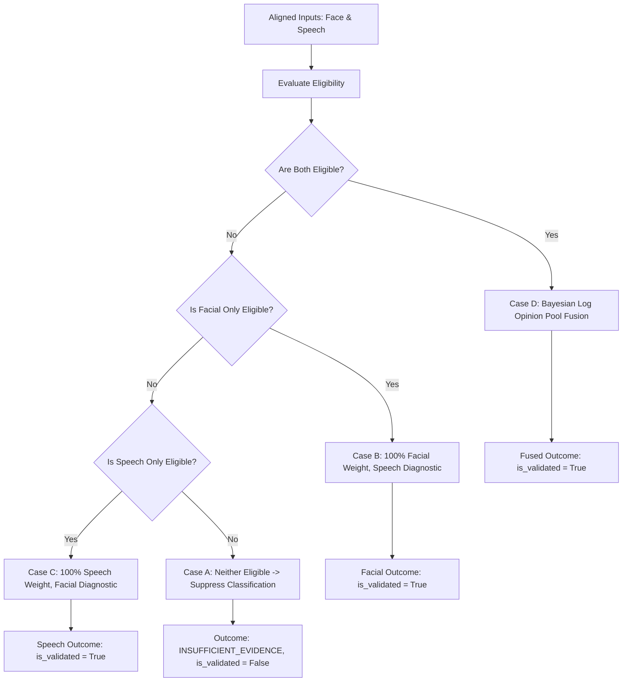

# ERS Multimodal Fusion Validation & Isolation Policy — Phase 3.1.4

**Project:** OVIC EON — Emotional Intelligence Infrastructure for Robotics  
**Organization:** OVIC Labs  
**Component:** ERS (Emotion Recognition System)  
**Standard:** Multimodal Fusion Gating & Epistemic Isolation  
**Date:** 2026-11-24  

---

## 1. Principles of Validation Isolation

In automated emotion recognition, blending predictions from an unvalidated or poorly performing sensory modality with a verified model degrades the reliable signal, introduces unpredictable variance, and creates a false impression of multimodal agreement.

Under Phase 3.1.4, ERS enforces **Multimodal Fusion Validation Isolation**:
1. **Zero Classification Weight for Unvalidated Streams:** An unvalidated, experimental, failed, or stale modality must NEVER contribute weight to classification probabilities, dominant category decisions, or confidence scores.
2. **Diagnostic Separation:** Observations from unvalidated modalities may be surfaced in telemetry logs, diagnostic sidebars, and debugging interfaces, but are strictly routed to `diagnostic_modalities` with $0.0$ classification weight.
3. **Traceability:** Every `FusionResult` cryptographically logs contributing model states, SHA-256 artifact digests, and validation record IDs.

---

## 2. Modality Eligibility Criteria

A sensory observation is classified as `ModalityEligibilityStatus.CLASSIFICATION_ELIGIBLE` if and only if all eight invariant conditions are satisfied:

1. **Artifact Integrity:** The model artifact file exists and matches the exact SHA-256 hash specified in the manifest.
2. **Validation Record Present:** A valid `.validation.json` record exists with matching artifact digest.
3. **Scientific Qualification:** The validation record asserts `is_validated = True` (Macro-F1 $\ge 0.40$, empirical dataset).
4. **Finite Probabilities:** The probability distribution contains finite, non-negative values summing to $1.0 \pm 10^{-4}$ (no NaN or Inf).
5. **Freshness:** Observation timestamp is within the maximum staleness window ($\Delta t \le 2.0\text{s}$).
6. **Sensor Quality:** Upstream input quality is acceptable (`input_quality != UNUSABLE`).
7. **Execution Status:** Pipeline inference succeeded (`status != FAILED` and `model_state != MODEL_INFERENCE_FAILED`).
8. **Active Consent:** Valid, non-revoked consent reference is registered for the current session.

---

## 3. Four-Way Fusion Decision Architecture

### Case A: Neither Modality is Eligible
- **Trigger:** Both modalities are unverified, unvalidated, failed, stale, or absent.
- **Classification Output:**
  - `dominant_estimate`: `"insufficient_evidence"`
  - `fused_probabilities`: `{"insufficient_evidence": 1.0}`
  - `confidence`: $0.0$
  - `uncertainty`: $1.0$
  - `is_validated`: `False`
  - `fusion_status`: `"insufficient_evidence_unvalidated"`
  - `modality_weights`: `{"facial": 0.0, "speech": 0.0}`
  - `classification_eligible_modalities`: `[]`
  - `diagnostic_modalities`: `["facial", "speech"]` (all present streams)

### Case B: Facial Eligible Only
- **Trigger:** Facial model is validated; speech model is unvalidated, failed, stale, or absent.
- **Classification Output:**
  - `fused_probabilities`: Exact copy of facial probability distribution.
  - `dominant_estimate`: Facial dominant category.
  - `confidence`: Calibrated facial confidence.
  - `modality_weights`: `{"facial": 1.0, "speech": 0.0}`
  - `classification_eligible_modalities`: `["facial"]`
  - `diagnostic_modalities`: `["speech"]` (if speech input was provided)
  - `is_validated`: `True`

### Case C: Speech Eligible Only
- **Trigger:** Speech model is validated; facial model is unvalidated, failed, stale, or absent.
- **Classification Output:**
  - `fused_probabilities`: Exact copy of speech probability distribution.
  - `dominant_estimate`: Speech dominant category.
  - `confidence`: Calibrated speech confidence.
  - `modality_weights`: `{"facial": 0.0, "speech": 1.0}`
  - `classification_eligible_modalities`: `["speech"]`
  - `diagnostic_modalities`: `["facial"]` (if facial input was provided)
  - `is_validated`: `True`

### Case D: Both Modalities Eligible
- **Trigger:** Both facial and speech models are fully validated and fresh.
- **Algorithm:** Bayesian logarithmic opinion pool:
  $$\log p_{\text{fused}}(k) = w_f \log p_f(k) + w_s \log p_s(k) - \log Z$$
  Where $w_f$ and $w_s$ are quality-attenuated normalized weights ($w_f + w_s = 1.0$), and $Z$ is the partition normalization function.
- **Conflict Metric:** Computed via symmetric Jensen-Shannon divergence:
  $$D_{\text{JS}}(P_f \parallel P_s) = \frac{1}{2} D_{\text{KL}}(P_f \parallel M) + \frac{1}{2} D_{\text{KL}}(P_s \parallel M), \quad M = \frac{P_f + P_s}{2}$$
  If $D_{\text{JS}} > 0.40$, `conflicting_evidence = True`, and fused confidence is dynamically attenuated by $(1.0 - D_{\text{JS}})$.

---

## 4. Architectural Summary

Through this policy, ERS ensures that emotional cues from unvalidated models never contaminate robotic decision-making or affective state reasoning.
