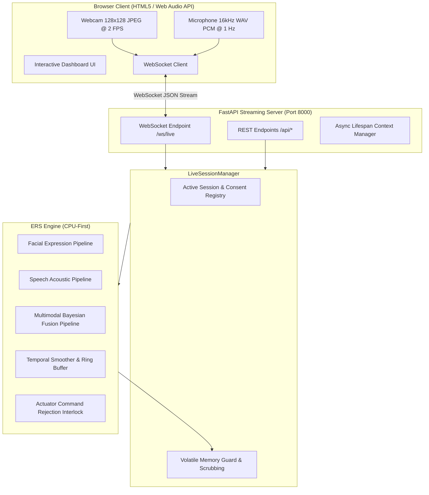

# OVIC EON — ERS Live Input Architecture Specification
## Phase 3.1.2: Streaming Ingestion, Zero-Retention Pipeline & Concurrency

This document details the architectural design, protocol specification, and lifecycle management for live sensory streaming in the **Emotion Recognition System (ERS)**.

---

## 1. System Architecture Overview

The live streaming subsystem bridges browser client sensors (webcam and microphone) to EON's local CPU-first intelligence engine via bidirectional WebSockets.



---

## 2. WebSocket Protocol Specification

The WebSocket endpoint is mounted at:
```
ws://{host}:{port}/ws/live/{session_id}
```

### 2.1 Inbound Messages (Client -> Server)

#### `init`: Session Initialization
```json
{
  "type": "init",
  "session_id": "session-uuid-1234",
  "consent_reference": "user-consent-token-xyz"
}
```

#### `frame`: Visual Webcam Frame
```json
{
  "type": "frame",
  "session_id": "session-uuid-1234",
  "image_base64": "data:image/jpeg;base64,/9j/4AAQSkZJRg...",
  "consent_reference": "user-consent-token-xyz"
}
```

#### `audio`: Acoustic Microphone Chunk
```json
{
  "type": "audio",
  "session_id": "session-uuid-1234",
  "audio_base64": "data:audio/wav;base64,UklGRi...",
  "sample_rate": 16000,
  "consent_reference": "user-consent-token-xyz"
}
```

#### `multimodal`: Concurrent Frame + Audio
```json
{
  "type": "multimodal",
  "session_id": "session-uuid-1234",
  "image_base64": "data:image/jpeg;base64,...",
  "audio_base64": "data:audio/wav;base64,...",
  "sample_rate": 16000,
  "consent_reference": "user-consent-token-xyz"
}
```

#### `revoke`: Instant Consent Revocation
```json
{
  "type": "revoke",
  "session_id": "session-uuid-1234"
}
```

### 2.2 Outbound Messages (Server -> Client)

#### `status`: Session Lifecycle Events
```json
{
  "type": "status",
  "status": "session_initialized",
  "session_id": "session-uuid-1234"
}
```

#### `observation`: Unimodal Sensor Observation
```json
{
  "type": "observation",
  "session_id": "session-uuid-1234",
  "timestamp": 1732448400.123,
  "modality": "facial",
  "data": {
    "dominant_estimate": "happiness",
    "emotion_probabilities": {
      "neutral": 0.12,
      "happiness": 0.78,
      "sadness": 0.02,
      "anger": 0.01,
      "fear": 0.01,
      "surprise": 0.04,
      "disgust": 0.02
    },
    "confidence": 0.78,
    "uncertainty": 0.22,
    "quality_score": 0.94,
    "is_definitive_claim": false,
    "latency_ms": 1.25
  },
  "latency_ms": 1.25
}
```

#### `fusion`: Multimodal Fused Output
```json
{
  "type": "fusion",
  "session_id": "session-uuid-1234",
  "timestamp": 1732448400.150,
  "data": {
    "dominant_estimate": "happiness",
    "confidence": 0.81,
    "uncertainty": 0.19,
    "agreement_score": 0.92,
    "conflict_detected": false,
    "is_definitive_claim": false
  },
  "latency_ms": 2.10
}
```

---

## 3. Concurrency and Thread Safety

To maintain real-time responsiveness on low-power CPUs without blocking the asyncio event loop:
1. **Asyncio Worker Pools**: Heavy compute stages (face detection, acoustic FFT, ONNX runtime session evaluation) run in worker threads via `loop.run_in_executor()`.
2. **Session Concurrency Semaphore**: An asyncio concurrency semaphore protects each session against unbounded queued sensory buffers.
3. **Ring Buffer Session Isolation**: Temporal ring buffers are partitioned strictly by `session_id`, protected by internal threading locks.

---

## 4. Subsystem Boundary and Integration Status

In accordance with Phase 3.1.2 requirements:
- The Live Demonstration Server operates as a **standalone edge perceptual unit**.
- It communicates internal status `core_integration_status: NOT_CONNECTED`.
- It maintains hard safety interlocks forbidding emission of robot motion or actuator control commands.
