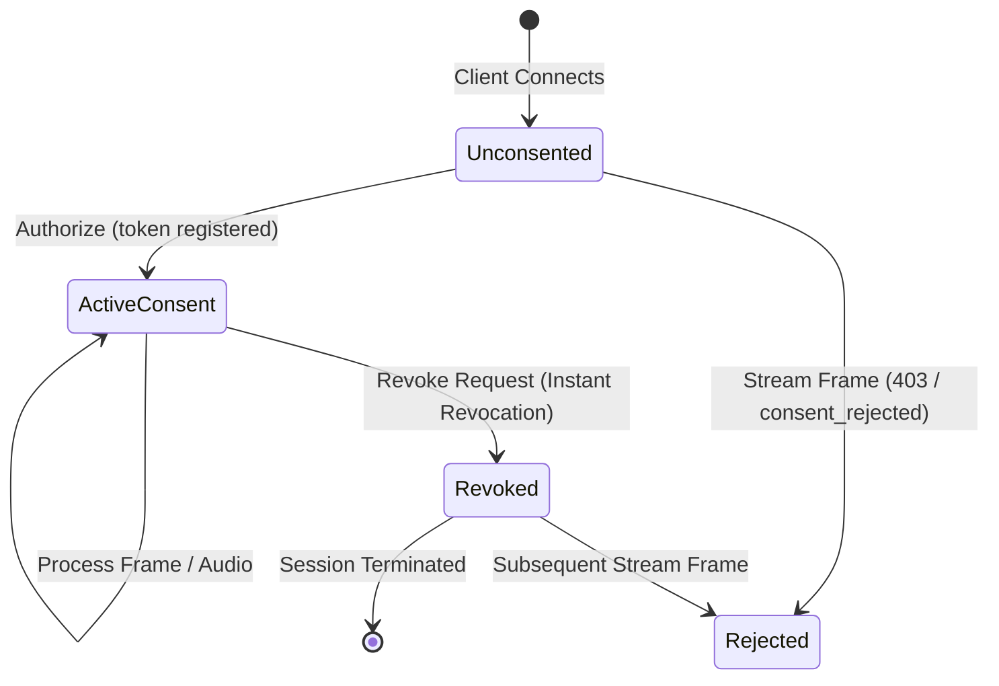

# OVIC EON — ERS Live Privacy, Consent, and Responsible AI Invariants
## Phase 3.1.2: Privacy Verification and Safety Compliance Report

This document specifies the privacy architecture, consent management lifecycle, and safety invariants enforced throughout the **Emotion Recognition System (ERS)** live sensory demonstration.

---

## 1. Non-Negotiable Responsible AI Invariants

| Invariant | Implementation Mechanism | Verification Test |
|---|---|---|
| **Epistemic Modesty** | `is_definitive_claim = False` frozen invariant in contracts. Outputs represent external behavioral features, not verified inner psychiatric states. | `test_epistemic_modesty_invariants` |
| **Zero Raw Media Retention** | Visual frames and audio waveforms are decoded in volatile RAM, processed, and immediately cleared via `inp.scrub_media_payload()`. No media files are ever persisted to disk. | `test_zero_disk_retention_during_streaming` |
| **Explicit Consent Gate** | Processing requires active, unrevoked consent for the specific session. Unregistered or empty tokens are rejected. | `test_consent_management` |
| **Instant Mid-Stream Revocation** | Revoking consent halts stream processing immediately on the very next incoming frame. | `test_instant_revocation_mid_stream` |
| **Strict Session Isolation** | Session contexts and consent tokens are strictly isolated. State or consent cannot leak across concurrent sessions. | `test_concurrent_session_isolation` |
| **Actuator Command Prohibition** | Perceptual outputs strictly forbid generating robot actuator or velocity commands (`cmd_vel`, `motor_command`, `actuator`). | `test_actuator_motion_command_prohibition` |
| **Non-Biometric Processing** | No biometric face recognition, facial embeddings, identity databases, or cross-session user tracking. | Core design inspection |

---

## 2. Consent Lifecycle State Machine

1. **Unconsented State**: Client connects to WebSocket or REST API without a valid consent reference. Any incoming sensory payloads are immediately rejected with status `consent_rejected`.
2. **Authorization**: User registers consent explicitly by submitting a non-empty consent token via `/api/consent/register` or the WebSocket `init` event.
3. **Continuous Verification**: Every visual frame and audio chunk is checked against the internal consent registry before entering the processing pipeline.
4. **Instant Revocation**: When the user clicks **Revoke Consent**, `manager.revoke_session_consent(session_id)` invalidates the session instantaneously. Any frame in flight or subsequent frame is rejected.

---

## 3. Zero Disk Retention Verification

To empirically verify zero disk persistence, the test suite executes `test_zero_disk_retention_during_streaming`:
1. Snapshots the filesystem before streaming.
2. Ingests 20 live camera frames and 20 audio chunks through the streaming manager.
3. Recursively inspects the workspace, temp directories, and package folders for media files (`.jpg`, `.jpeg`, `.png`, `.wav`, `.pcm`, `.raw`).
4. Invariant assertion passes: Zero media files created or retained.

---

## 4. Log Redaction and PII Protection

The `SensitiveDataRedactor` utility sanitizes all log events:
- Session identifiers and consent tokens are masked (e.g., `valid***xyz`).
- Raw binary payloads are excluded from `__repr__` and JSON serializers via `repr=False` in Pydantic models.
