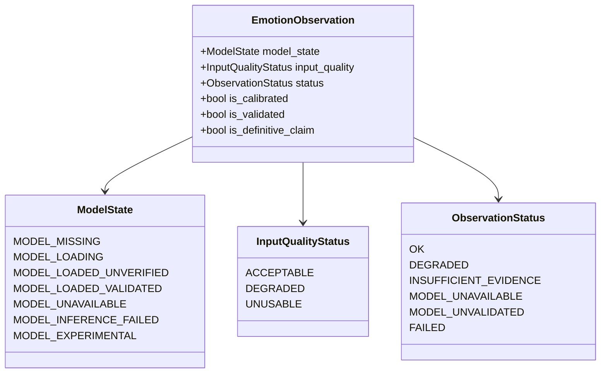

# ERS Model Status Hierarchy & Abstention Policy — Phase 3.1.4

**Project:** OVIC EON — Emotional Intelligence Infrastructure for Robotics  
**Organization:** OVIC Labs  
**Component:** ERS (Emotion Recognition System)  
**Standard:** Status Precedence, Multi-Dimensional State Decoupling & Abstention Policy  
**Date:** 2026-11-24  

---

## 1. Multi-Dimensional Separation

In prior ERS iterations, sensory input quality (e.g. low lighting) and machine learning model validation (e.g. unverified weights) were collapsed into a single status field. This caused critical qualification states to be masked whenever degraded sensor input was observed.

Under Phase 3.1.4, ERS strictly decouples these concerns into three independent orthogonal dimensions:

---

## 2. Deterministic Status Precedence Policy

When computing the final `ObservationStatus` for an observation envelope, the pipeline applies a deterministic, non-negotiable precedence hierarchy:

$$\mathbf{FAILED} \succ \mathbf{MODEL\_UNAVAILABLE} \succ \mathbf{MODEL\_UNVALIDATED} \succ \mathbf{INSUFFICIENT\_EVIDENCE} \succ \mathbf{DEGRADED} \succ \mathbf{OK}$$

### Precedence Evaluation Rules:
1. **FAILED:** Runtime hardware failure, out-of-memory error, or unhandled software exception during execution. Overrides all other states.
2. **MODEL_UNAVAILABLE:** Model file missing from disk or disabled via configuration.
3. **MODEL_UNVALIDATED:** The loaded model has unverified weights, lacks an auditable validation record, or failed accuracy qualification. **This state is NEVER overwritten by `DEGRADED` or `OK` sensory quality.**
4. **INSUFFICIENT_EVIDENCE:** Sensory input is unusable (e.g., severe silence, complete occlusion, no face detected) or the output distribution is uniform/uninformative ($p_k \approx 1/K$).
5. **DEGRADED:** Model is scientifically validated, but sensor input has suboptimal quality (e.g., low illumination, minor blur, or low acoustic SNR).
6. **OK:** Model is validated, and sensor quality meets nominal operating parameters.

---

## 3. Epistemic Abstention Policy

Under Responsible AI invariants, the system must actively abstain from returning discrete emotional categorizations whenever evidence is insufficient or uncalibrated.

### 3.1 Abstention Triggers:
1. **Unvalidated Weights:** When `model_state != MODEL_LOADED_VALIDATED`:
   - `dominant_estimate = "unknown"` or `"insufficient_evidence"`
   - `confidence = 0.0`
   - `uncertainty = 1.0`
   - Classification probabilities are suppressed or isolated to diagnostic telemetry.
2. **Low Confidence / High Uncertainty:**
   - If calibrated confidence $< 0.35$ or epistemic uncertainty $> 0.65$:
   - Output category is forced to `EmotionCategory.INSUFFICIENT_EVIDENCE`.
3. **Severe Sensory Degradation:**
   - If audio SNR $< 3.0\text{ dB}$ or image is severely underexposed/blurry:
   - Status transitions to `INSUFFICIENT_EVIDENCE`, preventing false robotic reactions.
4. **Non-Definitive Invariant:**
   - In adherence to psychological science, `is_definitive_claim` is hardcoded as `False` across all contracts. Facial and vocal expressions are communicative signals, not internal psychic truths.
