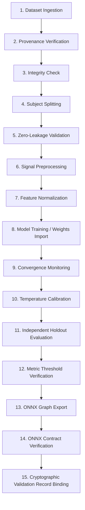

# ERS Model Training and Validation Guide — Phase 3.1.4

**Project:** OVIC EON — Emotional Intelligence Infrastructure for Robotics  
**Organization:** OVIC Labs  
**Component:** ERS (Emotion Recognition System)  
**Standard:** 15-Stage Reproducible Training & Scientific Qualification Pipeline  
**Date:** 2026-11-24  

---

## 1. Introduction

This guide documents the implementation, execution, and verification of the 15-stage scientific training and validation workflow implemented in `eon_ers.training.pipeline.ModelTrainingPipeline`. Every emotion perception model deployed to ERS must pass through this standardized, auditable lifecycle.



---

## 2. The 15 Sequential Stages

### Stage 1: Dataset Ingestion (`1_dataset_ingestion`)
- Ingest raw dataset manifests, metadata, and samples.
- Ensure samples are mapped to verifiable subject IDs (speakers/actors).

### Stage 2: Provenance Verification (`2_provenance_verification`)
- Audit dataset license, source publication, and commercial terms.
- Cross-reference against `ERS_DATASET_PROVENANCE_REGISTER.md`.

### Stage 3: Integrity Check (`3_integrity_check`)
- Verify cryptographic checksums (SHA-256) of input data archives and label manifests.

### Stage 4: Subject-Independent Partitioning (`4_subject_splitting`)
- Partition raw samples by unique subject IDs into Train (70%), Validation (10%), and Test (20%).

### Stage 5: Zero-Leakage Validation (`5_zero_leakage_validation`)
- Programmatically assert disjoint subject sets:
  $$\mathcal{S}_{\text{train}} \cap \mathcal{S}_{\text{val}} = \emptyset, \quad \mathcal{S}_{\text{train}} \cap \mathcal{S}_{\text{test}} = \emptyset, \quad \mathcal{S}_{\text{val}} \cap \mathcal{S}_{\text{test}} = \emptyset$$

### Stage 6: Signal & Media Preprocessing (`6_preprocessing`)
- Standardize visual frames: face cropping, 5-point alignment, 64×64 resizing, float32 normalization $[0, 1]$.
- Standardize acoustic frames: 16 kHz mono resampling, speech activity detection, framing.

### Stage 7: Feature Extraction / Normalization (`7_feature_normalization`)
- Compute 12 acoustic prosody features ($F_0$, RMS energy, spectral centroid, MFCCs) or extract visual tensors.
- Fit z-score scalers on training partition only; transform validation and test partitions using training statistics.

### Stage 8: Model Architecture & Training / Weights Import (`8_model_training_or_weights_import`)
- Train lightweight edge architecture (e.g. ConvNet or MLP) or import licensed pretrained weights.
- Ensure all hyperparameter configurations are serialized.

### Stage 9: Convergence & Validation Monitoring (`9_convergence_monitoring`)
- Track cross-entropy loss and balanced accuracy across epochs.
- Apply early stopping with patience = 5 on validation loss to prevent overfitting.

### Stage 10: Temperature Scaling & Calibration (`10_temperature_calibration`)
- Post-process uncalibrated logits $z$ with temperature parameter $T > 0$:
  $$p_k = \frac{\exp(z_k / T)}{\sum_{j=1}^K \exp(z_j / T)}$$
- Optimize $T$ on the validation set by minimizing Negative Log-Likelihood (NLL).

### Stage 11: Independent Holdout Test Evaluation (`11_test_evaluation`)
- Execute inference on strictly held-out test partition ($\mathcal{S}_{\text{test}}$).
- Log confusion matrices, per-class F1, and raw confidence distributions.

### Stage 12: Metric Threshold Qualification (`12_metric_qualification`)
- Evaluate Macro-F1 $\ge 0.40$, Balanced Accuracy $\ge 0.40$, and ECE $\le 0.15$.
- If thresholds are not met, mark `is_validated = False`.

### Stage 13: ONNX Graph Export & Optimization (`13_onnx_export`)
- Export model to ONNX runtime format.
- Run ONNX graph optimizations (constant folding, dead code elimination).

### Stage 14: ONNX Tensor Contract Verification (`14_contract_verification`)
- Instantiate `onnxruntime.InferenceSession`.
- Validate input/output tensor names, ranks, shapes, and floating-point data types.

### Stage 15: Cryptographic Validation Record Generation (`15_validation_record_generation`)
- Compute exact SHA-256 digest of the exported `.onnx` weights file.
- Generate signed `ModelValidationRecord` containing evaluation metrics, licensing restrictions, and provenance.
- Persist alongside weights as `<model_name>.validation.json`.

---

## 3. Invocation Example

```python
from eon_ers.evaluation.dataset import AFFECTNET_METADATA, EvaluationSample
from eon_ers.models.manifest import ModelManifest
from eon_ers.training.pipeline import ModelTrainingPipeline

# Initialize pipeline
pipeline = ModelTrainingPipeline(
    dataset_metadata=AFFECTNET_METADATA,
    model_manifest=manifest,
    output_dir="packages/ers/models",
)

# Run full 15-stage workflow
success, stage_results, record = pipeline.run_pipeline(
    raw_samples=samples,
    model_weights_path="packages/ers/models/facial_emotion_model.onnx",
)

print(f"Qualification Status: {'VALIDATED' if success else 'UNVALIDATED'}")
```
