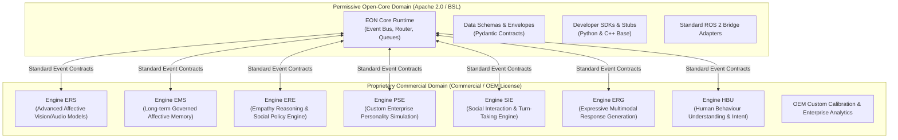
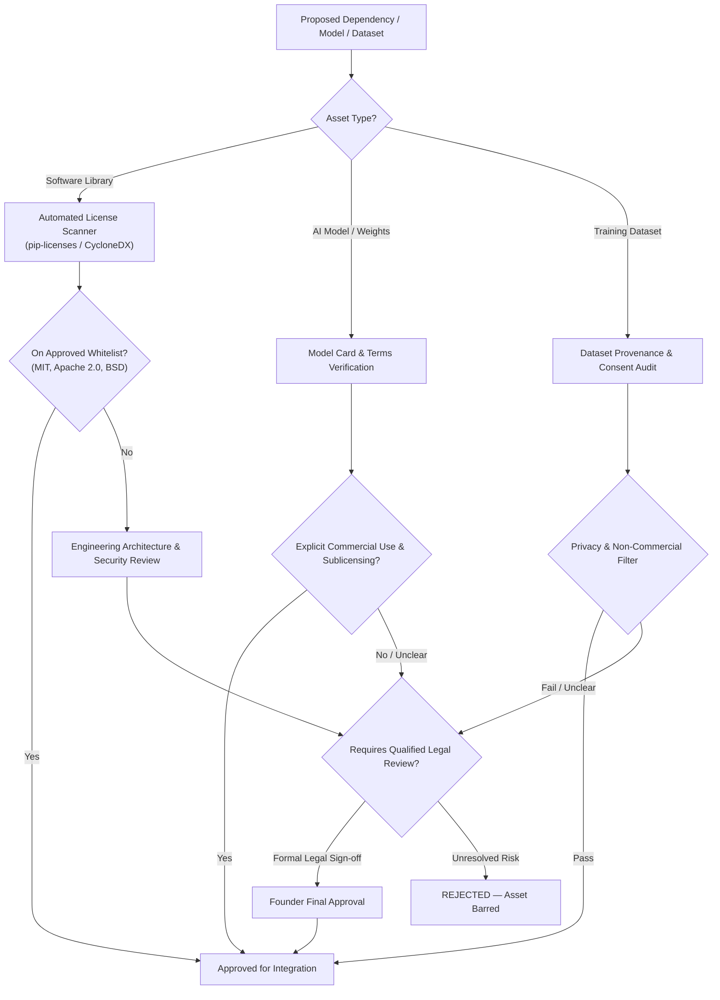

# OVIC EON — Commercial Licensing Strategy

**Product:** OVIC EON  
**Organization:** OVIC Labs  
**Tagline:** Emotional Intelligence Infrastructure for Robotics  
**Document:** Commercial Licensing Strategy  
**Document ID:** EON-LIC-001  
**Version:** 0.1.0  
**Phase:** 0.12 — Commercial Licensing Strategy  
**Status:** Qualified Baseline — Documentation Verified  
**Owner:** Product Founder & Engineering Governance  
**Classification:** Internal — Product and Commercial Strategy  
**Last Updated:** 2026-11-23  

---

> [!IMPORTANT]
> **Legal Disclaimer:** The licensing structures, dependency governance guidelines, intellectual property policies, and commercial models described in this document represent internal engineering and commercial planning assumptions. They do not constitute formal legal counsel or binding legal agreements. Formal commercial licensing, end-user license agreements (EULA), and OEM distribution contracts require qualified legal review and formal founder authorization prior to commercial distribution.

---

## 1. Executive Summary and Licensing Purpose

OVIC EON is engineered as modular emotional and social intelligence infrastructure for robotics. To maximize product adoption across the robotics ecosystem while preserving proprietary intellectual property for advanced commercial capabilities, OVIC EON adopts a structured **Open-Core Commercial Licensing Strategy**.

The purpose of this strategy is to:
1. Provide transparent, frictionless access to foundational runtime interfaces, data contracts, and developer tools for the robotics open-source and research communities.
2. Protect OVIC Labs' proprietary algorithms, affective state modeling techniques, and multi-modal empathy engines.
3. Establish clear, auditable compliance mechanisms for third-party software dependencies, machine learning model weights, and training datasets.
4. Provide robotics OEMs, tier-1 system integrators, and enterprise robotics manufacturers with predictable, commercially viable licensing models.
5. Prevent viral license contamination (e.g. strong copyleft) from compromising customer robotic control stacks or proprietary vehicle firmware.

---

## 2. Platform Architecture Licensing Boundaries (Open-Core Model)

The OVIC EON software platform is divided into two distinct licensing domains:

### 2.1 Open-Core Foundation (Permissive Licensing)
- **Applicable Components:** `eon.core`, `eon.schemas`, basic transport adapters, standard CLI tools, and client SDK headers/stubs.
- **Licensing Model:** Apache License 2.0 (or Business Source License 1.1 converting to Apache 2.0).
- **Objectives:** Allows robotics developers, researchers, and university laboratories to build against standardized EON event envelopes, inspect data schemas, write custom engine stubs, and integrate with standard ROS 2 middleware without licensing friction.
- **Patent Grant:** Includes explicit patent grants under Apache 2.0, providing defensive legal protection against patent claims.

### 2.2 Proprietary Intelligence Engines (Commercial Licensing)
- **Applicable Components:** High-performance model implementations of the seven intelligence engines (`eon.ers`, `eon.ems`, `eon.ere`, `eon.pse`, `eon.sie`, `eon.erg`, `eon.hbu`), pre-trained model weights, and proprietary evaluation harnesses.
- **Licensing Model:** OVIC Commercial Software License / OEM Embedding Agreement.
- **Objectives:** Monetization through per-robot licenses, enterprise subscriptions, fleet deployments, and OEM integration contracts.

---

## 3. Third-Party Dependency Governance & License Whitelist

To ensure enterprise suitability and eliminate the risk of intellectual property contamination, all third-party software dependencies used across OVIC EON must undergo automated license compliance audits.

### 3.1 License Classification Categories

| Category | License Types | Policy Status | Permitted Usage |
|---|---|---|---|
| **Category A: Permissive** | MIT, Apache 2.0, BSD-2-Clause, BSD-3-Clause, ISC, PSF, Unlicense | **PERMITTED (Whitelisted)** | Unlimited use in core runtime, commercial engines, and distributed binaries. |
| **Category B: Weak Copyleft** | LGPL 2.1/3.0, MPL 2.0, EPL 2.0 | **CONDITIONAL (Review Required)** | Allowed only as dynamically linked shared libraries (`.so`/`.dll`). Static linking or code embedding is strictly prohibited. |
| **Category C: Strong Copyleft** | GPL 2.0/3.0, AGPL 3.0, SSPL | **RESTRICTED (Strictly Barred)** | Strictly forbidden in all distributed packages, core libraries, and engine runtimes. |
| **Category D: Non-Commercial** | CC-BY-NC, JSON License, Research-Only | **RESTRICTED (Barred for Prod)** | Prohibited in all commercial builds, packages, and distribution artifacts. Permitted only in internal evaluation sandboxes. |

### 3.2 Automated Dependency Auditing
- Every CI build automatically validates project dependencies against the approved license whitelist using tools such as `pip-licenses` and CycloneDX SBOM scanners.
- Any dependency introducing Category C or D licenses triggers an immediate CI build failure.

---

## 4. Machine Learning Model Licensing & Dataset Governance

Robotics emotional intelligence relies on machine learning models and training datasets. Licensing risks in AI weights and training corpora present substantial commercial exposure.

### 4.1 Pre-trained Model Weights Review Framework
Before any pre-trained neural network or foundation model is integrated into OVIC EON, it must satisfy the following criteria:
1. **Commercial Distribution Rights:** The model license must explicitly grant commercial usage, modification, and redistribution rights (e.g., Apache 2.0, MIT, OpenRAIL-M with acceptable commercial terms).
2. **No Non-Commercial Encodings:** Models governed by Creative Commons Non-Commercial (CC-BY-NC) or "academic research only" terms are strictly rejected for production distribution.
3. **Derived Model Indemnification:** Any fine-tuned or distilled model produced by OVIC Labs must retain a documented lineage proving the base model permitted commercial distillation.
4. **Local Execution Autonomy:** Models must execute fully on-device (CPU-first, optional GPU) without requiring mandatory phone-home licensing beacons or mandatory cloud API calls.

### 4.2 Dataset Governance & Consent Documentation
1. **Commercial Training Rights:** Datasets used for pre-training, fine-tuning, or evaluation must have explicit commercial licenses or be created under documented internal capture protocols with informed human participant consent.
2. **Biometric Data Protection:** In compliance with international biometric privacy standards (e.g. GDPR, CCPA, Illinois BIPA), all training datasets must be stripped of unredacted personal identifiers.
3. **Synthetic Dataset Generation:** Synthetic data pipelines must use licensed rendering engines and simulator assets that grant commercial asset rights.
4. **Traceability:** Every model artifact distributed with EON must link to a Model Card recording dataset origins, licensing terms, and evaluation limitations.

---

## 5. Software Bill of Materials (SBOM) & Distribution Governance

### 5.1 SBOM Standards Compliance
OVIC EON produces machine-readable Software Bill of Materials with every release candidate and production distribution:
- **Formats:** SPDX 2.3 (ISO/IEC 5962:2021) and CycloneDX 1.5 JSON.
- **Coverage:** Complete manifest of direct dependencies, transitive packages, C++ shared libraries, AI model weights hashes, and corresponding license identifiers.

### 5.2 Release Notice and Attribution Obligations
All binary distributions, container images, and source releases must include:
1. `LICENSE`: The master license applicable to the specific package distribution.
2. `NOTICE`: Formal copyright statements, OVIC Labs intellectual property notices, and third-party attribution declarations required by permissive licenses (e.g. Apache 2.0 Section 4d).
3. `THIRD_PARTY_LICENSES.md`: Complete text of all third-party licenses incorporated into the distribution.

---

## 6. Commercial Customer and OEM Licensing Models

OVIC EON offers four structured licensing tiers for commercial customers:

### 6.1 Tier 1: Developer & Evaluation Edition
- **Target:** Robotics developers, academic researchers, and prototyping teams.
- **Scope:** Full access to Open-Core Runtime, data schemas, developer SDKs, synthetic test harnesses, and rate-limited evaluation models.
- **Commercial Rights:** Non-commercial evaluation and prototyping only. Commercial deployment prohibited.
- **Cost:** Free of charge.

### 6.2 Tier 2: Commercial Robotics SDK License
- **Target:** Commercial service and social robotics companies deploying up to 100 robots.
- **Scope:** Commercial runtime rights for core engines, standard perception adapters, and regular maintenance updates.
- **Deployment Model:** Per-robot annual subscription or annual fleet license.

### 6.3 Tier 3: OEM Fleet & Mass-Production License
- **Target:** Large-scale humanoid and service robotics manufacturers deploying > 100 robots annually.
- **Scope:** Embedded production rights, hardware-optimized acceleration binaries (NVIDIA Jetson, Intel, ARM), custom model adapters, and tier-2 SLA support.
- **Deployment Model:** Tiered volume royalty (per-unit fee) or enterprise platform license.

### 6.4 Tier 4: Enterprise Source-Available / Custom Integration
- **Target:** Tier-1 automotive, industrial automation, and humanoid robotics OEMs requiring deep hardware co-design.
- **Scope:** Source-available escrow access, custom engine development, dedicated safety certification support, and bespoke multi-modal training pipelines.
- **Deployment Model:** Annual enterprise licensing agreement with custom engineering services.

---

## 7. Contributor Intellectual Property & Inbound Contributions

To ensure that OVIC Labs retains uncontaminated ownership and commercial distribution rights for OVIC EON:
1. **Developer Certificate of Origin (DCO):** All open-source source contributions must include a `Signed-off-by` git commit trailer affirming compliance with DCO 1.1.
2. **Contributor License Agreement (CLA):** Significant code contributions to open-core or core runtime components require execution of an individual or corporate Contributor License Agreement, granting OVIC Labs a perpetual, irrevocable, worldwide, royalty-free copyright and patent license with rights to relicense.
3. **No External Copyright Contamination:** Code originating from GPL, AGPL, or unknown proprietary code repositories is strictly barred from submission.

---

## 8. Formal Licensing Approval Workflow

No model, dataset, or software dependency may be introduced into the OVIC EON codebase or release packaging without completing the following multi-stage review process:

1. **Automated Whitelist Verification:** Direct match against approved permissive licenses allows immediate engineering usage.
2. **Secondary Architecture Review:** Conducted by Software Architecture Lead for any conditional (weak copyleft) dependency.
3. **Qualified Legal Review:** Mandatory for any proprietary model agreement, custom OEM integration terms, or ambiguous dataset licenses.
4. **Founder Final Authorization:** Required for any exception to the standard open-core boundary or introduction of new commercial licensing tiers.

---

## 9. Traceability and Acceptance Criteria

| Requirement / Criterion ID | Description | Verification Method | Status |
|---|---|---|---|
| **EON-NFR-063** | Software Bill of Materials (SBOM) generation | Automated CycloneDX / SPDX audit | **SPECIFIED** |
| **EON-NFR-064** | Permissive dependency whitelist compliance | Automated license scanner check | **SPECIFIED** |
| **EON-NFR-065** | Prohibition of viral copyleft dependencies | Automated static audit in CI | **SPECIFIED** |
| **EON-PSR-083** | Biometric and dataset privacy compliance | Dataset audit & Model Card review | **SPECIFIED** |
| **AC-158** | Automated license compliance verification | CI pipeline execution | **SPECIFIED** |
| **AC-159** | Commercial OEM licensing boundary enforcement | Architectural interface inspection | **SPECIFIED** |
| **AC-160** | Contributor IP agreement (DCO/CLA) enforcement | GitHub pull request workflow audit | **SPECIFIED** |

---

## 10. Conclusion and Founder Review Gate

The OVIC EON Commercial Licensing Strategy provides a defensible, enterprise-ready intellectual property foundation. By maintaining a strict open-core separation between permissive runtime infrastructure and proprietary emotional intelligence engines, OVIC Labs achieves rapid ecosystem adoption while protecting core commercial value.
