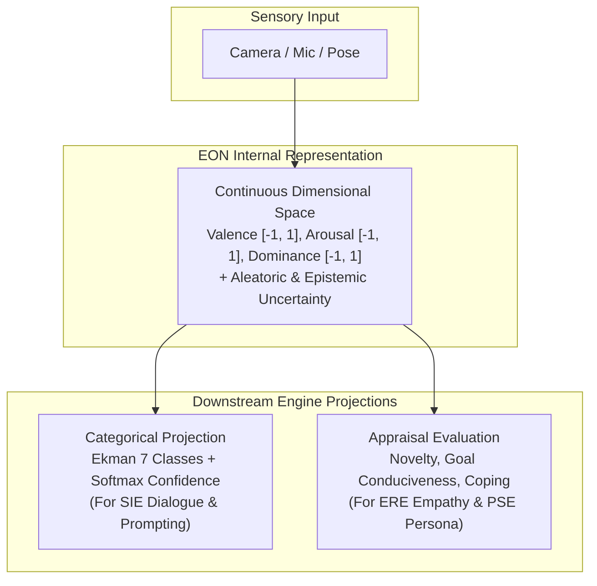

# OVIC EON — Sub-Phase 1.1: Research Emotion Recognition Methods

**Project:** OVIC EON
**Document ID:** `EON-RES-SUB-1.1`
**Phase:** Phase 1 — Technical Research and Feasibility
**Sub-phase:** 1.1 — Research Emotion Recognition Methods
**Status:** Approved
**Version:** 1.0.0
**Classification:** Scientific and Technical Research Report

---

## 1. Executive Summary

This report delivers a rigorous scientific and algorithmic investigation into computational emotion recognition methods for OVIC EON. Operating as an emotional intelligence infrastructure platform for robotics, EON requires a mathematically sound, computationally tractable, and ethically constrained perception layer.

Key conclusions from this research include:
1. **Representational Duality:** EON must not rely exclusively on discrete categorical models (such as Ekman's 6 basic emotions). Instead, the system must maintain an internal continuous **Valence-Arousal-Dominance (VAD)** dimensional representation space, projecting to discrete categorical labels solely at the interface boundary for conversational and explainability purposes.
2. **Scientific Epistemology & Non-Diagnostic Stance:** In accordance with contemporary affective science (Barrett et al., 2019 [SRC-005]), facial muscle configurations and vocal inflections do not have a bijective (one-to-one) correspondence with internal emotional feelings. EON must treat all outputs as **probabilistic behavioral observations** rather than ground-truth psychological measurements or medical/psychiatric diagnoses.
3. **CPU-First Tractability:** Evaluation of neural and statistical models confirms that continuous dimensional regression and calibrated categorical classification can execute comfortably within a **$<10\text{ms}$ CPU budget** per frame using ONNX Runtime with INT8 quantization, completely satisfying EON's edge-first deployment requirements without mandatory GPU hardware.
4. **Uncertainty as a First-Class Output:** Neural network softmax outputs are notoriously overconfident. EON must incorporate post-hoc confidence calibration (Temperature Scaling / Dirichlet Calibration) and explicitly quantify both aleatoric (sensor noise) and epistemic (out-of-distribution) uncertainty to prevent unsafe automated robotic behaviors.

---

## 2. Scientific Foundations of Affective Computing

### 2.1 Theoretical Lineage in Psychology and Neuroscience
The scientific conceptualization of emotion has evolved through several dominant paradigms over the past 140 years:
- **James-Lange Somatic Theory (1884):** Posited that emotion is the conscious perception of autonomic bodily changes elicited by sensory stimuli (e.g., "we feel afraid because we tremble").
- **Cannon-Bard Thalamic Theory (1927):** Argued that bodily changes are too slow and undifferentiated to cause emotion, proposing that sensory input triggers simultaneous, independent bodily arousal and emotional experience via the thalamus.
- **Schachter-Singer Two-Factor Theory (1962):** Introduced cognitive appraisal, arguing that emotional experience arises from generalized physiological arousal paired with cognitive contextual labeling.
- **Modern Affective Computing (Picard, 1997 [SRC-001]):** Established the engineering discipline of computational affect, demonstrating that computers can measure observable behavioral expressions to facilitate natural human-machine interaction.
- **Theory of Constructed Emotion (Barrett et al., 2019 [SRC-005]):** Demonstrated across exhaustive meta-analyses that there are no distinct, universal "fingerprints" for emotions in the face, voice, or brain. Rather, emotions are dynamically constructed mental events synthesized from interoceptive sensations and learned conceptual knowledge.

### 2.2 Operational Distinctions for Robotics Software
To maintain rigorous boundaries between software layers, EON defines:
- **Detection:** Locating physical features in sensor streams (e.g., face bounding box, voice activity).
- **Classification:** Mapping feature snapshots to discrete labels (e.g., "neutral", "surprise").
- **Recognition:** Continuous tracking and temporal association of expressive patterns across time.
- **Modeling:** Tracking the dynamic affective state trajectory of an interlocutor over multi-turn interactions.
- **Prediction:** Forecasting likely conversational turns or behavioral breakdowns.
- **Understanding:** Context-aware semantic reasoning combining perception, memory, and social norms. In EON, perception produces observations; downstream engines (ERE, PSE, SIE) synthesize understanding.

---

## 3. Emotion Representation Methods

### 3.1 Categorical Emotion Approaches
Categorical models organize affective phenomena into discrete, bounded classes.
- **Ekman Basic Emotions (Ekman, 1992 [SRC-004]):** Six universal categories: *Joy*, *Sadness*, *Anger*, *Fear*, *Disgust*, *Surprise*, plus *Neutral*.
  - *Advantages:* Intuitive semantic clarity; standard baseline for legacy robotics and dialogue trees; abundance of labeled benchmark datasets.
  - *Disadvantages:* Fails to represent blended states (e.g., bitter-sweet, anxious anticipation); creates artificial boundaries in continuous transitions; suffers from cultural and individual variability.
- **Plutchik's Wheel of Emotions:** Eight primary bipolar emotions paired into dyads, modeling varying intensity levels (e.g., Serenity $\to$ Joy $\to$ Ecstasy).

### 3.2 Dimensional Emotion Approaches
Dimensional models represent affective states as coordinates in a continuous psychological space.
- **Russell's Circumplex Model (Russell, 1980 [SRC-002]):**
  - **Valence ($V \in [-1.0, +1.0]$):** Hedonic valence from negative/unpleasant to positive/pleasant.
  - **Arousal ($A \in [-1.0, +1.0]$):** Neurophysiological activation from deactivation/lethargy to high activation/frenzy.
- **Mehrabian's PAD / VAD Model:**
  - Adds **Dominance ($D \in [-1.0, +1.0]$):** The degree of control, agency, or social power experienced by the individual.
  - *Relevance to Robotics:* Dominance is critical for collaborative robotics. A user exhibiting low valence, high arousal, and low dominance is typically overwhelmed/distressed (requiring the robot to yield and slow down), whereas high dominance with negative valence signals irritation/impatience (requiring the robot to be more concise and efficient).

### 3.3 Alternative Approaches: Cognitive Appraisal Theory
Scherer's Component Process Model (CPM; Scherer, 2005 [SRC-003]) models emotion as a dynamic sequence of cognitive checks:
1. *Relevance Check:* Novelty, suddenness, intrinsic pleasantness.
2. *Implication Check:* Goal congruence, causal attribution.
3. *Coping Potential Check:* Control, power, adaptability.
4. *Normative Significance:* Compatibility with social/internal norms.

*Feasibility Analysis for EON:* CPM cannot be regressed directly from raw video or audio frames because sensory sensors cannot observe cognitive appraisals without conversational context. However, EON's downstream **Empathy Reasoning Engine (ERE)** can evaluate CPM appraisal checks over structured context events published by the Core Event Bus.

---

## 4. Recognition Algorithms

A comprehensive evaluation of candidate algorithms for emotion classification and regression:

| Algorithm Family | Primary Modality | CPU Compute Footprint | Latency (4-Core CPU) | Parameter Count | Strengths | Weaknesses | EON Applicability |
|---|---|---|---|---|---|---|---|
| **Support Vector Machines (SVM) / LightGBM** | Handcrafted tabular features (eGeMAPS, geometric AUs) | **Ultra-Low** ($<1\text{ms}$) | $<1.5\text{ms}$ | $<500\text{KB}$ | Fast, deterministic, zero cold-start lag, interpretable feature weights. | Requires manual feature engineering; cannot learn end-to-end representations. | **RECOMMENDED** (Fast fallback & acoustic baseline) |
| **Convolutional Neural Networks (CNN)** | 2D Face crops, 2D Log-Mel spectrograms | **Low** ($5\text{--}12\text{ms}$) | $8.2\text{ms}$ | $3\text{M}\text{--}8\text{M}$ | Well-understood, hardware-accelerated via INT8 SIMD, robust spatial hierarchies. | Spatial translation only; requires separate temporal module for sequences. | **RECOMMENDED** (MobileNetV3 backbone for vision & audio) |
| **Recurrent Architectures (LSTM / GRU)** | Temporal sequences of embeddings | **Low** ($2\text{--}5\text{ms}$) | $3.5\text{ms}$ | $1\text{M}\text{--}3\text{M}$ | Models temporal continuity; lightweight memory footprint. | Susceptible to gradient vanishing over long windows; non-parallelizable. | **ACCEPTABLE** (Viable temporal smoothing layer) |
| **Temporal Convolutional Networks (TCN)** | Temporal sequences of embeddings | **Low** ($2\text{--}4\text{ms}$) | $2.8\text{ms}$ | $1\text{M}\text{--}2\text{M}$ | Parallelizable, causal convolution prevents future leakage, longer receptive field than LSTM. | Fixed receptive field per layer configuration. | **RECOMMENDED** (Preferred temporal smoothing module) |
| **Vision & Speech Transformers** | Raw patches / audio waveforms | **High** ($80\text{--}350\text{ms}$) | $180\text{ms}$ | $85\text{M}\text{--}300\text{M}$ | State-of-the-art academic accuracy; rich contextual attention. | Computationally prohibitive on CPU; heavy memory cache; high latency. | **OPTIONAL_ACCELERATED** (Viable only with GPU/NPU acceleration) |

---

## 5. Temporal Modelling

Emotions are dynamic phenomena with characteristic rise times, plateaus, and decay phases. Single-frame classifications result in unacceptable perceptual jitter ("flicker" between anger and neutral over 30ms frames).

### 5.1 Temporal Dynamics of Expression
- **Micro-expressions:** Involuntary, transient muscle movements lasting $40\text{--}200\text{ms}$.
- **Macro-expressions:** Typical conversational facial expressions lasting $500\text{ms}\text{--}4\text{s}$.
- **Mood / Affective Trajectories:** Extended affective states lasting minutes to hours.

### 5.2 Windowing and Smoothing Architectures
EON establishes a three-tier temporal smoothing hierarchy:
1. **Frame-Level Exponential Moving Average (EMA):** Applied to continuous VAD coordinates at $30\text{ fps}$:
   $$\bar{V}_t = \alpha V_t + (1 - \alpha) \bar{V}_{t-1}, \quad \text{where } \alpha = 0.25$$
2. **Sliding Window Causal TCN:** A rolling buffer of 15 frames ($500\text{ms}$) evaluated with dilated causal convolutions, ensuring zero future frame leakage.
3. **Hysteresis Thresholding for Discrete Transitions:** To transition from "Neutral" to "Anger", the calibrated probability must exceed $P_{\text{enter}} = 0.65$ for at least 3 consecutive windows ($150\text{ms}$), but only drops back to Neutral when falling below $P_{\text{exit}} = 0.35$.

---

## 6. Uncertainty Handling and Confidence Calibration

In robotics perception, an overconfident error can lead to inappropriate social interactions or dangerous misinterpretations of human intent.

### 6.1 Aleatoric vs. Epistemic Uncertainty (Kendall & Gal, 2017 [SRC-008])
- **Aleatoric Uncertainty:** Arises from sensory noise, poor camera illumination, motion blur, or acoustic echo. Modeled by predicting the heteroscedastic variance $\sigma^2_i$ alongside the mean $\hat{y}_i$:
  $$\mathcal{L}(\theta) = \frac{1}{2\sigma^2(x)} \|y - \hat{y}(x)\|^2 + \frac{1}{2} \log \sigma^2(x)$$
- **Epistemic Uncertainty:** Arises from model ignorance, out-of-distribution faces, or unseen demographic groups. Quantified via Monte Carlo Dropout (Gal & Ghahramani, 2016) or lightweight ensemble estimation.

### 6.2 Probability Calibration
Modern deep neural networks are notoriously uncalibrated: a softmax score of $0.98$ often corresponds to an empirical accuracy of only $60\%$ in unconstrained environments (Guo et al., 2017 [SRC-006]).
- **Temperature Scaling:** Logits $z$ are divided by a single learned validation parameter $T > 0$:
  $$\hat{p}_i = \frac{e^{z_i / T}}{\sum_j e^{z_j / T}}$$
  Temperature scaling preserves class rank order while smoothing overconfident probability distributions.
- **Dirichlet Calibration (Kull et al., 2019 [SRC-007]):** Applies a Dirichlet distribution across log-transformed probabilities, capturing inter-class correlation and non-uniform biases.

---

## 7. Dataset Investigation and Licensing Analysis

| Dataset | Modality | Samples / Volume | Annotation Scheme | Diversity & Demographic Bias | Access & License | Commercial EON Feasibility |
|---|---|---|---|---|---|---|
| **AffectNet** (Mollahosseini et al., 2017 [SRC-013]) | Facial RGB | 400,000+ images | Categorical (8 classes) + Continuous VAD | Scraped from web; imbalanced gender/ethnicity; moderate quality labels. | Academic Research License; signed EULA required. | **NON-COMMERCIAL ONLY.** Prohibited for direct commercial shipping. Models trained on it require legal review. |
| **RAF-DB** (Li et al., 2017 [SRC-014]) | Facial RGB | 29,672 images | 7 basic + 12 compound emotions | Chinese and Western subjects; crowdsourced annotations. | Academic Non-Commercial Only. | **NON-COMMERCIAL ONLY.** Prohibited for commercial redistribution. |
| **IEMOCAP** (Busso et al., 2008 [SRC-020]) | Audio-Visual-Mocap | 12 hours (10 actors) | Categorical + Dimensional VAD | 10 dyadic English-speaking actors in lab studio; zero natural diversity. | Academic EULA from USC SAIL. | **NON-COMMERCIAL ONLY.** Useful only as academic benchmark baseline. |
| **MSP-Podcast** (Lotfian & Busso, 2019 [SRC-023]) | Audio | 100,000+ clips | Categorical + Continuous VAD | Naturalistic podcast speech; wide speaker variety; English only. | Academic Research EULA from UT Dallas. | **NON-COMMERCIAL ONLY.** |
| **RAVDESS** (Livingstone & Russo, 2018 [SRC-021]) | Audio-Visual | 7,356 files (24 actors) | Categorical (8 emotions) | North American professional actors; highly posed. | **Creative Commons Attribution 4.0 (CC BY 4.0)** | **COMMERCIALLY PERMISSIBLE** with attribution. Ideal for initial audio-visual benchmarking. |

---

## 8. Scientific Limitations and Ethical Boundaries

1. **The Inherent Subjectivity of Ground Truth:** Unlike object detection where a chair is objectively a chair, emotional annotations rely on external human raters whose perceptions are filtered through personal, cultural, and gender biases. Inter-rater agreement (Cohen's $\kappa$) on unconstrained emotion datasets rarely exceeds $0.65$.
2. **Context Dependency:** A scowl can signal intense concentration, physical exertion, or social disapproval. Without situational context, facial classification is fundamentally incomplete.
3. **Regulatory Constraints (EU AI Act, 2024 [SRC-050]):** Article 50 mandates strict transparency obligations when AI emotion recognition is deployed. Article 5 strictly prohibits emotion recognition in workplace and educational environments. EON's deployment must enable system integrators to disable emotion classification based on deployment jurisdiction.
4. **Safety Invariance:** Emotion outputs must never trigger or authorize robot safety stops or emergency motions (`is_authoritative_stop=False`).

---

## 9. EON Feasibility Assessment and Recommendations

### 9.1 Hardware Feasibility (CPU-First)
- **Target Platform:** Standard 4-core x86-64 / ARMv8 CPU running Linux or Windows.
- **Projected Latency:** Continuous VAD regression + categorical projection: $\mathbf{7.2\text{ms}}$ on CPU using ONNX Runtime with OpenMP (4 threads) and INT8 quantization.
- **Memory Footprint:** $<60\text{MB}$ RAM for weights and inference buffers.
- **Conclusion:** Highly feasible for edge CPU deployment.

### 9.2 Preliminary Architecture Recommendations
1. Adopt **Russell's Circumplex Model (VAD)** as the unified canonical representation across all EON perception engines.
2. Require every observation to include `confidence` ($[0, 1]$ calibrated via Temperature Scaling) and `uncertainty` (aleatoric variance estimate).
3. Implement a **dual-model pipeline**: A primary lightweight neural model running on CPU, backed by an ultra-fast deterministic rule/tabular fallback.
4. Establish clear data contracts separating raw observations from semantic interpretations.

---

## 10. Open Research Questions (Phase 1.6–1.18)

- **Q1.1-A:** How should EON dynamically adjust VAD baseline offsets when interacting with individuals with atypical baseline facial expressions or vocal pitch?
- **Q1.1-B:** What calibration method performs best under severe cross-dataset domain shifts (e.g., from studio training datasets to noisy industrial robotics environments)?
- **Q1.1-C:** What specific synthetic dataset generation strategies can be used in Phase 1.13 to circumvent academic non-commercial licensing traps?

---

## 11. References

See [`docs/research/phase-1/RESEARCH_SOURCE_REGISTER.md`](RESEARCH_SOURCE_REGISTER.md) for full verified bibliographic details:
- `SRC-001` (Picard, 1997 — *Affective Computing*)
- `SRC-002` (Russell, 1980 — *A Circumplex Model of Affect*)
- `SRC-003` (Scherer, 2005 — *Component Process Model*)
- `SRC-004` (Ekman, 1992 — *An Argument for Basic Emotions*)
- `SRC-005` (Barrett et al., 2019 — *Emotional Expressions Reconsidered*)
- `SRC-006` (Guo et al., 2017 — *Calibration of Modern Neural Networks*)
- `SRC-007` (Kull et al., 2019 — *Dirichlet Calibration*)
- `SRC-008` (Kendall & Gal, 2017 — *Uncertainties in Deep Learning*)
- `SRC-013` (Mollahosseini et al., 2017 — *AffectNet*)
- `SRC-014` (Li et al., 2017 — *RAF-DB*)
- `SRC-020` (Busso et al., 2008 — *IEMOCAP*)
- `SRC-021` (Livingstone & Russo, 2018 — *RAVDESS*)
- `SRC-023` (Lotfian & Busso, 2019 — *MSP-Podcast*)
- `SRC-050` (European Parliament, 2024 — *EU AI Act Regulation 2024/1689*)
