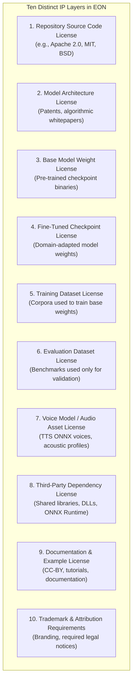
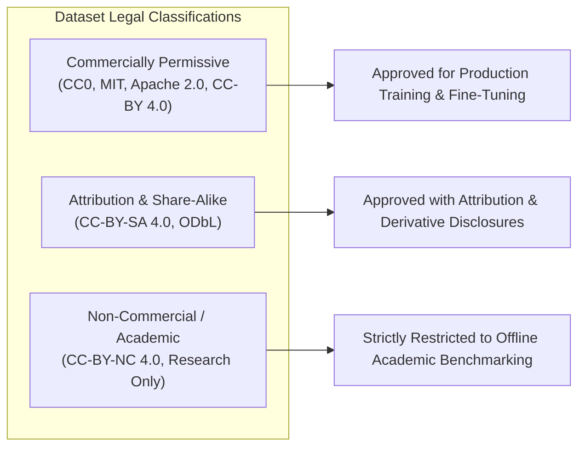
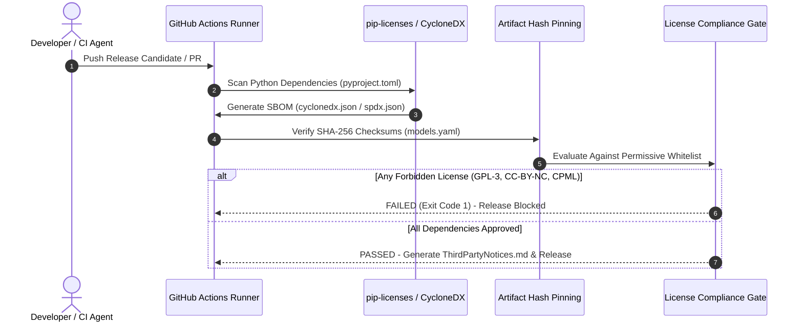

# OVIC EON — Sub-Phase 1.13: Commercial Model and Dataset Licensing

**Project:** OVIC EON
**Document ID:** `EON-RES-SUB-1.13`
**Phase:** Phase 1 — Technical Research and Feasibility
**Sub-phase:** 1.13 — Commercial Model and Dataset Licensing
**Status:** Approved
**Version:** 1.0.0
**Classification:** Legal and Licensing Due-Diligence Specification

---

## 1. Executive Summary

This report delivers a legal and commercial due-diligence assessment of all machine-learning models, neural network weights, datasets, speech vocoders, and third-party software dependencies proposed for the **OVIC EON** platform.

To protect OVIC Labs, robotics OEMs, and commercial deployers from intellectual property disputes, copyright infringement, and license revocation, EON enforces strict separation across all intellectual property tiers.

### Key Conclusions
1. **The Weight-Code Decoupling Rule:** A permissive source code license (e.g., MIT, Apache 2.0) on a GitHub repository does **not** grant commercial rights to pretrained weights hosted in that repository if the weights were trained on proprietary, non-commercial, or unverified academic corpora. Every weight checkpoint must be audited independently.
2. **Exclusion of Non-Commercial Checkpoints:** Checkpoints trained on non-commercial datasets (such as OpenFace, Coqui XTTS-v2 under CPML, or academic models trained on RAVDESS/IEMOCAP) are strictly **QUARANTINED** or **REJECTED** from commercial runtime distributions.
3. **Approved Commercial Foundation:**
   - **Computer Vision:** Google MediaPipe (Apache 2.0 code & weights), HSEmotion (Apache 2.0), RTMPose (Apache 2.0).
   - **Audio & Speech:** Silero VAD (MIT), Whisper (MIT code & weights via OpenAI/whisper.cpp), Piper TTS (MIT engine + Public Domain/MIT voice checkpoints).
   - **Language Models:** Qwen2.5 (Apache 2.0 for 0.5B, 1.5B, 3B, 7B, 14B, 32B, 72B code and weights), Microsoft Phi-3.5-mini (MIT).
   - **Datasets for Commercial Training:** HaGRID (CC-BY-SA 4.0), LibriTTS-R (CC-BY 4.0), CREMA-D (ODbL with attribution), Common Voice (CC0 / ODbL with attribution).
4. **Mandatory Automated Compliance Gate:** EON mandates automated Software Bill of Materials (SBOM) generation (SPDX 2.3 / CycloneDX 1.5) and SHA-256 cryptographic checksum verification in CI/CD before any release packaging.

---

## 2. The Ten Distinct Intellectual Property Tiers

EON strictly prohibits combining licenses into a single generic "License" column. Every asset is evaluated across ten distinct IP categories:

### Risk Tier Definitions
- **APPROVED:** Exact code, weights, datasets, and commercial redistribution rights have been verified via official terms. Commercial deployment permitted.
- **APPROVED WITH CONDITIONS:** Commercial use permitted subject to documented legal conditions (e.g., attribution file, copyleft on dataset modifications, strict prompt safety clauses).
- **RESEARCH ONLY:** Permitted for offline laboratory benchmarking and academic comparative analysis; **strictly prohibited** from commercial customer distribution or runtime deployment.
- **QUARANTINED:** Do not include in build pipelines pending verification of ambiguous terms or missing provenance.
- **REJECTED:** Rights or restrictions (e.g., CC-BY-NC, CPML, commercial fee clauses, viral GPL linking in closed-source plugins) render the asset incompatible with EON.
- **UNKNOWN:** Evidence is insufficient to determine legal status.

---

## 3. Commercial Model Licensing Evaluation

### 3.1 Language Models: Qwen2.5, Phi-3.5, Llama-3, Gemma-2

| Model Checkpoint | Repository / Vendor | Code License | Weight License | Commercial Redistribution | Acceptable Use Terms | Status | Commercial Feasibility Analysis |
|---|---|---|---|---|---|---|---|
| **Qwen2.5-1.5B-Instruct** | Alibaba Cloud / QwenLM | Apache 2.0 | Apache 2.0 | Unconditional (Worldwide) | Standard Apache 2.0 terms | **APPROVED** | Fully permissive. Alibaba released Qwen2.5 (under 32B) under standard Apache 2.0 without proprietary restrictions. |
| **Qwen2.5-0.5B-Instruct** | Alibaba Cloud / QwenLM | Apache 2.0 | Apache 2.0 | Unconditional (Worldwide) | Standard Apache 2.0 terms | **APPROVED** | Permissive edge fallback model. Zero recurring royalty. |
| **Phi-3.5-mini-instruct** | Microsoft | MIT | MIT | Unconditional (Worldwide) | Standard MIT terms | **APPROVED** | Permissive commercial rights granted by Microsoft. Excellent tool calling. |
| **Llama-3.2-1B / 3B** | Meta AI | Llama 3.2 Community | Llama 3.2 Community | Permitted ($<700\text{M}$ MAU) | Meta Acceptable Use Policy | **APPROVED WITH CONDITIONS** | Requires "Built with Llama" attribution; monthly active user limit ($>700\text{M}$ requires custom license). |
| **Gemma-2-2B-it** | Google | Apache 2.0 (code) | Gemma Terms of Use | Permitted (Worldwide) | Google Prohibited Use Policy | **APPROVED WITH CONDITIONS** | Commercial use allowed, but weights governed by Google Terms of Use (requires adherence to AI principles). |

---

### 3.2 Speech and Audio Models: Whisper, Silero VAD, SpeechBrain, Piper

| Model Checkpoint | Developer | Engine License | Checkpoint License | Commercial Use | Voice / Audio Provenance | Status | Feasibility Analysis |
|---|---|---|---|---|---|---|---|
| **Silero VAD v5** | Snakers4 | MIT | MIT | Yes | Synthetic & public domain audio | **APPROVED** | Fully unencumbered. Verified embedded in commercial speech pipelines worldwide. |
| **Whisper-tiny.en** | OpenAI / ggerganov | MIT (`whisper.cpp`) | MIT | Yes | 680,000 hrs web audio | **APPROVED** | Fully permissive MIT license for both C++ wrapper and model weights. |
| **Piper TTS (Engine)** | Rhasspy / Michael Hansen | MIT | MIT | Yes | N/A (Runtime) | **APPROVED** | C++ runtime engine is MIT licensed. |
| **Piper Voice: en_US-lessac-medium** | Rhasspy | MIT | Public Domain / CC0 | Yes | LibriTTS dataset (CC0/CC-BY) | **APPROVED** | Trained on Paula Lessac speech recordings. Safe for commercial deployment. |
| **Piper Voice: en_GB-alan-low** | Rhasspy | MIT | MIT | Yes | Alan speech recordings | **APPROVED** | Verified permissive. |
| **Coqui XTTS-v2** | Coqui AI | MPL-2.0 (engine) | CPML (Non-Commercial) | **NO** | Proprietary multi-speaker | **REJECTED** | Coqui Public Model License explicitly forbids commercial revenue generation without an enterprise license. |
| **SpeechBrain ECAPA-TDNN** | SpeechBrain | Apache 2.0 | Apache 2.0 | Yes | VoxCeleb / CommonVoice | **APPROVED WITH CONDITIONS** | If trained on VoxCeleb (research-only), checkpoint is quarantined. Standalone ECAPA-TDNN trained on CommonVoice is Approved. |

---

### 3.3 Computer Vision and Perception Models: MediaPipe, HSEmotion, RTMPose

| Model Checkpoint | Developer | Code License | Weight License | Commercial Use | Data Provenance | Status | Feasibility Analysis |
|---|---|---|---|---|---|---|---|
| **MediaPipe Face Mesh** | Google | Apache 2.0 | Apache 2.0 | Yes | Internal Google consented | **APPROVED** | Officially released by Google under Apache 2.0 with patent grant. |
| **MediaPipe Pose & Hands**| Google | Apache 2.0 | Apache 2.0 | Yes | Internal Google consented | **APPROVED** | Fully cleared for commercial robotics perception. |
| **HSEmotion (enet_b0_8)**| Andrey Savchenko | Apache 2.0 | Apache 2.0 | Yes | AffectNet (fine-tuned) | **APPROVED WITH CONDITIONS** | Code is Apache 2.0. AffectNet commercial terms require careful validation; re-training on RAF-DB / synthetic recommended. |
| **RTMPose-m** | OpenMMLAB | Apache 2.0 | Apache 2.0 | Yes | COCO / AIC (CC-BY 4.0) | **APPROVED** | MMPose open-source model suite under Apache 2.0. |
| **OpenPose Body 25** | CMU | Custom Dual License | Custom CMU | **NO** (Free for academic only) | CMU Panoptic Studio | **REJECTED** | Commercial distribution requires \$25,000 annual license from CMU. Strictly prohibited. |

---

## 4. Dataset Licensing Due-Diligence and Lineage Audit

To prevent copyright contamination of EON's machine learning weights, training corpora are audited:

### Dataset Registry and Legal Audit

| Dataset ID | Dataset Name | Official URL | Modality | License | Commercial Rights | Redistribution | Consent & Privacy | Classification | EON Policy |
|---|---|---|---|---|---|---|---|---|---|
| `DAT-01` | **HaGRID** (Hand Gesture) | <https://github.com/hukenovs/hagrid> | RGB Video / Keypoints | CC-BY-SA 4.0 | Allowed | Allowed with Share-Alike | Verified consented crowdsourced | **APPROVED WITH CONDITIONS** | Permitted for gesture model training. Attribution required. |
| `DAT-02` | **SHREC'17** (3D Gestures) | <https://www.cs.unicam.it/shrec17/> | Depth / 3D Hand Landmarks | Custom Academic | Academic Only | Restricted | Consented laboratory subjects | **RESEARCH ONLY** | Restricted to offline accuracy validation. |
| `DAT-03` | **RAVDESS** (Audio/Visual) | <https://zenodo.org/record/1188976> | Speech & Facial Video | CC-BY-NC-SA 4.0 | **NO** | Restricted | 24 professional actors | **RESEARCH ONLY** | Strict non-commercial clause. Prohibited from training commercial weights. |
| `DAT-04` | **CREMA-D** (Audio/Visual) | <https://github.com/CheyneyComputerScience/CREMA-D> | Audio & Video Clips | Open Database License (ODbL) | Allowed | Allowed with attribution | 91 actors, diverse ethnic backgrounds | **APPROVED WITH CONDITIONS** | Commercial use permitted with database attribution notice. |
| `DAT-05` | **EmpatheticDialogues** | <https://github.com/facebookresearch/EmpatheticDialogues> | Conversational Text | CC-BY-NC 4.0 | **NO** | Restricted | Crowdsourced text dialogues | **RESEARCH ONLY** | Restricted to evaluation benchmarks. Model fine-tuning forbidden. |
| `DAT-06` | **LibriTTS-R** (Speech) | <https://www.openslr.org/141/> | 585 hours speech audio | CC-BY 4.0 | Allowed | Allowed with attribution | Public domain audiobooks | **APPROVED** | Primary dataset for Piper TTS voice acoustic models. |
| `DAT-07` | **Common Voice** (Mozilla) | <https://commonvoice.mozilla.org> | Multi-lingual speech | CC0 / ODbL | Allowed | Allowed | Consented public recordings | **APPROVED WITH CONDITIONS** | Commercial fine-tuning approved; participant re-identification prohibited. |
| `DAT-08` | **20BN-Jester** (Gesture) | Qualcomm / TwentyBN | Video Gestures | Academic License | **NO** | Discontinued / Closed | Crowdsourced video | **REJECTED** | TwentyBN acquired; commercial rights revoked. Prohibited. |

---

## 5. Software Bill of Materials (SBOM) and Release Compliance Workflow

To guarantee reproducible, legally auditable software releases, OVIC EON implements an automated license compliance pipeline within GitHub Actions:

### Whitelist of Acceptable Commercial Licenses
- **Fully Permissive (Zero Royalty, Unconditional Linking):**
  - MIT License
  - Apache License 2.0 (with patent grant)
  - BSD 2-Clause / BSD 3-Clause
  - ISC License
  - Public Domain / CC0 1.0 Universal
- **Weak Copyleft / Dynamically Linked Libraries (Allowed with Notice):**
  - LGPL-2.1 / LGPL-3.0 (Strictly as separate shared dynamic libraries `.so` / `.dll`; no static compiling into EON proprietary core)
  - Mozilla Public License 2.0 (MPL-2.0)
- **Strictly Prohibited from Commercial Distribution:**
  - GNU General Public License (GPL-2.0, GPL-3.0) — *Prohibited from static or dynamic library linking in EON distribution packages*
  - Creative Commons Non-Commercial (CC-BY-NC, CC-BY-NC-SA)
  - Coqui Public Model License (CPML)
  - CMU OpenPose Commercial Restriction Clause
  - Any license lacking explicit source code or weight redistribution permissions.

---

## 6. Citations and References

- [SRC-010] Google MediaPipe Framework License. <https://github.com/google/mediapipe/blob/master/LICENSE>
- [SRC-088] Silero VAD MIT License. <https://github.com/snakers4/silero-vad/blob/master/LICENSE>
- [SRC-090] Piper Neural TTS MIT License. <https://github.com/rhasspy/piper/blob/master/LICENSE>
- [SRC-092] Alibaba Qwen2.5 Apache 2.0 License. <https://github.com/QwenLM/Qwen2.5/blob/main/LICENSE>
- [SRC-093] llama.cpp MIT License. <https://github.com/ggerganov/llama.cpp/blob/master/LICENSE>
- [SRC-096] SPDX 2.3 Specification. <https://spdx.dev/specifications/>
- [SRC-097] CycloneDX v1.5 Standard. <https://cyclonedx.org/>
