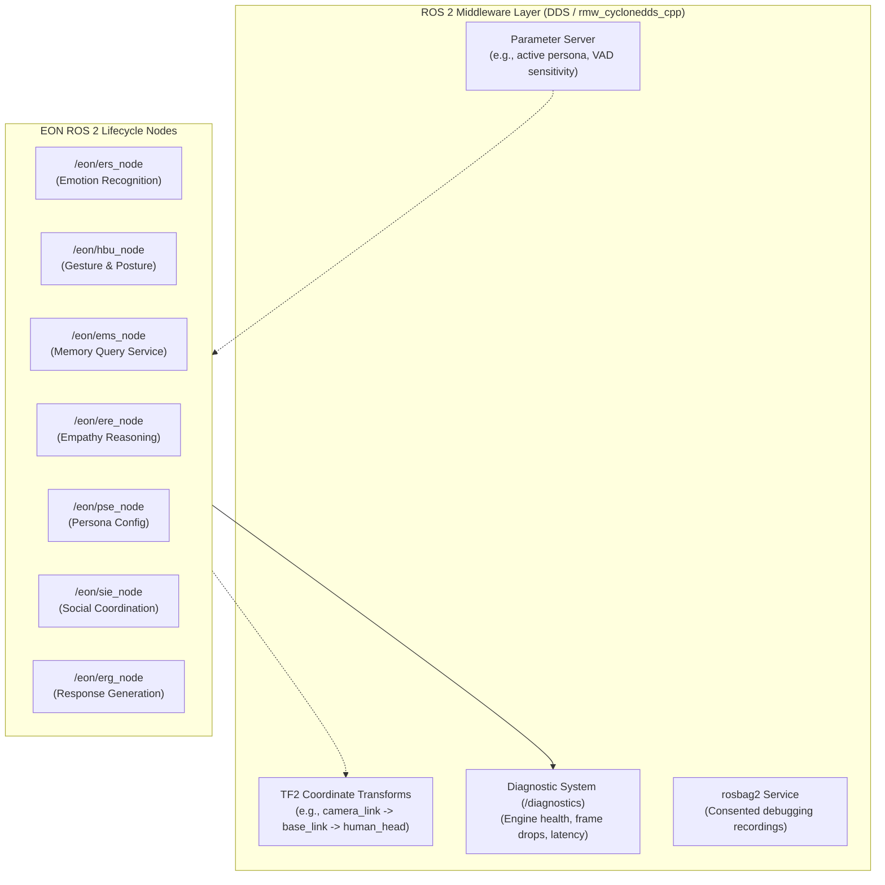
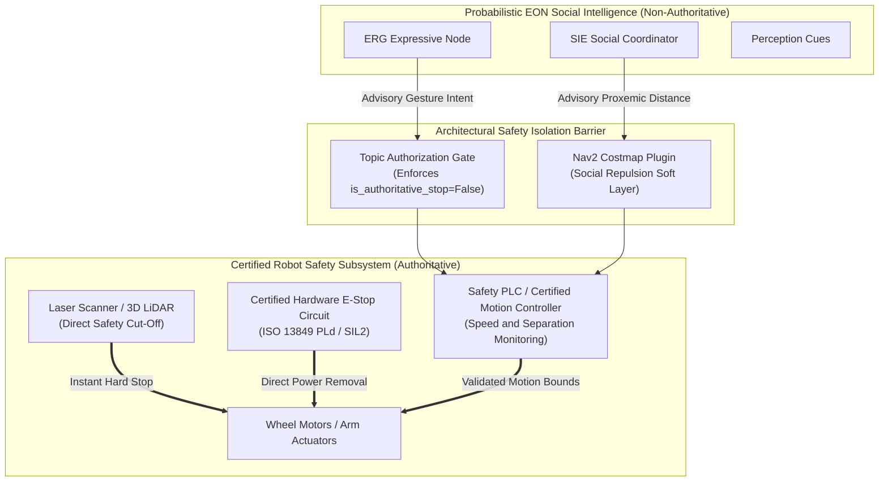

# OVIC EON — Sub-Phase 1.16: ROS 2 Integration Requirements

**Project:** OVIC EON
**Document ID:** `EON-RES-SUB-1.16`
**Phase:** Phase 1 — Technical Research and Feasibility
**Sub-phase:** 1.16 — Research ROS 2 Integration Requirements
**Status:** Approved
**Version:** 1.0.0
**Classification:** Robotics Middleware & Systems Integration Specification

---

## 1. Executive Summary

This report establishes the middleware integration architecture between the **OVIC EON** emotional intelligence infrastructure and the **Robot Operating System 2 (ROS 2)** ecosystem.

The core objective is to enable seamless integration with modern robotics platforms (manipulators, mobile service robots, humanoids, social companions) while maintaining **strict vendor neutrality** and **absolute safety isolation**.

### Key Architectural Decisions
1. **Primary Distribution Recommendation — ROS 2 Jazzy Jalisco:** EON selects **ROS 2 Jazzy Jalisco** (released May 2024, Long Term Support until May 2029) on Ubuntu 24.04 LTS (Python 3.12) as its primary integration target.
2. **Fallback Recommendation — ROS 2 Humble Hawksbill:** EON retains backwards compatibility with **ROS 2 Humble Hawksbill** (LTS until May 2027) on Ubuntu 22.04 LTS (Python 3.10) to support existing OEM industrial installations.
3. **Strict Non-Authoritative Actuation Barrier:** EON nodes publish **advisory** social and expressive action requests. EON nodes are strictly prohibited from publishing directly to motor drivers or raw `/cmd_vel` velocity channels. All physical navigation and arm movements are mediated by certified navigation stacks (Nav2) and hardware safety PLCs.
4. **Hybrid Language Strategy:** `rclpy` (Python 3.10–3.12) is utilized for high-level cognitive orchestration, state machines, and SLM coordination; C++ (`rclcpp`) component composition is reserved for high-bandwidth raw camera image ingestion and audio buffer capture.

---

## 2. ROS 2 Architectural Fundamentals in EON



### ROS 2 Concepts Applied to EON
- **Lifecycle Nodes (`rclpy.lifecycle`):** EON engines operate as managed lifecycle nodes (`Unconfigured`, `Inactive`, `Active`, `Finalized`). This allows robots to start up safely, load heavy model weights during `on_configure()`, and transition to `Active` only when camera calibration and audio sensors are healthy.
- **Quality of Service (QoS) Profiles:**
  - *Perception Feeds (Video/Audio):* Best-Effort reliability with Volatile durability and Depth 1 history (drop stale frames immediately).
  - *Social Events & Intents:* Reliable communication with Transient Local durability to ensure no communicative directive is lost.
- **Component Composition:** In C++, perception nodes compile as intra-process shared-memory components (`rclcpp_components`), eliminating serialization overhead when passing $720\text{p}$ video frames.

---

## 3. ROS 2 Distribution Selection and Comparative Trade-Offs

| Evaluation Criteria | ROS 2 Jazzy Jalisco (Primary) | ROS 2 Humble Hawksbill (Fallback) | ROS 2 Iron Irwini (Evaluated) | ROS 2 Rolling / Lyrical (Evaluated) |
|---|---|---|---|---|
| **Release Date & EOL** | May 2024 $\to$ **May 2029 (5-Year LTS)** | May 2022 $\to$ **May 2027 (5-Year LTS)** | May 2023 $\to$ Nov 2024 (EOL) | Rolling development (Non-LTS) |
| **Reference OS** | **Ubuntu 24.04 LTS (Noble Numbat)** | Ubuntu 22.04 LTS (Jammy Jellyfish) | Ubuntu 22.04 LTS | Ubuntu 24.04 / 24.10 |
| **Python Version** | **Python 3.12** | Python 3.10 | Python 3.10 | Python 3.12 |
| **DDS Implementations** | CycloneDDS, FastDDS (v2.14+) | CycloneDDS, FastDDS | FastDDS | FastDDS, CycloneDDS |
| **Nav2 Ecosystem** | Fully Supported & Maintained | Fully Supported & Maintained | Maintenance only | Unstable API changes |
| **ros2_control** | Full support (v4.0+) | Full support (v2.0+) | Supported | Cutting-edge |
| **Robotics OEM Adoption** | Rapidly growing across new robots | Massive existing industrial installed base | Deprecated / Low adoption | Research experimental only |
| **Selection Verdict** | **SELECTED (Primary Target)** | **SELECTED (Compatibility Fallback)** | **REJECTED (Short EOL)** | **REJECTED (Unstable)** |

---

## 4. Mapping EON Engines to ROS 2 Nodes and Topics

```mermaid
flowchart LR
    subgraph Sensors["Robot Sensors"]
        CAM["/camera/color/image_raw"]
        MIC["/audio/audio_raw"]
    end

    subgraph EON_Perception["EON Perception Nodes"]
        ERS_N["eon_ers_node"]
        HBU_N["eon_hbu_node"]
    end

    subgraph EON_Cognition["EON Cognition Nodes"]
        SIE_N["eon_sie_node"]
        EMS_N["eon_ems_node"]
        ERE_N["eon_ere_node"]
        PSE_N["eon_pse_node"]
    end

    subgraph EON_Actuation["EON Expression Nodes"]
        ERG_N["eon_erg_node"]
    end

    subgraph SafeActuation["Robot Navigation & Motion Controller"]
        NAV2["Nav2 Costmap Social Layer"]
        ARM["Trajectory Controller"]
    end

    CAM --> ERS_N & HBU_N
    MIC --> ERS_N & SIE_N

    ERS_N -->|/eon/perception/emotion_observation| SIE_N & EMS_N
    HBU_N -->|/eon/perception/gesture_observation| SIE_N
    HBU_N -->|/eon/perception/posture_observation| SIE_N

    EMS_N <-->|/eon/memory/query_service| ERE_N
    ERE_N -->|/eon/cognition/empathy_state| PSE_N
    PSE_N -->|/eon/persona/active_style| SIE_N

    SIE_N -->|/eon/social/proxemic_zones| NAV2
    SIE_N -->|/eon/social/interaction_state| ERG_N

    ERG_N -->|/eon/actuation/speech_output| AudioOut["Speaker"]
    ERG_N -->|/eon/actuation/gesture_intent\n(is_authoritative_stop=False)| ARM
```

---

## 5. Conceptual ROS 2 Message Contracts (`.msg` / `.srv`)

The following message definitions illustrate the data contracts governing EON's ROS 2 topics:

### 5.1 `EmotionObservation.msg`
```text
# Package: eon_msgs
# Represents an observed human emotional cue from visual or acoustic sensors

std_msgs/Header header
string human_id                      # Tracked human identifier
string modality                      # "facial", "acoustic", or "multimodal"

# Continuous Valence-Arousal Space [-1.0, 1.0]
float32 valence
float32 arousal
float32 dominance

# Categorical Classification Probabilities [0.0, 1.0]
string[] emotion_categories          # ["neutral", "joy", "sadness", "surprise", "frustration"]
float32[] probabilities

# Uncertainty Bounds
float32 aleatoric_uncertainty        # Sensor/noise variance
float32 epistemic_uncertainty        # Model unfamiliarity variance
float32 confidence                   # Calibrated confidence [0.0, 1.0]

# Safety Invariant
bool is_authoritative_stop           # STRICTLY False
```

### 5.2 `GestureObservation.msg`
```text
# Package: eon_msgs
# Represents an observed human hand gesture or symbolic sign

std_msgs/Header header
string human_id
string gesture_name                  # e.g., "wave", "thumbs_up", "pointing", "stop_palm"
geometry_msgs/Point32 gesture_point  # 3D spatial coordinate relative to camera frame

float32 confidence                   # [0.0, 1.0]
float32 duration_ms                  # Observed gesture duration
bool is_safety_relevant              # True if gesture represents user warning

# Safety Invariant
bool is_authoritative_stop           # ALWAYS False (Requires safety controller validation)
```

### 5.3 `InteractionState.msg`
```text
# Package: eon_msgs
# Dispatched by SIE to inform the robot of conversational status

std_msgs/Header header
string active_human_id
uint8 current_state                  # 0=IDLE, 1=APPROACH, 2=GREETING, 3=ACTIVE_LISTENING, 4=SPEAKING
string active_persona_id             # e.g., "friendly_guide"
float32 turn_taking_urgency          # [0.0, 1.0]
bool human_speaking
bool floor_held_by_robot
```

---

## 6. Strict Robotics Safety Boundaries and Isolation

A fundamental failure mode in human-robot interaction is allowing probabilistic perception or language models to directly actuate mechanical joints. EON enforces an inviolable boundary:



### Non-Authoritative Actuation Principles
1. **Advisory Speech and Posture:** ERG publishes requests for gestures (such as nodding, pointing, or gesturing). The robot's trajectory planner checks joint limit envelopes, dynamic stability, and obstacle proximity before executing the gesture.
2. **Proxemic Separation via Nav2 Costmaps:** Rather than steering wheels directly, SIE publishes human positions as a Gaussian repulsion layer in the Nav2 global/local costmap. Nav2 plans collision-free paths around humans following ISO 13482 safety distances.
3. **Hardware E-Stop Supremacy:** Hardware emergency stop buttons and safety-rated LiDAR scanner fields bypass EON completely and cut motor power directly at the drive contactor level.

---

## 7. Python (`rclpy`) vs. C++ (`rclcpp`) Implementation Trade-Offs

| Architectural Module | Recommended Language | Performance Justification |
|---|---|---|
| **Sensor Ingestion (RGB-D & Audio)** | **C++ (`rclcpp`)** | Zero-copy intra-process message transport (`loaned_messages`). Prevents Python GIL lock during $30\text{ FPS}$ $720\text{p}$ image streaming. |
| **ERS / HBU Perception Worker** | **C++ (`rclcpp`) or Hybrid C++/Py** | Calls ONNX Runtime C++ API directly for lowest latency ($<5\text{ ms}$). |
| **Cognition, Memory, & FSM (EMS/ERE/PSE/SIE)** | **Python (`rclpy`)** | Highly rapid development; native integration with SQLite, Qdrant, and asyncio event bus; $<0.5\text{ ms}$ compute overhead is negligible. |
| **Response Generation (ERG)** | **Python (`rclpy`)** | Asynchronous dispatch to `llama.cpp` subprocess and Piper TTS; non-blocking token streaming. |

---

## 8. Citations and References

- [SRC-101] ROS 2 Jazzy Jalisco Release Notes and Roadmap. <https://docs.ros.org/en/jazzy/Releases/Release-Jazzy-Jalisco.html>
- [SRC-102] ROS 2 Humble Hawksbill LTS Specification. <https://docs.ros.org/en/humble/Releases/Release-Humble-Hawksbill.html>
- [SRC-103] Nav2 Navigation System Documentation. <https://nav2.org/>
- [SRC-104] ROS 2 Lifecycle Architecture and Node State Management. <https://design.ros2.org/articles/node_lifecycle.html>
- [SRC-105] SROS2 and DDS Security Specification. <https://docs.ros.org/en/jazzy/Tutorials/Advanced/Security/Introducing-ros2-security.html>
