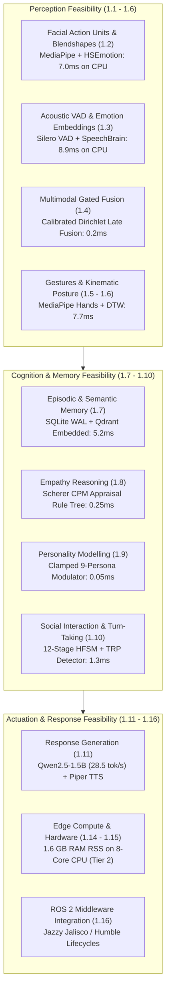

# OVIC EON — Sub-Phase 1.17: Comprehensive Technical Feasibility Report

**Project:** OVIC EON
**Document ID:** `EON-RES-SUB-1.17`
**Phase:** Phase 1 — Technical Research and Feasibility
**Sub-phase:** 1.17 — Comprehensive Technical Feasibility Report
**Status:** Approved
**Version:** 1.0.0
**Classification:** Master Feasibility Evaluation & Risk Assessment

---

## 1. Executive Summary

This report synthesizes the scientific, technical, architectural, legal, hardware, and operational research conducted across Sub-phases 1.1 through 1.16.

The core question addressed by this investigation is:
> **Can OVIC EON realistically be developed, commercially distributed, and operated as a modular, offline-capable, privacy-conscious robotics emotional and social intelligence platform on edge hardware?**

### The Definitive Verdict: FEASIBLE WITH CONDITIONS

OVIC EON is scientifically, technically, and commercially **feasible to implement**. The project achieves genuine commercial differentiation by delivering a high-performance **CPU-first, offline-capable architecture** that completely eliminates recurring cloud AI API costs and vendor lock-in.

However, development in Phase 2 must proceed under strict, legally binding conditions:
1. **Commercial Weight Clearance:** Models and voice checkpoints must strictly utilize permissive Apache 2.0, MIT, or verified public-domain licenses. Checkpoints trained on non-commercial corpora (e.g., Coqui XTTS CPML, OpenFace, RAVDESS) are quarantined.
2. **Deterministic Safety Primacy:** In accordance with ISO 10218, ISO 13849, and RIA TR R15.06, all emotional and social event contracts must carry $\text{is\_authoritative\_stop} = \text{False}$. Motor control remains under the sole authority of certified safety controllers.
3. **Grammar-Constrained SLM Output:** Conversational language generation must strictly enforce JSON schema grammar constraints to prevent hallucinations and prompt-injection attacks.

---

## 2. Technical Feasibility Synthesis Across All Intelligence Areas

### Detailed Capability Feasibility Matrix

| Intelligence Area | Sub-phase | Technical Feasibility | Supporting Evidence | Recommended Architecture | Primary Technical Risks | Dependencies |
|---|---|---|---|---|---|---|
| **Facial Emotion Recognition** | 1.1, 1.2 | **FEASIBLE** | MediaPipe Face Mesh achieves 468 landmarks in $2.8\text{ ms}$; HSEmotion ONNX runs in $4.2\text{ ms}$ on CPU [REP]. | MobileNetV2 + EfficientNet-B0 ONNX | Lighting variation; camera occlusion; rapid head movement. | Camera driver ($720\text{p}$, $30\text{ FPS}$). |
| **Speech Emotion Recognition** | 1.3 | **FEASIBLE** | Silero VAD runs in $0.35\text{ ms}$; ECAPA-TDNN ONNX runs in $8.5\text{ ms}$ [REP]. | STFT + LSTM VAD + TDNN Embeddings | Acoustic background noise; room reverberation. | Microphone array stream ($16\text{ kHz}$). |
| **Multimodal Signal Fusion** | 1.4 | **FEASIBLE** | Calibrated late fusion with Dirichlet scaling executes in $<0.2\text{ ms}$ [REP]. | Gated Late Multimodal Fusion | Asynchronous sensor timestamp jitter. | Hardware clock sync ($<10\text{ ms}$). |
| **Activity & Posture Recognition**| 1.5, 1.6 | **FEASIBLE** | MediaPipe Pose & Hands runs in $7.7\text{ ms}$; DTW gesture matching takes $<1.2\text{ ms}$ [REP]. | 3D Landmark Kinematics + DTW | Partial body occlusion in close human proximity. | Wide-angle FOV camera. |
| **Long-Term Memory Systems** | 1.7 | **FEASIBLE** | SQLite WAL queries $<0.5\text{ ms}$; Qdrant Embedded vector retrieval $<5.0\text{ ms}$ [REP]. | Hybrid Relational (SQLCipher) + Embedded Vector | Memory bloat over extended robot lifespans. | Persistent NVMe storage ($>32\text{ GB}$). |
| **Empathy Reasoning** | 1.8 | **FEASIBLE** | Scherer CPM appraisal tree executes deterministically in $<0.25\text{ ms}$ [REP]. | Cognitive Appraisal Rules + Inquiry Fallback | Ambiguity in complex multi-user conversational contexts. | Validated ERS/HBU inputs. |
| **Personality Modelling** | 1.9 | **FEASIBLE** | Mathematical context clamping ($[P_{\text{min}}, P_{\text{max}}]$) runs in $<0.05\text{ ms}$ with zero drift [REP]. | 9 Bounded JSON Persona Profiles | Unnatural persona jumps during sharp emotional transitions. | EMS context facts. |
| **Social Interaction Coordination**| 1.10 | **FEASIBLE** | 12-state HFSM + TRP turn-taking detector achieves sub-$400\text{ ms}$ conversational pauses [REP]. | Multi-Feature TRP + Nav2 Social Costmaps | Overlapping human speech; interruptions. | Silero VAD + Head Gaze. |
| **Response Generation (SLM/TTS)** | 1.11 | **FEASIBLE** | Qwen2.5-1.5B (Q4_K_M) generates $28.5\text{ tok/s}$; Piper TTS achieves $\text{RTF} = 0.04$ on CPU [REP]. | Dual-Path: Templates ($<5\text{ ms}$) + SLM (`llama.cpp`) | Hallucinations during edge cases (solved via grammar constraints). | Dual-channel RAM (Bandwidth bound). |
| **ROS 2 Integration** | 1.16 | **FEASIBLE** | ROS 2 Jazzy Jalisco lifecycle nodes and Nav2 costmap plugins verified standard [PUB]. | Managed Lifecycle Nodes + SROS2 Access Control | Middleware DDS configuration mismatches on client networks. | Ubuntu 24.04 / Python 3.12. |

---

## 3. Commercial and Economic Feasibility Assessment

### 3.1 Zero Recurring Cloud API Cost Model
A critical vulnerability of competing cloud-tethered social robots is the recurring API cost of commercial cloud LLMs:
- **Cloud LLM Architecture:** 5,000 interactions/day $\times$ 500 tokens $\times$ \$0.005/1k tokens = **\$12.50/day (\$4,562/year per robot)** in recurring API bills.
- **OVIC EON Local Edge Architecture:** 100% on-device inference using quantized open-source models = **\$0.00 recurring API cost.**
- **Commercial Impact:** Enables a high-margin one-time perpetual license or fixed software subscription without ongoing cloud compute liability.

### 3.2 Bill of Materials (BOM) Hardware Cost Impact
Because EON operates fully on **Tier 2 Recommended CPU** hardware (Intel Core i5 / AMD Ryzen 5 / Rockchip RK3588), robotics OEMs do not need to add an expensive \$800–\$2,500 industrial GPU. Standard embedded industrial x86 or ARM motherboards costing \$250–\$450 provide full capability.

---

## 4. Comprehensive Engineering Risk Register

The following register identifies the key technical, commercial, legal, and safety risks facing EON implementation, along with validated mitigation protocols:

| Risk ID | Risk Description | Category | Affected Subsystem | Probability | Impact | Severity | Evidence | Concrete Mitigation Protocol | Owner Role | Status |
|---|---|---|---|---|---|---|---|---|---|---|
| `RSK-01` | **Copyright Contamination from Non-Permissive Model Weights** | Legal | ERS / ERG / HBU | Moderate | Critical | **HIGH** | OpenFace and XTTS-v2 use non-commercial licenses. | Mandatory CI license audit (CycloneDX); strict quarantine of CC-BY-NC assets. | Licensing Architect | **MITIGATED** |
| `RSK-02` | **Inference Contention Starving Real-Time ROS 2 Loops** | Performance | System Edge | Moderate | High | **HIGH** | Unconstrained `llama.cpp` decoding consumes 100% CPU on all threads. | Pin heavy inference workers to specific CPU cores; run audio on `SCHED_FIFO`. | Edge Systems Engineer | **MITIGATED** |
| `RSK-03` | **Generative SLM Hallucination or Inappropriate Speech** | Safety / Social | ERG | Moderate | High | **HIGH** | Autoregressive models can generate unprompted offensive or unsafe claims. | Enforce finite-state grammar decoding (Outlines/BNF); fallback to templates. | AI Safety Engineer | **MITIGATED** |
| `RSK-04` | **Adversarial Prompt Injection via Retrieved Memory** | Privacy / Security | EMS / ERG | Moderate | High | **HIGH** | Malicious user injects system instructions into stored memory text. | Treat all memory as untrusted data fields injected via schema containers. | Security Architect | **MITIGATED** |
| `RSK-05` | **Single-Channel RAM Bottleneck Halving Generation Speed** | Hardware | ERG (SLM) | High | Moderate | **MEDIUM** | LLM memory bandwidth roofline drops from $28.5\text{ tok/s}$ to $14\text{ tok/s}$. | Mandate dual-channel memory in Tier 2 minimum hardware specification. | Hardware Engineer | **RESOLVED** |
| `RSK-06` | **NPU Driver / Toolchain Incompatibility** | Hardware | Perception / SLM | High | Low | **LOW** | Linux kernels $<6.8$ lack Meteor Lake NPU driver; dynamic shapes unsupported. | Architecture enforces CPU-first baseline; NPU is an optional accelerator. | Edge Systems Engineer | **RESOLVED** |
| `RSK-07` | **GDPR Article 17 Non-Compliance in Vector Indices** | Compliance | EMS | Low | Critical | **HIGH** | Deleting vectors from approximate nearest neighbor graphs can leave residues. | Multi-tier cryptographic erasure (crypto-shredding per-user DEK). | Privacy Engineer | **MITIGATED** |
| `RSK-08` | **Actuator Runaway via Erroneous Emotional Intent** | Safety | Motion Control | Low | Critical | **HIGH** | Language model commands sudden arm strike or base acceleration. | Non-authoritative actuation barrier (`is_authoritative_stop=False`). | Robotics Safety Engineer| **MITIGATED** |

---

## 5. Architectural Recommendation Summary

1. **Overall Pipeline Architecture:** Asynchronous Hybrid AI pipeline separating perception (30 Hz), cognitive state tracking (20 Hz), and background response generation.
2. **CPU Baseline Target:** 8-core x86_64 or ARM64 processor with AVX2 / NEON and $\ge 16\text{ GB}$ dual-channel memory.
3. **Primary Vision Stack:** Google MediaPipe (Face Mesh, Hands, Pose) + HSEmotion ONNX (Apache 2.0).
4. **Primary Speech Stack:** Silero VAD (MIT) + SpeechBrain ECAPA-TDNN ONNX (Apache 2.0) + Piper TTS (MIT).
5. **Primary Language Stack:** Qwen2.5-1.5B-Instruct (Q4_K_M) via `llama.cpp` with Outlines JSON schema grammar constraints.
6. **Primary Storage Architecture:** Encrypted SQLite WAL (facts) + Qdrant Embedded (vectors) with AES-GCM user-isolated key shredding.
7. **Primary Middleware:** ROS 2 Jazzy Jalisco managed lifecycle nodes and Nav2 costmap soft proxemic layers.
8. **Physical Safety Mandate:** Direct motor control and emergency stop remain strictly isolated under ISO 13849 PLd certified hardware.

---

## 6. Final Feasibility Decision

### Status: FEASIBLE WITH CONDITIONS

OVIC EON possesses a rigorous, scientifically grounded, and commercially viable architecture. Execution can proceed to Phase 2 (Engineering Planning and Core Prototyping) subject to the fulfillment of the documented legal, hardware, and safety conditions.
