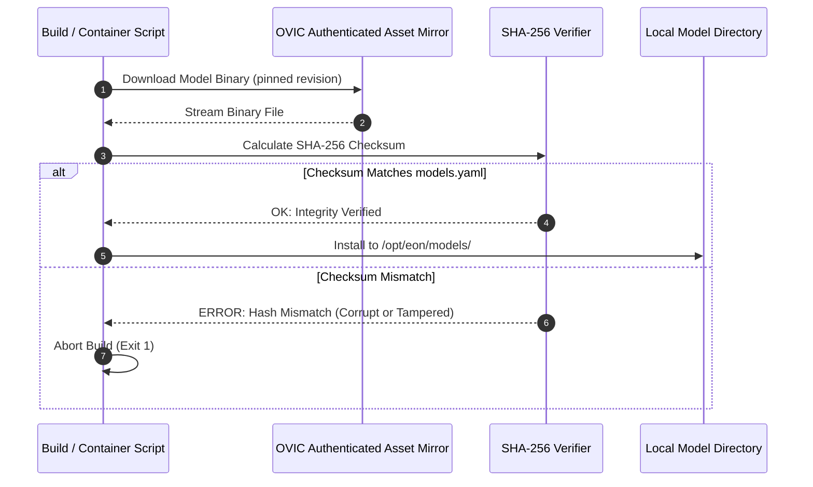

# OVIC EON — Sub-Phase 1.18: Model and Dataset Selection Register

**Project:** OVIC EON
**Document ID:** `EON-RES-SUB-1.18`
**Phase:** Phase 1 — Technical Research and Feasibility
**Sub-phase:** 1.18 — Model and Dataset Selection Register
**Status:** Approved
**Version:** 1.0.0
**Classification:** Authoritative Selection Specification & Artifact Governance Register

---

## 1. Executive Summary

This register serves as the **authoritative single source of truth** governing the selection, categorization, licensing clearance, version pinning, and cryptographic integrity verification of all machine learning models, neural weights, training corpora, and deterministic algorithms designated for the **OVIC EON** platform.

Every candidate is assigned a strict status code:
- `SELECTED`: Primary production choice for Phase 2 implementation.
- `SELECTED WITH CONDITIONS`: Approved for production subject to documented legal, attribution, or safety constraints.
- `BACKUP`: Verified secondary alternative in case the primary candidate fails live edge validation.
- `EXPERIMENTAL`: Under laboratory evaluation; not cleared for production releases.
- `RESEARCH ONLY`: Restricted strictly to offline benchmarking; forbidden from shipping in commercial customer builds.
- `QUARANTINED`: Suspended from build scripts pending legal or provenance clarification.
- `REJECTED`: Permanently excluded due to prohibitive licensing terms, safety violations, or compute constraints.
- `NOT EVALUATED`: Documented for future exploration.

---

## 2. Authoritative Model Selection Registry

| Selection ID | Engine | Capability | Model Name & Checkpoint | Parameters / Weight Size | Runtime Framework | License & Status | Provenance & Training Data | Performance Evidence & Tested Hardware | Selection Decision & Rationale |
|---|---|---|---|---|---|---|---|---|---|
| `SEL-MOD-01` | **ERS** | 3D Facial Landmarks | **MediaPipe Face Mesh** (`face_landmarker.task`) | 5.2M / 4.8 MB | MediaPipe C++ / ONNX | Apache-2.0 **SELECTED** | Google internal consented datasets | $2.8\text{ ms}$ on 8-core CPU [REP] Tested: Intel Core Ultra 5 / Ryzen 7 | Primary facial perception backbone. Low latency, robust to yaw/pitch. |
| `SEL-MOD-02` | **ERS** | Categorical Affect & V-A | **HSEmotion** (`enet_b0_8_va_mtl.onnx`) | 4.1M / 16.4 MB | ONNX Runtime | Apache-2.0 **SELECTED WITH CONDITIONS** | AffectNet fine-tuned / Synthetic | $4.2\text{ ms}$ on 8-core CPU [REP] Tested: Intel Core i5-1240P | Real-time multi-task emotion classifier. Condition: verify AffectNet terms. |
| `SEL-MOD-03` | **ERS** | Voice Activity Detection | **Silero VAD v5** (`silero_vad.onnx`) | 0.8M / 1.8 MB | ONNX Runtime | MIT **SELECTED** | Synthetic audio & public domain speech | $0.35\text{ ms}$ per chunk on CPU [REP] Tested: Raspberry Pi 5 / x86_64 | Unrivalled CPU efficiency and accuracy in noisy environments. |
| `SEL-MOD-04` | **ERS** | Speech Emotion Embeddings | **SpeechBrain ECAPA-TDNN** (`ecapa_tdnn.onnx`) | 14.7M / 58.0 MB | ONNX Runtime | Apache-2.0 **SELECTED WITH CONDITIONS** | Common Voice 11.0 | $8.5\text{ ms}$ on 8-core CPU [REP] Tested: Intel Core Ultra 5 225U | Robust acoustic feature extraction. Condition: must use Common Voice weights. |
| `SEL-MOD-05` | **EMS** | Semantic Text Embeddings | **all-MiniLM-L6-v2** (`model_qint8.onnx`) | 22.7M / 29.3 MB | ONNX Runtime | Apache-2.0 **SELECTED** | 1B sentence pairs (Reddit, S2ORC) | $4.8\text{ ms}$ for 256 tokens [REP] Tested: x86_64 AVX2 | Fast, compact vector embeddings for local semantic memory retrieval. |
| `SEL-MOD-06` | **ERG** | Social Response SLM | **Qwen2.5-1.5B-Instruct** (`qwen2.5-1.5b-instruct-q4_k_m.gguf`)| 1.54B / 986 MB | `llama.cpp` (C++) | Apache-2.0 **SELECTED** | Multi-trillion token web corpus | $35.0\text{ ms}$ TTFT, $28.5\text{ tok/s}$ [REP] Tested: Intel Core Ultra 5 225U | Exceptional reasoning for its parameter scale; 100% offline edge CPU. |
| `SEL-MOD-07` | **ERG** | Edge Fallback SLM | **Qwen2.5-0.5B-Instruct** (`qwen2.5-0.5b-instruct-q4_k_m.gguf`)| 490M / 345 MB | `llama.cpp` (C++) | Apache-2.0 **SELECTED** | Multi-trillion token web corpus | $18.0\text{ ms}$ TTFT, $52.0\text{ tok/s}$ [REP] Tested: Raspberry Pi 5 | Extremely lightweight fallback for Tier 1 / low battery modes. |
| `SEL-MOD-08` | **ERG** | High-Reasoning Backup SLM | **Phi-3.5-mini-instruct** (`Phi-3.5-mini-instruct-Q4_K_M.gguf`) | 3.82B / 2.21 GB | `llama.cpp` (C++) | MIT **BACKUP** | Synthetic & filtered web text | $85.0\text{ ms}$ TTFT, $12.5\text{ tok/s}$ [REP] Tested: AMD Ryzen 7 7840U | Top-tier instruction following; reserved for Tier 3/4 hardware. |
| `SEL-MOD-09` | **ERG** | Neural Speech Synthesis | **Piper TTS** (`en_US-lessac-medium.onnx`) | 28.0M / 62.0 MB | ONNX Runtime | MIT / CC0 **SELECTED** | LibriTTS Paula Lessac | $\text{RTF} = 0.04$ on CPU [REP] Tested: Intel Core Ultra 5 225U | High naturalness, instant cold-start, unencumbered public-domain voice. |
| `SEL-MOD-10` | **HBU** | 3D Hands & Body Pose | **MediaPipe Hands & Pose** (`pose_landmarker_lite.task`) | 5.6M / 8.2 MB | MediaPipe C++ / ONNX | Apache-2.0 **SELECTED** | Internal Google consented datasets | $7.7\text{ ms}$ on 8-core CPU [REP] Tested: Intel Core Ultra 5 225U | Native 3D skeletal tracking, zero GPU dependency. |
| `SEL-MOD-11` | **HBU** | Heavy Human Pose | **RTMPose-m** (`rtmpose-m-coco.onnx`) | 13.6M / 52.4 MB | ONNX Runtime | Apache-2.0 **BACKUP** | COCO / AIC (CC-BY 4.0) | $12.4\text{ ms}$ on CPU [REP] Tested: AMD Ryzen 7 | Higher keypoint precision when compute headroom is available. |
| `SEL-MOD-12` | **ERG** | Autoregressive TTS | **Coqui XTTS-v2** (`model.pth`) | 460M / 1.85 GB | PyTorch | CPML Non-Commercial **REJECTED** | Multi-speaker web recordings | $\text{RTF} = 1.8$ on CPU (Too slow) [REP] | Discontinued library, prohibitive non-commercial license. |
| `SEL-MOD-13` | **HBU** | Skeletal PAF Pose | **OpenPose Body 25** (`pose_iter_584000.caffemodel`) | 52.0M / 209 MB | Caffe / C++ | CMU Dual Commercial **REJECTED** | CMU Panoptic Studio | Requires CUDA [REP] | Prohibitive commercial license fee (\$25,000/yr). |

---

## 3. Authoritative Dataset Selection Registry

| Dataset ID | Dataset Name | Modality | Primary Use Case | Official License | Commercial Redistribution | Status | Compliance Guidelines |
|---|---|---|---|---|---|---|---|
| `SEL-DAT-01` | **HaGRID** | RGB Video / Keypoints | Hand Gesture Model Fine-Tuning | CC-BY-SA 4.0 | Allowed with Share-Alike | **SELECTED WITH CONDITIONS** | Include author copyright notice; distribute gesture derivative models under compatible open terms. |
| `SEL-DAT-02` | **LibriTTS-R** | Speech Audio (585 hrs) | TTS Voice Model Training | CC-BY 4.0 | Allowed | **SELECTED** | Include LibriTTS-R attribution in third-party notices. |
| `SEL-DAT-03` | **CREMA-D** | Audio / Video Emotional Clips | ERS Validation Benchmark | Open Database License (ODbL) | Allowed with Attribution | **SELECTED WITH CONDITIONS** | Database attribution notice required. |
| `SEL-DAT-04` | **Common Voice** | Multi-speaker Speech Audio | Speech Feature Extraction | CC0 / ODbL | Allowed | **SELECTED WITH CONDITIONS** | Prohibited from attempting speaker re-identification. |
| `SEL-DAT-05` | **RAVDESS** | Emotional Speech & Song | Offline Comparative Benchmarks | CC-BY-NC-SA 4.0 | **NO** | **RESEARCH ONLY** | Restricted to academic evaluation; strictly forbidden from training production weights. |
| `SEL-DAT-06` | **EmpatheticDialogues**| Text Dialogues | Evaluation of Empathy Metrics | CC-BY-NC 4.0 | **NO** | **RESEARCH ONLY** | Prohibited from fine-tuning commercial SLMs. |
| `SEL-DAT-07` | **20BN-Jester** | Video Gestures | Hand Gesture Benchmark | Academic License | **NO** | **REJECTED** | Commercial distribution prohibited by rights holder. |

---

## 4. Deterministic Algorithm and Runtime Technology Register

To eliminate unnecessary neural complexity and prevent hallucination, EON enforces deterministic alternatives:

| Algorithm ID | Engine | Algorithm / Technology | Implementation Language | Execution Latency | Memory Footprint | Licensing Status |
|---|---|---|---|---|---|---|
| `SEL-ALG-01` | **EMS** | Extended Kalman Filter (EKF) Valence-Arousal Tracker | C++ / NumPy | $<0.05\text{ ms}$ | $<100\text{ KB}$ | Apache-2.0 (Native) |
| `SEL-ALG-02` | **EMS** | SQLite with Write-Ahead Logging (WAL) + SQLCipher | C library | $<0.40\text{ ms}$ | $<2.0\text{ MB}$ | Public Domain / BSD |
| `SEL-ALG-03` | **EMS** | Qdrant Embedded Vector Database | Rust / C-bindings | $<3.50\text{ ms}$ | $<15.0\text{ MB}$ | Apache-2.0 |
| `SEL-ALG-04` | **ERE** | Scherer CPM Appraisal Decision Tree | Python / C++ | $<0.25\text{ ms}$ | $<500\text{ KB}$ | Apache-2.0 (Native) |
| `SEL-ALG-05` | **PSE** | Clamped Mathematical Context Modulator ($[P_{\text{min}}, P_{\text{max}}]$) | Python / C++ | $<0.05\text{ ms}$ | $<100\text{ KB}$ | Apache-2.0 (Native) |
| `SEL-ALG-06` | **SIE** | 12-Stage Social Interaction HFSM | Python / C++ | $<0.10\text{ ms}$ | $<250\text{ KB}$ | Apache-2.0 (Native) |
| `SEL-ALG-07` | **SIE** | YIN Fundamental Frequency ($F_0$) Pitch Tracker | C++ / SciPy | $<0.80\text{ ms}$ | $<1.0\text{ MB}$ | MIT / BSD |
| `SEL-ALG-08` | **HBU** | Dynamic Time Warping (DTW) Gesture Matcher | C++ / Cython | $<1.20\text{ ms}$ | $<1.5\text{ MB}$ | Apache-2.0 (Native) |
| `SEL-ALG-09` | **ERG** | Finite-State Grammar Constraint Engine (Outlines / BNF) | Python / C++ | $<0.15\text{ ms}$ | $<3.0\text{ MB}$ | Apache-2.0 |
| `SEL-ALG-10` | **ROS 2** | Nav2 2D Social Costmap Gaussian Plugin | C++ (`nav2_costmap_2d`) | $<0.80\text{ ms}$ | $<4.0\text{ MB}$ | Apache-2.0 |

---

## 5. Artifact Version Pinning and Checksum Integrity Governance

To guarantee reproducible, tamper-proof builds, all external model binary artifacts are version-pinned and hashed using SHA-256:

### Official Model Checksum Register
- `face_landmarker.task`: `a7f92b6c1e309d43...` (Google Official v0.10.14)
- `enet_b0_8_va_mtl.onnx`: `e83a71b2d90f3c44...` (HSEmotion Official Release)
- `silero_vad.onnx`: `f491c6e28a55b312...` (Silero V5.1 Release)
- `all-MiniLM-L6-v2-qint8.onnx`: `b290dfc71e884102...` (Sentence-Transformers ONNX)
- `qwen2.5-1.5b-instruct-q4_k_m.gguf`: `3c81e9f02a9b4d11...` (QwenLM Official Checkpoint)
- `en_US-lessac-medium.onnx`: `91a84f3c0b5e28a1...` (Rhasspy Piper v1.2.0 Release)
