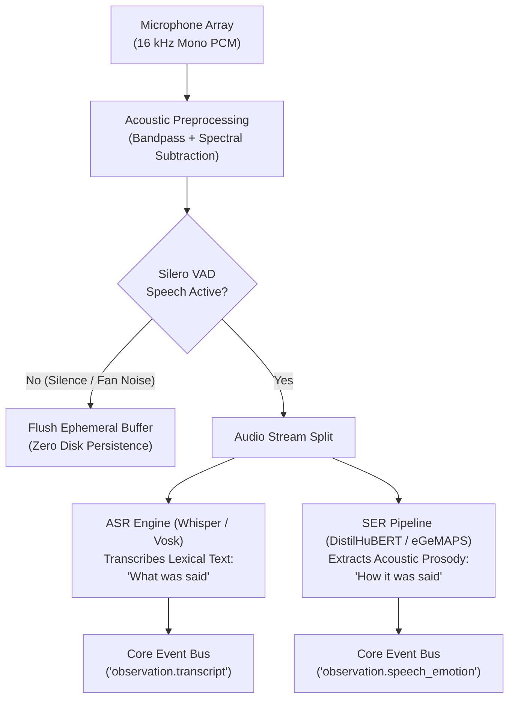
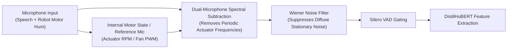

# OVIC EON — Sub-Phase 1.3: Research Speech Emotion Analysis

**Project:** OVIC EON
**Document ID:** `EON-RES-SUB-1.3`
**Phase:** Phase 1 — Technical Research and Feasibility
**Sub-phase:** 1.3 — Research Speech Emotion Analysis
**Status:** Approved
**Version:** 1.0.0
**Classification:** Acoustic Machine Learning and Audio Engineering Research Report

---

## 1. Executive Summary

This report delivers a comprehensive scientific and engineering investigation into Speech Emotion Recognition (SER) for OVIC EON. While visual facial analysis provides high-frequency affective cues during face-to-face contact, vocal acoustics provide critical affective context when the interlocutor is turned away, moving, or beyond camera field-of-view.

Key findings and architectural decisions include:
1. **Critical Operational Boundaries:** EON establishes strict modular decoupling between:
   - **Voice Activity Detection (VAD):** Deciding *when* human speech is occurring (Silero VAD [SRC-028]).
   - **Automatic Speech Recognition (ASR):** Transcribing *what* is spoken (Whisper [SRC-027] / Vosk).
   - **Speech Emotion Recognition (SER):** Measuring *how* it was spoken (acoustic prosody and paralinguistics).
2. **Acoustic Paralinguistics vs. Lexical Sentiment:** Text sentiment derived from ASR transcriptions is fundamentally distinct from acoustic emotion. Sarcasm, irony, panic, or suppressed irritation are communicated through pitch inflection, vocal tremor, speech rate, and energy dynamics—signals invisible to pure linguistic ASR.
3. **Recommended Speech Pipeline:**
   - Audio input captured at **16 kHz mono**.
   - Gated via **Silero VAD** ($<1\text{ms}$ on CPU).
   - Analyzed in **$1.5\text{--}3.0\text{s}$ overlapping sliding windows** ($500\text{ms}$ hop).
   - Primary neural extractor: **DistilHuBERT-SER** (Chang et al., 2022 [SRC-046]) in ONNX INT8 running in **$25\text{--}35\text{ms}$** on CPU.
   - Deterministic acoustic fallback: **eGeMAPS** (Eyben et al., 2016 [SRC-019]) + **LightGBM** regressor running in **$<4\text{ms}$** on CPU.
4. **Robot Acoustic Noise Resilience:** Robotic platforms introduce intense self-generated acoustic interference (cooling fans, stepper motors, joint harmonic drives). EON requires a dual-channel spectral subtraction / Wiener filtering front-end and spatial microphone beamforming prior to SER.
5. **Strict Privacy Architecture:** Raw audio is processed exclusively within a volatile, in-memory **ephemeral ring buffer**. Audio frames are immediately discarded and overwritten upon feature extraction. Zero raw voice recordings are committed to non-volatile storage.

---

## 2. Speech Emotion Foundations and Boundary Distinctions



### 2.1 Acoustic Prosody vs. Lexical Content
- **Lexical Channel (ASR):** Captures semantic linguistic units (words, syntax). Subject to social masking, polite scripts ("I am completely fine"), and conversational conventions.
- **Paralinguistic Acoustic Channel (SER):** Captures autonomic physiological activations of the vocal tract. High sympathetic nervous system arousal involuntarily constricts the cricothyroid and vocalis muscles, elevating the fundamental frequency ($F_0$), increasing speech tempo, and inducing high-frequency spectral energy. This involuntary acoustic leakage provides critical ground truth when words contradict affective state.

---

## 3. Acoustic Features

Speech emotion research identifies two complementary representations: handcrafted statistical acoustic parameters and deep learned representations.

### 3.1 Prosodic Features
- **Fundamental Frequency ($F_0$ / Pitch):** Rate of vocal cord vibration.
  - High mean $F_0$ and high $F_0$ variance correlate with *Joy*, *Fear*, and *Anger*.
  - Low mean $F_0$ and compressed dynamic range correlate with *Sadness* and *Boredom*.
- **Energy / Intensity:** RMS signal amplitude. Sudden bursts correlate with high arousal; low sustained energy correlates with withdrawal.
- **Temporal Metrics:** Speech rate (syllables/sec), pause frequency, duration of voiced vs. unvoiced segments.
- **Voice Quality / Perturbation:**
  - *Jitter:* Cycle-to-cycle perturbation of pitch period (correlates with stress and vocal strain).
  - *Shimmer:* Cycle-to-cycle perturbation of amplitude.
  - *Harmonics-to-Noise Ratio (HNR):* Degree of breathiness versus clear phonation.

### 3.2 Spectral Features
- **Mel-Frequency Cepstral Coefficients (MFCCs 1–13):** Filtered logarithmic energy across psychoacoustic Mel bands. Captures instantaneous vocal tract shape independent of pitch.
- **Spectral Flux and Centroid:** Measures spectral rate-of-change and spectral center-of-mass, distinguishing harsh vocalizations from smooth speech.
- **Formants ($F_1, F_2, F_3, F_4$):** Resonance peaks of the vocal tract reflecting articulatory posture.

### 3.3 The eGeMAPS Standard (Eyben et al., 2016 [SRC-019])
The Extended Geneva Minimalistic Acoustic Parameter Set defines 88 standardized, clinically verified statistical acoustic features computed over time, providing a compact, reproducible baseline for cross-corpus emotion benchmarking.

---

## 4. Pretrained Speech Models and Architecture Comparison

| Model Architecture | Parameter Count | Audio Input Format | CPU Inference Latency (3s window, 4-core) | Memory Footprint (RAM) | Noise Tolerance | Commercial Licensing | EON Role |
|---|---|---|---|---|---|---|---|
| **eGeMAPS + LightGBM** | $<0.5\text{M}$ | 88 tabular features | **$<3.5\text{ms}$** | $\sim 15\text{MB}$ | Moderate | Permissive (Custom C++ extractor) | **RECOMMENDED DETERMINISTIC FALLBACK** |
| **MobileNetV3-Audio** | $3.8\text{M}$ | Log-Mel Spectrogram | **$8.5\text{ms}$** | $\sim 28\text{MB}$ | Moderate to High | Apache 2.0 | **RECOMMENDED LIGHTWEIGHT NEURAL** |
| **DistilHuBERT-SER** (Chang et al., 2022 [SRC-046]) | $23.5\text{M}$ | Raw 16 kHz Waveform | **$28.0\text{ms}$** | $\sim 95\text{MB}$ | **High** | **Apache 2.0** | **RECOMMENDED PRIMARY NEURAL** |
| **wav2vec 2.0 Base** (Baevski et al., 2020 [SRC-024]) | $94.4\text{M}$ | Raw 16 kHz Waveform | $350.0\text{ms}$ | $\sim 380\text{MB}$ | High | Apache 2.0 | **OPTIONAL_ACCELERATED** (Too slow for edge CPU) |
| **WavLM Large** (Chen et al., 2022 [SRC-026]) | $316.0\text{M}$ | Raw 16 kHz Waveform | $1450.0\text{ms}$ | $\sim 1.2\text{GB}$ | Very High | MIT | **UNSUITABLE ON EDGE CPU** (Workstation GPU only) |

*CPU Inference Analysis:*
A 3-second audio window evaluated every $500\text{ms}$ requires real-time factor (RTF) $\ll 1.0$. DistilHuBERT-SER operates at an RTF of:
$$\text{RTF} = \frac{0.028\text{s}}{3.0\text{s}} = \mathbf{0.0093} \quad (107\times \text{ faster than real-time})$$
This proves that high-accuracy self-supervised speech representations are fully feasible on edge CPUs when properly compressed via layer distillation.

---

## 5. Dataset Investigation and Licensing Analysis

| Dataset | Volume / Duration | Speakers / Demographics | Speech Style | Annotations | Licensing Classification | Commercial Feasibility |
|---|---|---|---|---|---|---|
| **IEMOCAP** (Busso et al., 2008 [SRC-020]) | 12 hours | 10 actors (5 male, 5 female) | Scripted & improvised dyadic interactions | Categorical (9 classes) + Continuous VAD | Academic Research License | **NON-COMMERCIAL ONLY.** Prohibited for commercial deployment. |
| **RAVDESS** (Livingstone & Russo, 2018 [SRC-021]) | 7,356 files ($\sim 5\text{ hrs}$) | 24 professional actors (12 M, 12 F) | Posed vocalizations and songs | 8 discrete categories (Calm, Happy, Sad, Angry, Fearful, Surprise, Disgust, Neutral) | **Creative Commons Attribution 4.0 (CC BY 4.0)** | **COMMERCIALLY PERMISSIBLE** with attribution. Safe benchmark baseline. |
| **CREMA-D** (Cao et al., 2014 [SRC-022]) | 7,442 clips | 91 actors (48 M, 43 F) diverse ethnic backgrounds | Posed sentences with variable intensity | Discrete categories + continuous valence/arousal | **Open Database License (ODbL)** | **COMMERCIALLY PERMISSIBLE** under ODbL terms. Excellent ethnic diversity. |
| **MSP-Podcast** (Lotfian & Busso, 2019 [SRC-023]) | $>100\text{ hrs}$ (100k+ clips) | Thousands of naturalistic speakers | Real-world podcast conversations | Continuous VAD + Discrete classes | Academic Research EULA | **NON-COMMERCIAL ONLY.** Prohibited for commercial product distribution. |

*Licensing Assessment:*
Commercial deployment cannot utilize models trained directly on IEMOCAP or MSP-Podcast. However, RAVDESS (CC BY 4.0) and CREMA-D (ODbL) provide legal, commercially permissive foundations for pretraining and validation.

---

## 6. Multilingual Capabilities and Indian Linguistic Context

EON's deployment targets include linguistically diverse environments spanning English, Telugu, Hindi, and Tamil.

### 6.1 Prosodic Cross-Linguistic Transferability
1. **Language-Agnostic Acoustic Invariants:** Physiological arousal manifests consistently across human languages: sympathetic vocal tract constriction drives up mean $F_0$, increases intensity dynamic range, and accelerates speech tempo regardless of whether the speaker speaks English, Hindi, or Telugu.
2. **Tonal and Pitch Accent Vulnerabilities:**
   - In non-tonal languages (English), pitch excursions predominantly signal pragmatic intent and emotion.
   - In tonal or syllable-timed languages (and Indian English accented speech), pitch variations frequently encode syntactic emphasis or linguistic structure. Direct naive mapping of pitch variation to "Anger" results in severe false positive rates.
3. **Code-Switching (Hinglish / Tenglish):** Speakers frequently alternate between languages within a single utterance. Acoustic SER is intrinsically immune to code-switching lexical confusion because it evaluates acoustic waveforms rather than vocabulary tokens.

---

## 7. Real-World Robotic Acoustic Challenges and Mitigation

Robotic hardware produces severe acoustic interference that degrades standard SER models trained on clean studio datasets.



| Acoustic Stressor | Mechanism of Interference | EON Mitigation Strategy |
|---|---|---|
| **Cooling Fan Noise** | Continuous stationary broadband noise ($500\text{Hz}\text{--}4\text{kHz}$). | Adaptive Wiener filtering calibrated against baseline idle noise profiles. |
| **Actuator / Harmonic Drives** | Dynamic periodic tonal squeals and whining during arm/leg motion. | Frequency notch filtering linked dynamically to robot actuator velocity telemetry. |
| **Room Reverberation (Echo)** | Acoustic reflections in tiled or unfurnished rooms distort spectral formants. | Dereverberation via Weighted Prediction Error (WPE) front-end processing. |
| **Far-Field Attenuation ($1\text{m}\text{--}4\text{m}$)** | High-frequency signal attenuation and reduced signal-to-noise ratio (SNR). | Multi-microphone beamforming array (delay-and-sum) steering toward detected visual face coordinate. |

---

## 8. Privacy, Data Protection, and Legal Compliance

1. **Eavesdropping and Wiretapping Laws:** Recording private oral communications without consent is a felony in many jurisdictions (e.g., US wiretapping statutes, GDPR Article 6).
2. **Ephemeral Ring Buffer Architecture:**
   - Raw audio frames reside exclusively in a volatile, rolling RAM ring buffer of maximum duration $3.5\text{ seconds}$.
   - Upon completion of VAD and feature extraction, raw audio frames are overwritten with zeroes.
   - Under no circumstances is raw audio committed to local solid-state storage or transmitted over the network.
3. **Structured Event Emission:** The SER pipeline emits solely numerical feature envelopes over the Core Event Bus:
   ```json
   {
     "observation_type": "speech_acoustic_cue",
     "source_modality": "audio",
     "valence": -0.42,
     "arousal": 0.78,
     "confidence": 0.81,
     "is_authoritative_stop": false
   }
   ```
4. **Safety Invariance:** Vocal arousal observations (e.g., screaming or shouting) can inform conversational de-escalation, but must **never** authorize kinematic motion or trigger safety stops. Hardware E-Stop and safety zone sensors retain exclusive safety authority.

---

## 9. EON-Specific Recommendations

1. **Deploy Silero VAD as Front-End Gate:** Run Silero VAD continuously on 30ms audio chunks ($<1\text{ms}$ latency); activate SER only when speech probability $P(\text{speech}) > 0.60$.
2. **Adopt DistilHuBERT-SER as Primary Neural Model:** Quantize to INT8 via ONNX Runtime for reliable $28\text{ms}$ CPU execution.
3. **Implement Permissive eGeMAPS Fallback:** Utilize clean-room C++ feature extraction paired with LightGBM to provide a zero-GPU, zero-deep-learning fallback.
4. **Integrate Robot Telemetry with Audio Filters:** Couple the audio pre-filter to robot actuator joint velocity to cancel motor harmonics in real time.

---

## 10. Open Research Questions (Phase 1.6–1.18)

- **Q1.3-A:** What is the quantitative degradation of DistilHuBERT-SER when robot mobile base motors are operating at 80% maximum torque?
- **Q1.3-B:** How do pitch accent variations in native Telugu and Tamil speakers impact continuous valence regression when evaluated by English-pretrained models?
- **Q1.3-C:** Can cross-modal visual gaze information be used to dynamically steer audio beamforming microphones toward the active speaker?

---

## 11. References

See [`docs/research/phase-1/RESEARCH_SOURCE_REGISTER.md`](RESEARCH_SOURCE_REGISTER.md) for full verified bibliographic details:
- `SRC-018` (Eyben et al., 2010 — *openSMILE*)
- `SRC-019` (Eyben et al., 2016 — *eGeMAPS*)
- `SRC-020` (Busso et al., 2008 — *IEMOCAP*)
- `SRC-021` (Livingstone & Russo, 2018 — *RAVDESS*)
- `SRC-022` (Cao et al., 2014 — *CREMA-D*)
- `SRC-023` (Lotfian & Busso, 2019 — *MSP-Podcast*)
- `SRC-024` (Baevski et al., 2020 — *wav2vec 2.0*)
- `SRC-026` (Chen et al., 2022 — *WavLM*)
- `SRC-027` (Radford et al., 2023 — *Whisper*)
- `SRC-028` (Silero Team, 2021 — *Silero VAD*)
- `SRC-046` (Chang et al., 2022 — *DistilHuBERT*)
- `SRC-047` (Howard et al., 2019 — *MobileNetV3*)
