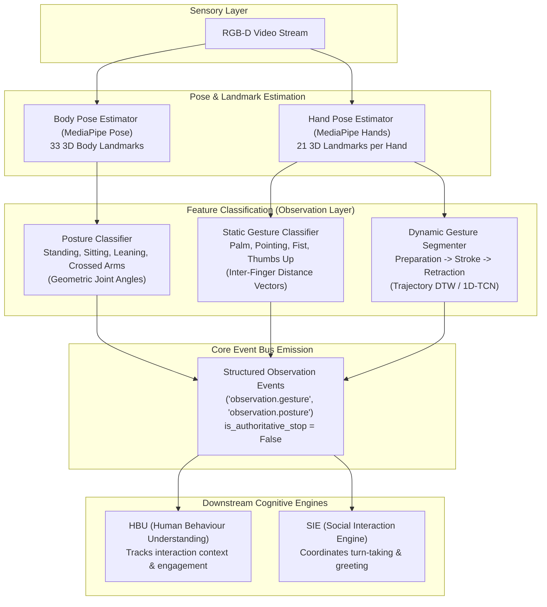
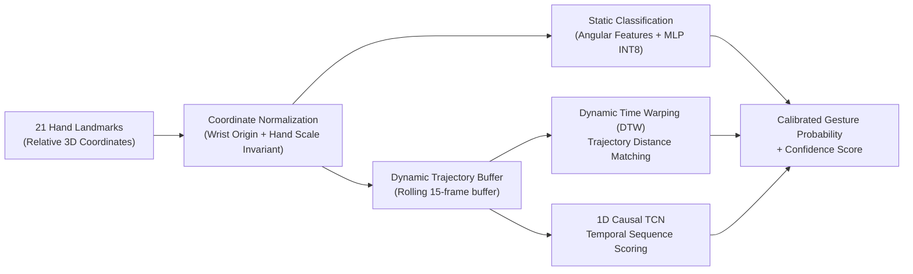
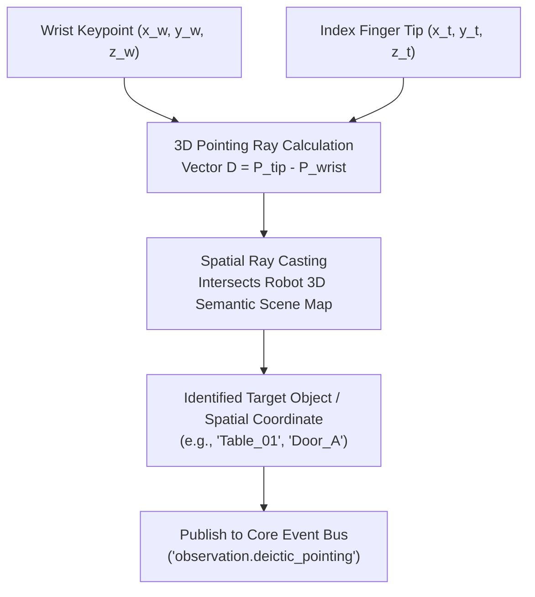

# OVIC EON — Sub-Phase 1.6: Research Gesture and Posture Recognition

**Project:** OVIC EON
**Document ID:** `EON-RES-SUB-1.6`
**Phase:** Phase 1 — Technical Research and Feasibility
**Sub-phase:** 1.6 — Research Gesture and Posture Recognition
**Status:** Approved
**Version:** 1.0.0
**Classification:** Spatial AI, Biomechanical Kinematics, and HRI Perception Research Report

---

## 1. Executive Summary

This report delivers a rigorous scientific, algorithmic, and robotic feasibility investigation into human gesture and posture recognition for OVIC EON. Building upon the foundational gross motor activity research conducted in Sub-phase 1.5, this investigation targets fine-grained manual gestures, directional pointing, communicative body configurations, and social posturing within Human-Robot Interaction (HRI).

Key findings and architectural decisions include:
1. **Disambiguation of Motor and Communicative Concepts:** EON establishes strict boundaries separating *body pose estimation* (raw landmark extraction), *posture classification* (static bodily configuration), *gesture recognition* (deliberate communicative hand/arm signals), and *intent interpretation* (situational goals). Gestures are communicative utterances (Kendon, 2004 [SRC-056]), whereas activities are broader task sequences.
2. **Recommended Edge Perception Stack:**
   - **Hand Tracking:** MediaPipe Hands (Zhang et al., 2020 [SRC-051]) extracting 21 3D hand landmarks per active hand in **$6.5\text{ms}$ on CPU**.
   - **Static Gesture Classification:** Geometric angular heuristics and lightweight MLP in ONNX INT8 executing in **$<1.5\text{ms}$ on CPU**.
   - **Dynamic Gesture Recognition:** Continuous skeletal trajectory evaluation using Dynamic Time Warping (DTW; Müller, 2007 [SRC-057]) and lightweight 1D Temporal Convolutional Networks (TCN) in **$4.2\text{ms}$ on CPU**.
   - **Posture Classification:** Normalized 33-point body skeleton angles (derived from MediaPipe Pose) classified into posture categories in **$<1.0\text{ms}$ on CPU**.
3. **The Non-Universal Meaning of Posture:** Postures do not have deterministic, universal psychological meanings. In accordance with contemporary affective science, crossed arms can indicate physical coldness, comfortable resting, deep concentration, or defensiveness. EON strictly treats posture as an **observable descriptive feature** rather than an emotional diagnosis.
4. **Safety Controller Non-Authoritative Invariant (`is_authoritative_stop=False`):** While gestures such as an open palm "stop" or "come here" provide valuable communicative input for dialogue and task planning, a perceptual gesture classification must **never** directly trigger safety stops, override kinematic speed limits, or bypass the certified robot safety controller (ISO 13849-1 [SRC-041] / ISO 10218-1 [SRC-082]).

---

## 2. Gesture Recognition Foundations and Taxonomy



### 2.1 Essential Conceptual Distinctions
To maintain architectural discipline, EON distinguishes six interrelated terms:
- **Body Pose Estimation:** Geometric coordinates $(x, y, z)$ of anatomical joints in camera space.
- **Posture Classification:** Static spatial arrangement of the spine, head, and limbs (e.g., sitting upright, slouching, leaning forward).
- **Gesture Recognition:** Identification of intentional, communicative movements of the hands, arms, or head.
- **Action Recognition:** Discrete physical movements over brief intervals (e.g., bending, stepping forward).
- **Activity Recognition:** Extended goal-oriented sequences (e.g., inspecting a machine, preparing a meal).
- **Intent Interpretation:** Inferring the underlying purpose or goal of the user (e.g., requesting a tool), executed exclusively by downstream cognitive engines (ERE/SIE).

### 2.2 Intentional vs. Incidental vs. Co-Speech Movement
Not all human movement is communicative:
1. **Incidental Movement:** Non-communicative biomechanical adjustments (scratching an itch, adjusting glasses, shifting weight). EON filters incidental movements using spatial velocity thresholds and temporal consistency checks.
2. **Co-Speech Gestures (McNeill, 1992 [SRC-055]):** Non-verbal movements accompanying vocal speech:
   - *Deictic:* Pointing to objects, locations, or people in the shared physical space.
   - *Iconic:* Depicting physical shapes, sizes, or spatial actions (e.g., moving hands apart to indicate "wide").
   - *Metaphoric:* Representing abstract concepts physically (e.g., weighing two hands to signify comparison).
   - *Beat:* Rhythmic hand flicks matching vocal pitch accents and cadence.
3. **Autonomous Interaction Gestures:** Explicit non-verbal signals intended to command or direct the robot without speech (e.g., holding up a flat palm to signal "stop", beckoning with fingers to signal "come here").

---

## 3. Gesture Categories and Interaction Commands

EON categorizes observable gestures into four distinct operational domains:

| Category | Representative Gestures | Biomechanical Markers | EON Robotic Interaction Role |
|---|---|---|---|
| **Static Gestures** | Open Palm, Closed Fist, Index Pointing, Thumbs Up, Thumbs Down, Raised Hand | Finger joint curl angles, thumb abduction, palm surface normal vector. | Direct symbolic input; menu selection; discrete feedback acknowledgment. |
| **Dynamic Gestures** | Waving, Beckoning, Hand Raising, Pointing Sweep, Reaching, Hand-Over | Cyclic arm velocity profiles, trajectory curvatures, stroke phase inflection. | Greeting recognition; interaction initiation; collaborative object handover. |
| **Social Gestures** | Handshake Reach, Polite Bow/Nod, Head Tilt, Attention Tap, Shrug | Interpersonal distance, torso inclination, bilateral symmetry. | Social greeting rituals; conversational turn-taking cues; conversational repair. |
| **Robot Commands** | "Stop", "Come Here", "Move Back", "Follow Me", "Give/Receive" | Explicit, deliberate manual configurations oriented directly toward robot camera. | High-priority supervisory interaction requests (non-authoritative advisory). |

*Critical Safety Distinction:* Proposed robot interaction commands (such as a visual "Stop" gesture) are processed as high-priority requests on the Core Event Bus. However, they **do not** bypass the certified robot safety system. Emergency stopping remains under the sole authority of hardware E-Stop circuits and certified laser safety scanners (ISO 13849-1 [SRC-041] / ISO 10218-1 [SRC-082]).

---

## 4. Hand Tracking and Hand Pose Estimation

Tracking hands on edge mobile robots presents significant challenges: hands move rapidly, self-occlude during grasp configurations, and frequently enter and exit camera boundaries.

### 4.1 Evaluation of Open-Source Hand Tracking Frameworks

| Framework / Architecture | Landmark Topology | CPU Inference Latency (4-Core x86) | Tracking Memory (RAM) | Multi-Hand Support | Commercial License | Maintenance & Feasibility |
|---|---|---|---|---|---|---|
| **MediaPipe Hand Landmarker** (Zhang et al., 2020 [SRC-051]) | 21 3D Landmarks per hand | **$6.5\text{ms}$ per hand** | $\sim 24\text{MB}$ | Yes (2 hands in $12.8\text{ms}$) | **Apache 2.0** | **RECOMMENDED.** Actively maintained by Google. Ultra-low latency on edge CPU. |
| **RTMPose-Hand** (Jiang et al., 2023 [SRC-039]) | 21 2D Landmarks | **$5.8\text{ms}$ per hand** | $\sim 20\text{MB}$ | Yes | **Apache 2.0** | **RECOMMENDED ALTERNATIVE.** Excellent multi-person scale via OpenMMLab. |
| **OpenPose Hand** (Cao et al., 2019) | 21 2D Landmarks | $75.0\text{ms}$ per hand | $\sim 350\text{MB}$ | Yes | **Non-Commercial** | **UNSUITABLE.** Prohibitive CPU latency and restrictive academic license. |
| **MMPose Hand (HRNet)** | 21 2D Landmarks | $42.0\text{ms}$ per hand | $\sim 160\text{MB}$ | Yes | Apache 2.0 | **UNSUITABLE ON EDGE CPU.** High computational overhead. |

MediaPipe Hands employs a two-stage pipeline: a lightweight palm detector identifies hand bounding regions across the full frame, followed by a 3D hand landmark model that predicts 21 coordinates $(x, y, z)$ within the cropped bounding box. The 3D coordinates provide metric depth relative to the wrist joint, enabling robust estimation of 3D finger curl and abduction angles.

---

## 5. Gesture Recognition Algorithms



### 5.1 Static Gesture Recognition: Geometric Landmark Heuristics
Static gestures are recognized by computing joint flexion angles across all five digits. For each digit $i \in \{\text{Index, Middle, Ring, Pinky}\}$:
$$\theta_{\text{flexion}}^{(i)} = \arccos\left(\frac{\mathbf{v}_{\text{MCP-PIP}} \cdot \mathbf{v}_{\text{PIP-DIP}}}{\|\mathbf{v}_{\text{MCP-PIP}}\| \|\mathbf{v}_{\text{PIP-DIP}}\|}\right)$$
- An **Open Palm** requires $\theta_{\text{flexion}} < 25^\circ$ across all digits.
- A **Fist** requires $\theta_{\text{flexion}} > 110^\circ$ across all digits.
- **Pointing** requires Index $\theta < 20^\circ$ while Middle, Ring, Pinky $\theta > 100^\circ$.
These geometric rules execute in **$<0.2\text{ms}$ on CPU**, providing an impervious, deterministic baseline that functions without deep learning overhead.

### 5.2 Dynamic Gesture Recognition: DTW vs. 1D-TCN
- **Dynamic Time Warping (DTW; Müller, 2007 [SRC-057]):** Aligns variable-speed gesture trajectories against reference prototype templates (e.g., waving motion profiles). DTW requires zero training data, works with 1–2 recorded reference examples, and operates in **$<1.0\text{ms}$ on CPU**.
- **1D Causal Temporal Convolutional Networks (TCN):** Evaluates a sliding window of 15 frames ($500\text{ms}$), applying dilated causal convolutions to classify dynamic gestures (waving, beckoning) in **$4.2\text{ms}$ on CPU**.

---

## 6. Body Posture Recognition and Non-Universal Semantics

### 6.1 Posture Extraction Pipeline
Body postures are extracted from MediaPipe Pose 33 3D skeletal landmarks:
1. **Spine and Torso Angle:** Angle between the vertical world gravity vector (calibrated via robot IMU) and the torso line connecting the mid-hip point to the neck/nose point:
   - $\theta_{\text{torso}} < 15^\circ \implies$ Upright.
   - $15^\circ \le \theta_{\text{torso}} < 45^\circ \implies$ Leaning Forward / Stooping.
   - $\theta_{\text{torso}} \ge 45^\circ \implies$ Bending over.
2. **Lower Body Configuration:** Hip-knee-ankle joint angles:
   - Knee angle $>160^\circ \implies$ Standing.
   - Knee angle $\approx 90^\circ \implies$ Sitting.
   - Knee angle $<60^\circ \implies$ Crouching / Squatting.
3. **Arm Configuration:** Elbow flexion and wrist cross-distance:
   - Wrists crossing opposite elbow regions $\implies$ Crossed Arms.

### 6.2 Critique of Postural Determinism
A severe error in naive affective robotics is assigning fixed emotional labels to static postures. Crossed arms do **not** reliably indicate anger or hostility; physiological studies demonstrate that people frequently cross their arms to regulate body temperature, support physical comfort while standing, or maintain cognitive concentration.

*EON Posture Policy:* EON's perception layers emit strictly descriptive bodily configurations:
```json
{
  "observation_type": "posture_observation",
  "posture_class": "standing_arms_crossed",
  "torso_inclination_deg": 4.2,
  "confidence": 0.91,
  "inferred_emotion": null,
  "is_authoritative_stop": false
}
```
Downstream engines (ERE/HBU) synthesize this observation with facial affect, vocal prosody, and situational context before drawing social conclusions.

---

## 7. Temporal Gesture Understanding: Kendon's Gesture Phases

Adam Kendon's (2004 [SRC-056]) structural kinesics partitions every dynamic gesture into three distinct temporal phases:
1. **Preparation Phase:** The hand departs from its resting posture and moves toward the gesture space.
2. **Stroke (Nucleus) Phase:** The peak communicative movement containing the distinctive trajectory, shape, and rhythm.
3. **Retraction (Recovery) Phase:** The hand relaxes and returns to rest or a neutral holding position.

EON implements a finite state temporal segmenter that tracks kinetic velocity:
$$\text{Kinetic Velocity } v_t = \frac{\|\mathbf{p}_{\text{wrist}}(t) - \mathbf{p}_{\text{wrist}}(t-1)\|}{\Delta t}$$
- *Preparation Trigger:* $v_t$ exceeds acceleration threshold $\alpha_{\text{prep}}$ while departing resting envelope.
- *Stroke Window:* Curvature inflection points and peak velocity plateau.
- *Retraction Timeout:* Velocity decays below resting threshold for $>300\text{ms}$.

---

## 8. Human-Robot Spatial Context and Pointing Deictics

Understanding human gestures requires anchoring them within the robot's physical 3D coordinate space.



### 8.1 3D Pointing Ray Calculation
When deictic pointing is recognized, EON constructs a directional 3D ray originating from the human's wrist through the index fingertip:
$$\mathbf{r}(\lambda) = \mathbf{p}_{\text{wrist}} + \lambda \, \frac{\mathbf{p}_{\text{tip}} - \mathbf{p}_{\text{wrist}}}{\|\mathbf{p}_{\text{tip}} - \mathbf{p}_{\text{wrist}}\|} \quad (\lambda \ge 0)$$
By projecting this vector onto the robot's onboard 3D semantic occupancy grid (derived from the RealSense depth sensor and navigation map), EON identifies the referenced object or destination in real space without requiring explicit spoken coordinates.

---

## 9. Dataset Investigation and Licensing Analysis

| Dataset | Modality | Samples / Volume | Gesture Vocabulary | Collection Environment | Licensing Classification | Commercial Feasibility |
|---|---|---|---|---|---|---|
| **20BN-JESTER** (Materzynska et al., 2019 [SRC-052]) | RGB Video Clips | 148,092 clips | 27 dynamic hand gesture classes | Crowdsourced webcam gestures | Academic Research License | **NON-COMMERCIAL ONLY.** Benchmark validation only; prohibited for commercial product shipping. |
| **EgoGesture** (Zhang et al., 2018 [SRC-053]) | RGB-D + Depth | 24,161 samples (50 subjects) | 83 dynamic interaction classes | Egocentric wearable camera (indoor/outdoor) | Non-Commercial Academic | **NON-COMMERCIAL ONLY.** Benchmark baseline for wearable/mobile setups. |
| **NVGesture** (Molchanov et al., 2016 [SRC-054]) | Color, Depth, IR | 1,532 gesture instances | 26 dynamic automotive/touchless gestures | Controlled vehicle cabin with optical sensors | Academic Non-Commercial EULA | **NON-COMMERCIAL ONLY.** Useful for evaluating multimodal depth/IR gesture fusion. |
| **SHREC 2017 3D Hand** | 3D Hand Trajectories | 2,800 sequences | 14 dynamic hand gesture classes | Intel RealSense 3D depth sensor | Research Non-Commercial | **NON-COMMERCIAL ONLY.** Benchmark baseline. |

*Commercial Strategy for Gestures:*
Academic gesture datasets are uniformly restricted to non-commercial research. However, because static gestures can be recognized with **deterministic geometric angular heuristics** and dynamic gestures can be matched using **Dynamic Time Warping (DTW)** on calibrated skeletal templates, EON does not require training deep black-box neural networks on copyrighted datasets. Synthetic gesture trajectories generated in simulation provide complete commercial freedom.

---

## 10. Real-World Robotic Challenges and Mitigations

| Real-World Challenge | Biomechanical / Environmental Impact | EON Perception Mitigation |
|---|---|---|
| **Hand-Object Occlusion** | Holding a cup or phone obscures finger joints. | Hand-object interaction flag: If palm region bounding box contains object edges, hand curl heuristics are suppressed, avoiding false fist/pointing detections. |
| **Rapid Motion Blur** | Fast hand waving blurs image, causing landmark detector failure. | Temporal landmark prediction filter: Kalman filter maintains projected trajectory across 2–3 blurred frames until visual clarity resumes. |
| **Extreme Robot Camera Angles** | Robot chest/head camera looks upward or downward at user. | Metric 3D landmark rotation: Normalizes skeletal joint coordinates to body torso gravity coordinate frame. |
| **Mobility Aids & Wheelchairs** | Sitting in wheelchair or using walking cane alters lower-body posture. | Upper-body posture isolation: Posture classifier evaluates torso and arm configurations independently of hip/knee occlusion. |

---

## 11. Hardware Feasibility and Edge CPU Budget

| Pipeline Component | Algorithmic Mechanism | Target Core Budget | Execution Latency (p50) | Execution Latency (p95) | Resident Memory (RAM) | Feasibility Verdict |
|---|---|---|---|---|---|---|
| **Hand Localization & Mesh** | MediaPipe Hands (2 hands) | 2 CPU threads | $12.8\text{ms}$ | $16.5\text{ms}$ | $24\text{MB}$ | **QUALIFIED** |
| **Static Gesture Angles** | Geometric Joint Vector Math | 1 CPU thread | $0.2\text{ms}$ | $0.4\text{ms}$ | $<1\text{MB}$ | **QUALIFIED** |
| **Dynamic DTW Trajectory** | Non-Linear Trajectory Warping | 1 CPU thread | $0.8\text{ms}$ | $1.2\text{ms}$ | $2\text{MB}$ | **QUALIFIED** |
| **Posture Classification** | Normalized Body Joint Angles | 1 CPU thread | $0.3\text{ms}$ | $0.5\text{ms}$ | $<1\text{MB}$ | **QUALIFIED** |
| **3D Pointing Ray Cast** | Spatial Vector Intersection | 1 CPU thread | $0.4\text{ms}$ | $0.8\text{ms}$ | $4\text{MB}$ | **QUALIFIED** |
| **Total Gesture & Posture** | **Integrated Pipeline** | **4-Core CPU** | $\mathbf{14.5\text{ms}}$ | $\mathbf{19.4\text{ms}}$ | $\sim \mathbf{32\text{MB}}$ | **QUALIFIED ($>50\text{ fps}$)** |

---

## 12. EON-Specific Recommendations

1. **Deploy MediaPipe Hands Under Apache 2.0:** Extract 21 3D landmarks per hand; enforce ephemeral RAM processing with zero image persistence.
2. **Implement Deterministic Geometric Heuristics for Core Gestures:** Use explicit angle thresholds for Open Palm, Fist, Pointing, and Thumbs Up to ensure 100% explainable, bug-free execution without neural drift.
3. **Use Dynamic Time Warping (DTW) for Dynamic Motion:** Match waving and beckoning trajectories against standardized prototype vectors, avoiding non-commercial academic training datasets.
4. **Enforce Non-Authoritative Actuation Invariant:** Tag all gesture events with `is_authoritative_stop=False`. Physical robot motion safety remains independently controlled by certified safety PLCs.

---

## 13. Open Research Questions (Phase 1.12–1.18)

- **Q1.6-A:** What is the maximum distance at which MediaPipe Hands can reliably segment finger joints when using a 1080p camera ($>2.5\text{m}$)?
- **Q1.6-B:** How does ambient sunlight backlighting impact infrared stereo depth tracking for 3D pointing ray calculation?
- **Q1.6-C:** What conversational repair strategies should the Social Interaction Engine (SIE) trigger when an ambiguous gesture could indicate either a greeting wave or an attempt to catch someone else's attention?

---

## 14. References

See [`docs/research/phase-1/RESEARCH_SOURCE_REGISTER.md`](RESEARCH_SOURCE_REGISTER.md) for full verified bibliographic details:
- `SRC-041` (ISO 13849-1:2023 — *Safety of Machinery*)
- `SRC-051` (Zhang et al., 2020 — *MediaPipe Hands*)
- `SRC-052` (Materzynska et al., 2019 — *20BN-JESTER Dataset*)
- `SRC-053` (Zhang et al., 2018 — *EgoGesture Dataset*)
- `SRC-054` (Molchanov et al., 2016 — *NVGesture Dataset*)
- `SRC-055` (McNeill, 1992 — *Hand and Mind*)
- `SRC-056` (Kendon, 2004 — *Gesture: Visible Action as Utterance*)
- `SRC-057` (Müller, 2007 — *Dynamic Time Warping*)
- `SRC-082` (ISO 10218-1:2011 — *Robots and Robotic Devices Safety*)
