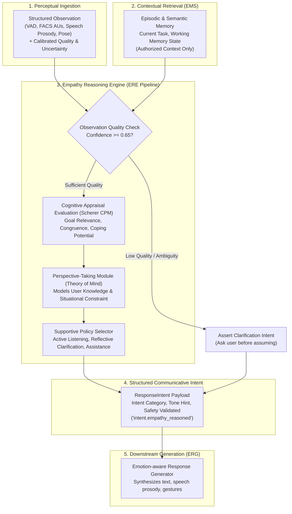
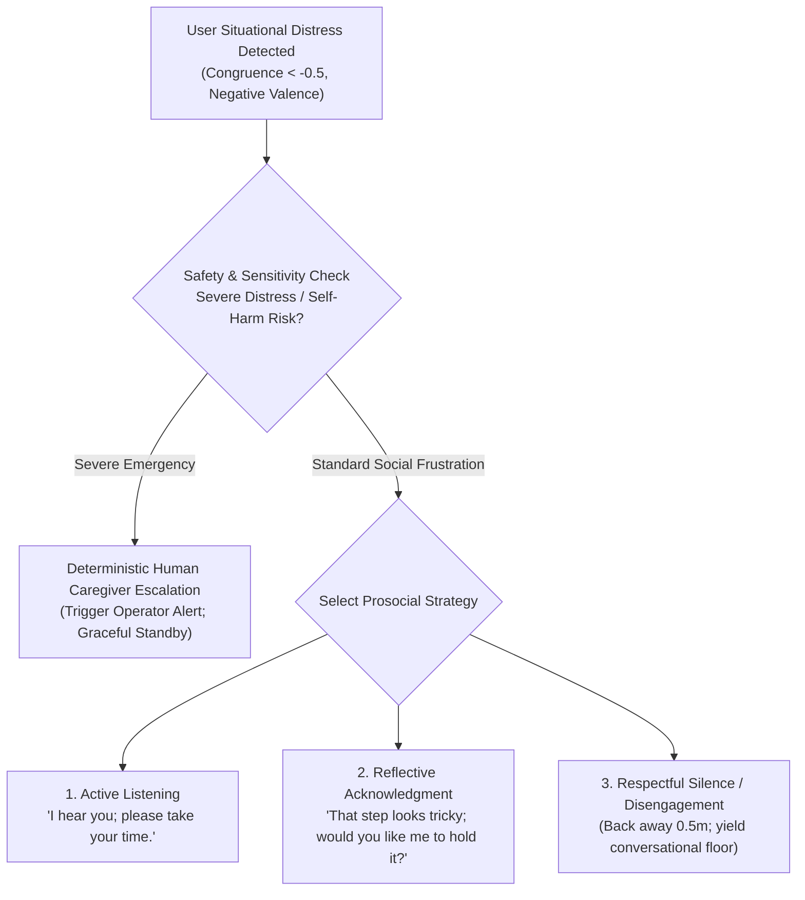
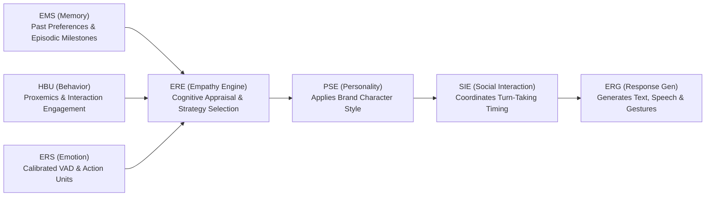

# OVIC EON — Sub-Phase 1.8: Research Empathy Reasoning Approaches

**Project:** OVIC EON
**Document ID:** `EON-RES-SUB-1.8`
**Phase:** Phase 1 — Technical Research and Feasibility
**Sub-phase:** 1.8 — Research Empathy Reasoning Approaches
**Status:** Approved
**Version:** 1.0.0
**Classification:** Cognitive Architecture, Social Robotics, and Applied Ethics Research Report

---

## 1. Executive Summary

This report delivers a rigorous scientific, cognitive, and ethical investigation into empathy reasoning approaches for OVIC EON's **Empathy Reasoning Engine (ERE)**. In human-robot interaction, "empathy" is frequently misunderstood as simulating human emotional suffering or fabricating false consciousness. Such approaches are unscientific, ethically deceptive, and dangerous in mission-critical robotics.

Key findings and architectural decisions include:
1. **The Epistemological Non-Deception Boundary:** EON strictly enforces **Cognitive and Compassionate Empathy** (understanding a situation and selecting helpful actions) while explicitly rejecting synthetic "Affective Empathy" (claiming to feel a user's pain). A robot has no biological nervous system, somatic sensations, or conscious suffering. EON must never claim to experience human feelings (Paiva et al., 2017 [SRC-070]; Asada, 2015 [SRC-071]).
2. **The 5-Level Functional Separation:** EON establishes strict modular decoupling between:
   - *Level 1 (Observation):* Detecting an acoustic or visual cue (e.g., elevated vocal pitch, furrowed brow).
   - *Level 2 (Inference):* Classifying probable distress with explicit uncertainty.
   - *Level 3 (Contextualization):* Evaluating situational appraisals (e.g., task failure, time pressure).
   - *Level 4 (Policy Action Selection):* Choosing a supportive communicative strategy (e.g., active listening, clarifying before acting).
   - *Level 5 (Deceptive Anthropomorphism):* Claiming subjective emotional experience (**STRICTLY PROHIBITED**).
3. **Appraisal-Based Cognitive Reasoning (Scherer CPM [SRC-069]):** Instead of black-box neural generation, ERE implements computational appraisal checks evaluating **Goal Relevance**, **Goal Congruence**, and **Coping Potential**. When task progress is obstructed and user coping potential is low, ERE triggers helpful, non-intrusive support policies.
4. **Clarification Over Presumption:** When emotional observations are ambiguous or multimodal channels conflict, ERE mandates asking respectful, low-friction clarification questions rather than making speculative psychological assumptions.
5. **Vulnerable User Protections and Human Escalation:** EON explicitly prohibits medical or psychological diagnosis. For users in severe acute distress, ERE triggers deterministic graceful disengagement and human caregiver escalation protocols.

---

## 2. Empathy Foundations in Cognitive Science and Robotics

### 2.1 Deconstructing Empathy: Decety, Batson, and Baron-Cohen
Psychological and neurocognitive literature establishes that empathy is not a monolithic construct, but comprises three distinct components:
- **Cognitive Empathy (Theory of Mind; Baron-Cohen, 1995 [SRC-066]):** The capacity to construct a mental model of another agent's perspective, desires, and beliefs (e.g., understanding that a worker is frustrated because a robotic tool jammed).
- **Affective Empathy (Emotional Contagion):** The biological mirroring of emotional states mediated by mirror neurons and autonomic nervous coupling. **EON does not implement affective empathy.**
- **Compassionate Empathy (Empathic Concern; Batson, 2009 [SRC-068]):** The prosocial motivation to provide practical assistance and communicative support to alleviate another's situational difficulty.

### 2.2 The Five Levels of Computational Empathy in EON

| Level | Functional Definition | System Implementation in EON | Ethical & Safety Status |
|---|---|---|---|
| **Level 1: Observable Cue** | Measuring physical sensor changes. | Pitch rise ($F_0$), frowning (AU4), tense posture. | Objective, scientific, verified. |
| **Level 2: Affective Inference** | Probabilistic classification of distress. | Continuous VAD coordinate regression with uncertainty metadata. | Probabilistic, non-diagnostic. |
| **Level 3: Contextual Appraisal** | Modeling user situational state. | Evaluating task deadline, obstacle presence, prior session memory. | Deterministic cognitive appraisal. |
| **Level 4: Supportive Action** | Selecting appropriate helpful behavior. | Active listening, offering help, slowing down robot speed. | **Core ERE Capability (Safe).** |
| **Level 5: False Feeling** | Claiming subjective emotional experience. | *"I feel so sad for you; my heart is breaking."* | **STRICTLY PROHIBITED (Deceptive).** |

---

## 3. Cognitive Emotion Appraisal (Scherer's CPM)

Klaus R. Scherer's Component Process Model (2001 [SRC-069]) provides the ideal mathematical and conceptual foundation for computational empathy without anthropomorphism. ERE evaluates four sequential appraisal checks:

| Appraisal Dimension | Computational Formulation in ERE | Illustrative Contextual Input | Robotic Empathy Reasoning Outcome |
|---|---|---|---|
| **1. Relevance Check** | $\text{Rel} = w_1 \cdot \Delta_{\text{env}} + w_2 \cdot P(\text{user\_target})$ | User drops a component on the floor. | High relevance: Event directly impacts shared workspace. |
| **2. Goal Congruence** | $\text{Cong} \in [-1.0, +1.0]$ | Assembly task fails validation inspection. | High incongruence ($\text{Cong} = -0.85$): User goal is obstructed. |
| **3. Coping Potential** | $\text{Cope} = \frac{\text{UserControlScore}}{\text{TaskComplexity}}$ | Tool requires two hands; user has one hand occupied. | Low coping potential ($\text{Cope} = 0.2$): User needs physical assistance. |
| **4. Responsibility Attribution** | Agent classification: $\text{Self}, \, \text{Other}, \, \text{External}$ | Robot arm moved too quickly, causing spill. | Self-attribution: Robot acknowledges its own role; issues polite apology. |

When $\text{Cong} < -0.5$ and $\text{Cope} < 0.4$, ERE's decision policy generates a supportive intervention intent (`"offer_assistance"` or `"acknowledge_difficulty"`).

---

## 4. Perspective-Taking (Theory of Mind)

Theory of Mind (ToM; Baron-Cohen, 1995 [SRC-066]) allows an agent to maintain distinct belief representations for itself versus the human user.

### 4.1 Resolving Perceptual Asymmetries
In robotics, perceptual asymmetries are ubiquitous:
- *Robot Knowledge:* Robot lidar detects that the battery door is unlatched behind the machine.
- *User Belief:* User cannot see the battery door from their physical position and assumes the machine is ready.
- *Naive Response:* The robot attempts to run the task, failing or halting abruptly.
- *ToM Perspective-Taking:* ERE models the user's field-of-view; recognizes the user's false belief; formulates a polite, explanatory clarification: *"Before we begin, please note the rear battery door is open."*

---

## 5. Supportive Response Strategies and Anti-Manipulation Guardrails

### 5.1 The Canon of Supportive Behaviors
1. **Active Listening:** Acknowledging user statements without immediately interrupting with unsolicited solutions.
2. **Permission-Seeking Before Action:** A robot must **never** wrest physical control of an object from a frustrated user. The robot must ask: *"Would you like me to hold this bracket for you?"*
3. **Respecting Silence:** High arousal paired with silence often signals intense focus or rising irritation. ERE implements a conversational backoff policy, suppressing non-essential chatter.
4. **Appropriate Disengagement:** If the user displays avoidance cues (averted gaze, turning away, stepping back), ERE immediately yields social space rather than persistently pursuing interaction.

### 5.2 Prohibition of Emotional Manipulation
Robots must not exploit emotional vulnerability for commercial gain:
- Prohibited: Using guilt, simulated sadness, or affective pleading to encourage product purchases, service renewals, or extended engagement.
- Prohibited: Feigning loneliness or attachment to manipulate elderly users or children.

---

## 6. Comparison of Empathy Reasoning Architectures

| Architecture | Reasoning Paradigm | Execution Latency (CPU) | Determinism & Auditability | Edge Memory Overhead | Licensing | EON Feasibility Assessment |
|---|---|---|---|---|---|---|
| **Deterministic Decision Trees / FSM** | Explicit if-then rules on appraisal checks | **$<0.5\text{ms}$** | **100% Deterministic** (Full rule audit) | $<2\text{MB}$ RAM | Permissive Code | **RECOMMENDED DETERMINISTIC SAFETY BACKBONE** |
| **Bayesian Decision Networks** | Probabilistic graphical belief networks | **$1.8\text{ms}$** | High (Mathematical probability graphs) | $\sim 5\text{MB}$ RAM | Permissive Code | **RECOMMENDED FOR INTENT UNCERTAINTY** |
| **Knowledge-Graph Common Sense (SenticNet)** | Symbolic affective graph traversal | $12.0\text{ms}$ | High | $\sim 45\text{MB}$ RAM | Non-commercial academic | **RESERVED FOR RESEARCH BENCHMARKING** |
| **Fine-Tuned Generative SLM (e.g., Qwen2.5-1.5B)** | End-to-end prompt-based empathy generation | $85.0\text{ms}\text{--}150.0\text{ms}$ | Low (Stochastic tokens, hallucination risk) | $\sim 1.2\text{GB}$ RAM | Apache 2.0 | **RECOMMENDED AS POLICY-CONSTRAINED ADVISOR ONLY** |

*EON Hybrid Decision:* ERE employs a **Hybrid Policy Engine**:
- Fast Bayesian networks evaluate observation uncertainty.
- Deterministic policy rules enforce safety corridors, human escalation, and permission-seeking.
- When conversational flexibility is required, a local quantized SLM is constrained via grammar templates (Outlines / Guidance [SRC-094, SRC-095]) to adhere strictly to the selected empathy intent.

---

## 7. Vulnerable User Protections and Regulatory Compliance

| User Demography | Specific Vulnerability | EON Architectural Guardrail |
|---|---|---|
| **Children** | Highly susceptible to anthropomorphic deception; may believe robot is a living friend. | Transparency enforcement: Robot periodically reinforces its identity as a machine helper; never encourages secrets from parents. |
| **Elderly / Dementia** | Emotional attachment; confusion regarding robot capabilities and autonomy. | Predictable, calm pacing; repeated clear self-identification; zero medical advice claims. |
| **Acute Human Distress** | Panic attacks, extreme anger, or expressions of self-harm. | Immediate human escalation protocol: System flags emergency event and notifies human operators. |
| **Users with Speech / Motor Differences** | Non-standard prosody or atypical facial musculature. | Adaptive baseline calibration; suppress premature emotion labels; prioritize direct explicit choices. |

---

## 8. ERE Integration with Other EON Intelligence Engines

1. **Input from ERS & HBU:** ERE receives structured `ObservationPayload` envelopes containing continuous VAD, Action Units, and proxemic engagement scores.
2. **Context from EMS:** ERE queries episodic memory to check if the user previously expressed specific preferences (e.g., preferring quiet environments).
3. **Intent Emission to PSE & SIE:** ERE outputs an abstract `ResponseIntent` (e.g., `intent: "active_listening_acknowledgment"`, `strategy: "supportive_permission"`).
4. **Execution by ERG:** ERG realizes this intent into surface text, expressive prosody, and synchronized head tilts.

---

## 9. EON-Specific Recommendations

1. **Adopt Cognitive and Compassionate Empathy Exclusively:** Prohibit simulated emotional suffering or claims of biological feelings.
2. **Implement Scherer CPM as Computational Backbone:** Evaluate Goal Relevance, Congruence, and Coping Potential deterministically.
3. **Mandate Clarification Over Assumption:** If multimodal signals diverge or confidence is below $0.65$, ask a respectful question rather than guessing.
4. **Isolate Actuation from Empathy Reasoning:** Empathy outputs are non-authoritative recommendations (`is_authoritative_stop=False`). Physical robot motion safety remains independently controlled by certified safety controllers.

---

## 10. Open Research Questions (Phase 1.12–1.18)

- **Q1.8-A:** How should ERE mathematically balance conflicting situational goals (e.g., completing an industrial shift on time versus pausing to comfort an overwhelmed worker)?
- **Q1.8-B:** What prompt-framing architectures best prevent local SLMs from slipping into manipulative emotional language during supportive dialogue?
- **Q1.8-C:** How can human evaluation benchmarks reliably measure user perceived respectfulness without relying on subjective likert surveys alone?

---

## 11. References

See [`docs/research/phase-1/RESEARCH_SOURCE_REGISTER.md`](RESEARCH_SOURCE_REGISTER.md) for full verified bibliographic details:
- `SRC-066` (Baron-Cohen, 1995 — *Mindblindness: An Essay on Theory of Mind*)
- `SRC-067` (Decety & Jackson, 2004 — *Functional Architecture of Human Empathy*)
- `SRC-068` (Batson, 2009 — *These Things Called Empathy*)
- `SRC-069` (Scherer, 2001 — *Appraisal Processes in Emotion*)
- `SRC-070` (Paiva et al., 2017 — *Empathy in Virtual Agents and Robots*)
- `SRC-071` (Asada, 2015 — *Towards Artificial Empathy*)
- `SRC-094` (Microsoft, 2024 — *Guidance Constrained Decoding*)
- `SRC-095` (Normal Computing, 2024 — *Outlines Structured Generation*)
- `SRC-098` (Cambria et al., 2020 — *SenticNet 6*)
- `SRC-099` (High-Level Expert Group, 2019 — *Ethics Guidelines for Trustworthy AI*)
