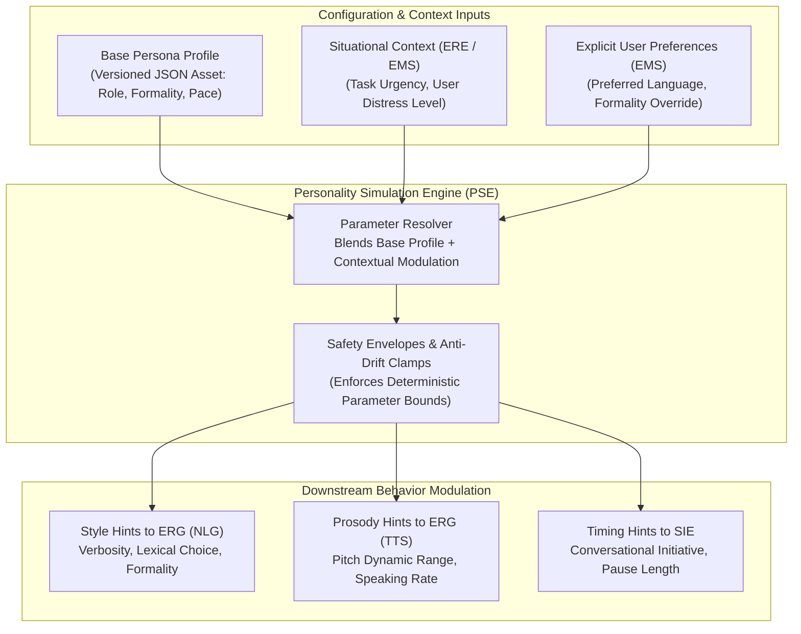
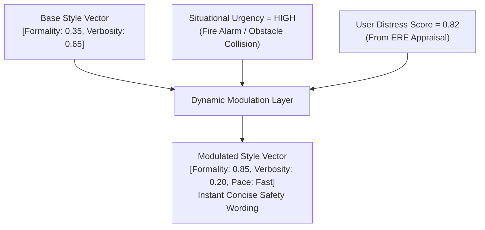
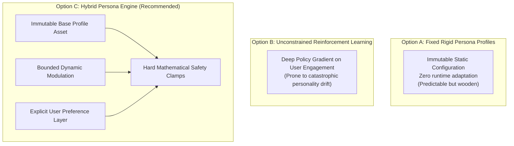

# OVIC EON — Sub-Phase 1.9: Research Personality Modelling

**Project:** OVIC EON
**Document ID:** `EON-RES-SUB-1.9`
**Phase:** Phase 1 — Technical Research and Feasibility
**Sub-phase:** 1.9 — Research Personality Modelling
**Status:** Approved
**Version:** 1.0.0
**Classification:** Computational Social Science, HRI Persona Design, and Behavioral Systems Research Report

---

## 1. Executive Summary

This report delivers a thorough scientific, computational, and architectural investigation into personality modelling for OVIC EON's **Personality Simulation Engine (PSE)**. Human beings instinctively attribute personality, intentions, and social traits to interactive machines (Computers as Social Actors paradigm; Nass & Moon, 2000 [SRC-074]). A robot that displays erratic, unpredictable, or jarring changes in conversational tone erodes user trust and violates professional norms.

Key findings and architectural decisions include:
1. **Interaction Style vs. Psychological Diagnoses:** EON establishes an unyielding boundary: robot "personality" is strictly an **engineering configuration of interaction style parameters** (formality, verbosity, conversational initiative, prosodic modulation), never an autonomous psychological entity or a claim of artificial soul.
2. **Prohibition of Human Psychological Profiling:** EON categorically forbids inferring, categorizing, or persisting personality profiles of human users from physical sensor observations (facial expressions, vocal acoustic pitch, ethnicity, gender, or disability). Only **explicit, voluntary user-provided preferences** (e.g., preferred name, language, pacing) may be stored in semantic memory.
3. **Recommended Architecture — Option C (Hybrid Persona Engine):**
   - **Immutable Base Persona:** Versioned, manufacturer-defined role profiles (e.g., "Professional Industrial Assistant", "Calm Eldercare Companion", "Curious STEM Tutor").
   - **Context-Sensitive Style Modulation:** Dynamic adjustment of expressiveness and pace governed by current situational urgency and user arousal.
   - **User-Configured Overrides:** Explicit user controls (e.g., toggling between concise technical bullet points versus conversational warmth).
4. **Guaranteed Anti-Drift Architecture:** Free-form reinforcement learning on live conversational data is rejected due to risks of catastrophic personality drift, erratic behavior, and prompt injection vulnerabilities. EON enforces deterministic parameter clamps ensuring style values stay within strict safety envelopes.
5. **Safety Isolation Invariant:** Personality configurations govern surface wording, speech rate, and expressive head gestures, but have **zero authority** over robot physical motion safety limits, speed corridors, or emergency stops (`is_authoritative_stop=False`).

---

## 2. Personality Foundations in Psychology and HRI



### 2.1 Theoretical Frameworks: Big Five and HEXACO
Scientific personality psychology provides structured trait taxonomies:
- **The Five-Factor Model (FFM / OCEAN; Goldberg, 1990 [SRC-072]):**
  - *Openness to Experience:* Intellectual curiosity versus routine preference.
  - *Conscientiousness:* Organization, thoroughness, and discipline.
  - *Extraversion:* Sociability, assertiveness, and conversational energy.
  - *Agreeableness:* Warmth, cooperation, and empathy.
  - *Neuroticism:* Emotional instability versus calm resilience.
- **The HEXACO Model (Ashton & Lee, 2007 [SRC-073]):**
  - Expands FFM with **Honesty-Humility (H)**, capturing fairness, sincerity, and greed avoidance. For social robotics, maintaining maximal Honesty-Humility is an essential ethical guardrail against deceptive or manipulative behavior.

### 2.2 Psychological Reality in Human-Robot Interaction
Robert's (2018 [SRC-075]) meta-analysis in HRI revealed two competing paradigms:
1. **Similarity-Attraction Hypothesis:** Users generally prefer robots that reflect their own social style (e.g., introverted users prefer calm, reserved robots; extraverted users prefer enthusiastic robots).
2. **Complementarity Hypothesis:** In task-oriented domains, users prefer complementary traits (e.g., a dominant, anxious user frequently benefits from an exceptionally calm, agreeable, and reassuring robotic partner).
*EON Conclusion:* Because user preferences vary by context, EON must not guess or pigeonhole users, but provide **transparent, user-configurable interaction style settings**.

---

## 3. Computational Persona Configurations in EON

EON formalizes nine standardized, role-specific interaction personas:

| Persona Identifier | Role Archetype | Formality ($[0, 1]$) | Verbosity ($[0, 1]$) | Initiative ($[0, 1]$) | Characteristic Expression & Style | Target Robotics Domain |
|---|---|---|---|---|---|---|
| `eon_persona_professional` | Industrial Assistant | $0.85$ | $0.35$ | $0.40$ | Concise, precise terminology, zero colloquialisms, safety-first. | Industrial Cobots, Manufacturing |
| `eon_persona_calm` | Eldercare Companion | $0.50$ | $0.60$ | $0.30$ | Patient, gentle cadence, deliberate pauses, soothing prosody. | Eldercare, Healthcare, Rehabilitation |
| `eon_persona_supportive` | Service Concierge | $0.65$ | $0.55$ | $0.60$ | Affiliative, courteous, helpful, reassuring, solution-oriented. | Hospitality, Front Desk, Retail |
| `eon_persona_curious` | STEM Educational Tutor | $0.40$ | $0.70$ | $0.75$ | Inquisitive, enthusiastic questions, encouraging feedback. | Educational Humanoids, Museums |
| `eon_persona_reserved` | Laboratory Guide | $0.80$ | $0.30$ | $0.25$ | Quiet, understated, speaks only when addressed, task-focused. | Cleanrooms, High-Security Labs |
| `eon_persona_friendly` | Domestic Social Helper | $0.35$ | $0.65$ | $0.50$ | Warm, informal, light conversational tone, engaging gestures. | Domestic & Companion Robots |
| `eon_persona_formal` | Corporate Security / Audit | $0.95$ | $0.40$ | $0.50$ | Strictly protocol-driven, authoritative diction, zero humor. | Corporate Security, Access Control |
| `eon_persona_playful` | Entertainment / Theme Park | $0.20$ | $0.80$ | $0.85$ | Expressive head tilts, animated pitch swings, playful phrasing. | Theme Parks, Event Robots |
| `eon_persona_encouraging`| Therapy / Coaching | $0.45$ | $0.65$ | $0.70$ | Celebrates user progress, highlights milestones, optimistic. | Physical Therapy, Fitness Robots |

---

## 4. Parameterized Style Representation and Schema Specification

Rather than relying on vague natural language prompts, EON parameterizes personality into a strictly typed Pydantic v2 data contract:

### 4.1 Proposed Personality Configuration Schema

```json
{
  "persona_id": "eon_persona_calm_v1",
  "version": "1.0.0",
  "display_name": "Calm Companion",
  "description": "Patient, gentle, low-arousal interaction style for healthcare and eldercare.",
  "style_parameters": {
    "formality": {
      "base_value": 0.50,
      "min_clamp": 0.30,
      "max_clamp": 0.85
    },
    "verbosity": {
      "base_value": 0.60,
      "min_clamp": 0.20,
      "max_clamp": 0.80
    },
    "conversational_initiative": {
      "base_value": 0.30,
      "min_clamp": 0.10,
      "max_clamp": 0.60
    },
    "humor_frequency": {
      "base_value": 0.10,
      "min_clamp": 0.00,
      "max_clamp": 0.30
    },
    "empathy_phrasing_depth": {
      "base_value": 0.85,
      "min_clamp": 0.50,
      "max_clamp": 1.00
    }
  },
  "acoustic_parameters": {
    "pitch_mean_offset_semitones": -1.5,
    "pitch_dynamic_range_scalar": 0.80,
    "speaking_rate_wpm": 135,
    "inter_turn_pause_seconds": 1.2
  },
  "kinesic_parameters": {
    "gesture_frequency_scalar": 0.40,
    "head_nod_amplitude_scalar": 0.60,
    "proxemic_distance_preference_m": 1.40
  },
  "safety_invariants": {
    "is_authoritative_stop": false,
    "allow_unsolicited_touch": false,
    "prohibit_manipulative_affect": true
  }
}
```

---

## 5. Context-Sensitive Dynamic Modulation

Personality must not be rigidly wooden. In emergency or high-stress contexts, a "Playful" robot must instantly drop its playful banter and adopt clear, concise emergency communication.



### 5.1 Contextual Modulation Mathematics
The runtime effective style parameter $P_{\text{eff}}$ is derived via linear contextual perturbation:
$$P_{\text{eff}} = \text{clamp}\left(P_{\text{base}} + \sum_k w_k \cdot C_k, \; P_{\text{min}}, \; P_{\text{max}}\right)$$
Where:
- $C_k \in [-1.0, +1.0]$ represents environmental context factors (e.g., $C_{\text{urgency}}$, $C_{\text{noise}}$, $C_{\text{distress}}$).
- $w_k$ is the sensitivity weight.
- $P_{\text{min}}, P_{\text{max}}$ are hard boundary clamps defined in the immutable persona schema.

*Example:* Under high environmental noise ($C_{\text{noise}} = +0.8$), verbosity is modulated downward to eliminate filler words, and speaking rate is reduced while volume is raised, guaranteeing acoustic intelligibility.

---

## 6. User Preference Modelling vs. Profiling Boundaries

To comply with data privacy frameworks (GDPR Article 9 / EU AI Act [SRC-050]), EON enforces an impenetrable architectural firewall separating **User Preferences** from **Prohibited Profiling**:

| User Feature Category | Data Source | Storage Destination | Regulatory Status | Permissibility in EON |
|---|---|---|---|---|
| **Explicit Preferences** | Voluntarily provided by user (e.g. *"Speak slower in Telugu"*). | Semantic Memory (`user_preferences` table). | Legitimate Interest / User Consent. | **PERMITTED & SUPPORTED** |
| **Accessibility Needs** | Explicitly declared (e.g. *"I am hard of hearing"*). | Encrypted Configuration Profile. | Explicit User Request. | **PERMITTED & SUPPORTED** |
| **Inferred Personality (OCEAN)** | Extracted from facial video, voice analysis, or speech. | N/A | High-Risk Profiling (GDPR Art. 22). | **STRICTLY PROHIBITED** |
| **Inferred Demographics** | Guessing age, gender, race, or sexual orientation. | N/A | Special Category Data (GDPR Art. 9). | **STRICTLY PROHIBITED** |
| **Inferred Mental Health** | Labeling user as "depressed" or "neurotic". | N/A | Prohibited Medical Profiling. | **STRICTLY PROHIBITED** |

---

## 7. Comparative Evaluation of Personality Architectures



### 7.1 Architecture Comparison Matrix

| Evaluation Dimension | Option A: Fixed Profiles | Option B: Unconstrained RL | Option C: Hybrid Persona Engine (Recommended) |
|---|---|---|---|
| **Behavioral Stability & Consistency** | **Maximum** (100% constant) | Extremely Poor (Drifts unpredictably) | **High** (Bounded by mathematical clamps) |
| **Contextual Appropriateness** | Poor (Inflexible in emergencies) | Moderate to High | **High** (Dynamic situational modulation) |
| **User Control & Customization** | None (Take it or leave it) | Opaque | **Full Control** (Explicit preference UI) |
| **CPU Memory & Compute Load** | **$<1\text{MB}$ RAM, $<0.1\text{ms}$** | $>500\text{MB}$ RAM, $>50\text{ms}$ | **$<5\text{MB}$ RAM, $<0.5\text{ms}$ CPU** |
| **Vulnerability to Manipulation** | Zero | High (Users can train robot to behave badly) | **Zero** (Clamps prevent toxic divergence) |
| **Auditability & Explainability** | Complete | Black-box weights | **100% Traceable** (JSON parameters) |
| **EON Recommendation** | Minimal Baseline | **REJECTED AS UNSAFE** | **RECOMMENDED TARGET ARCHITECTURE** |

---

## 8. Personality Evaluation and Anti-Drift Verification

To verify that EON's personality remains stable and resistant to drift over thousands of interaction sessions:
1. **Scenario-Based Lexical Consistency Audit:** Evaluating the robot across 50 standardized challenge prompts (e.g., handling an insult, responding to an urgent spill, greeting a guest). Text outputs must maintain a cosine similarity $>0.88$ against the target persona reference embedding.
2. **Formality Invariant Check:** Formality metrics (automated Flesch-Kincaid grade level and passive voice frequency) must remain within the declared $[\text{min\_clamp}, \, \text{max\_clamp}]$ bounds in $100\%$ of generated turns.
3. **Reproducibility Test:** Restarting the robot process with identical configuration and context inputs must produce identical parameter vectors (deterministic hashing).

---

## 9. EON-Specific Recommendations

1. **Deploy Option C (Hybrid Persona Engine):** Standardize on versioned JSON persona profiles governed by deterministic parameter clamps.
2. **Enforce the Anti-Profiling Rule:** Restrict user data to voluntary, explicit preferences; prohibit automated inferential personality profiling.
3. **Mandate Urgent Safety Override:** Ensure high-urgency environmental alerts immediately override informal personas, adopting concise, direct safety instructions.
4. **Safety Controller Isolation:** Personality configurations modulate expressive style only; robot speed, trajectory limits, and protective stops remain exclusively governed by certified safety PLCs (`is_authoritative_stop=False`).

---

## 10. Open Research Questions (Phase 1.12–1.18)

- **Q1.9-A:** What is the optimal mathematical weighting between base persona parameters and explicit user preference overrides when they partially conflict?
- **Q1.9-B:** How can EON evaluate whether a robot's interaction style is perceived as authentic rather than condescending across diverse cultural environments (e.g., Japan vs. Germany vs. India)?
- **Q1.9-C:** What automated telemetry metrics can detect subtle user annoyance caused by personality phrasing without requiring intrusive post-interaction surveys?

---

## 11. References

See [`docs/research/phase-1/RESEARCH_SOURCE_REGISTER.md`](RESEARCH_SOURCE_REGISTER.md) for full verified bibliographic details:
- `SRC-050` (European Parliament, 2024 — *EU AI Act Regulation 2024/1689*)
- `SRC-072` (Goldberg, 1990 — *The Big-Five Factor Structure*)
- `SRC-073` (Ashton & Lee, 2007 — *The HEXACO Model of Personality Structure*)
- `SRC-074` (Nass & Moon, 2000 — *Machines and Mindlessness: Social Responses*)
- `SRC-075` (Robert, 2018 — *Personality in Human-Robot Interaction*)
- `SRC-076` (Tapus & Matarić, 2007 — *Socially Assistive Robots Personality*)
- `SRC-092` (European Parliament, 2016 — *GDPR Regulation EU 2016/679*)
- `SRC-099` (High-Level Expert Group, 2019 — *Ethics Guidelines for Trustworthy AI*)
