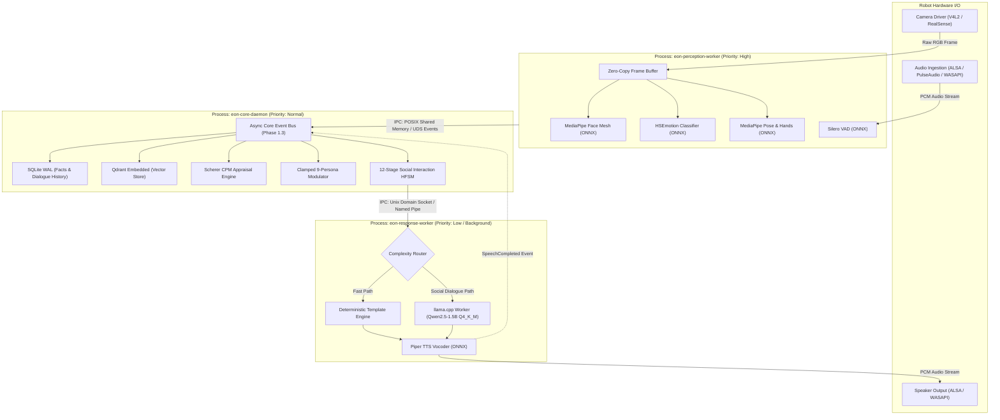

# OVIC EON — Edge Deployment Architecture Specification

**Project:** OVIC EON
**Document ID:** `EON-ARCH-EDGE-001`
**Phase:** Phase 1 — Technical Research and Feasibility
**Classification:** Systems Engineering & Runtime Deployment Architecture
**Version:** 1.0.0
**Status:** Approved

---

## 1. Overview and Architectural Goals

This specification defines the physical runtime architecture for running OVIC EON locally on an edge robot compute board.

The design achieves five foundational non-functional requirements:
1. **Zero Mandatory Cloud Connectivity:** 100% of perception, state tracking, social reasoning, dialogue generation, and speech synthesis occurs on localhost.
2. **Process Fault Isolation:** A fault or crash in a native C/C++ model worker (e.g., `llama.cpp` or ONNX Runtime) cannot crash the Core Event Bus or corrupt persistent state.
3. **Sub-100ms Perception-to-Intent Latency:** High-throughput streaming via shared memory ring buffers ensures real-time responsiveness.
4. **Predictable CPU and Thermal Behavior:** Strict CPU core affinity and thread budget isolation prevent high-load SLM decoding from starving real-time audio or camera feeds.
5. **Cryptographic Data Separation:** Encrypted SQLite WAL storage with user-isolated data encryption keys (DEK) enforces GDPR compliance and instant cryptographic erasure.

---

## 2. Multi-Process Topology and IPC Architecture



---

## 3. Inter-Process Communication (IPC) Protocols

EON utilizes an asymmetric IPC design optimized for data throughput and latency:

1. **High-Rate Vision Ingestion (Camera $\to$ Perception Worker):**
   - *Transport:* Zero-copy POSIX shared memory (`shm_open` / `mmap` on Linux; Named Shared Memory on Windows).
   - *Data Format:* Raw packed BGR/RGB $640 \times 480$ uint8 buffers with circular ring pointer indexing.
   - *Latency:* $<0.05\text{ ms}$ transfer overhead.
2. **Perception Events (Perception Worker $\to$ Core Bus):**
   - *Transport:* Unix Domain Sockets (UDS) streaming in Linux; Windows Named Pipes in Windows.
   - *Data Format:* FlatBuffers or high-speed binary MsgPack containing structured `EmotionObservation` and `GestureObservation` payloads.
   - *Latency:* $<0.15\text{ ms}$ serialization and transfer.
3. **Response Directives (Core Bus $\to$ Response Worker):**
   - *Transport:* Bidirectional Unix Domain Socket.
   - *Payload:* Lightweight JSON or MsgPack `ResponseIntent` containing prompt template, retrieved untrusted facts, and persona style vectors.

---

## 4. Edge Memory Budget Allocation (Tier 2 Target: 16 GB System)

```text
+--------------------------------------------------------------------------------------------------+
| SUBSYSTEM / PROCESS        | RESIDENT SET SIZE (RSS) | ALLOCATION RATIONALE                      |
+--------------------------------------------------------------------------------------------------+
| Host OS + System Services  | ~1,200 MB               | Linux (Ubuntu/Debian) or Windows Core     |
| ROS 2 Daemon + Middleware  | ~450 MB                 | DDS Discovery, ROS 2 Daemons, Nav2 stack  |
| Robot Motion Controller    | ~350 MB                 | Certified Kinematics & Motor I/O          |
| eon-perception-worker      | ~320 MB                 | MediaPipe, HSEmotion, Silero VAD, buffers |
| eon-core-daemon            | ~280 MB                 | Event Bus, SQLite cache, Qdrant Embedded  |
| eon-response-worker        | ~1,150 MB               | Qwen2.5-1.5B (986MB) + Piper TTS (70MB)   |
| Emergency Buffer Headroom  | ~500 MB                 | Prevents OOM-killer during memory spikes  |
+--------------------------------------------------------------------------------------------------+
| TOTAL ALLOCATED MEMORY:    | ~4,250 MB               | (<27% of 16 GB System RAM)                |
| FREE AVAILABLE RAM:        | ~11,750 MB              | Available for robot mapping and app logic |
+--------------------------------------------------------------------------------------------------+
```

---

## 5. Storage Directory Layout on Edge Robotics Hardware

EON organizes its local storage deterministically under `/opt/eon/` (Linux) or `C:\ProgramData\OVIC\EON\` (Windows):

```text
/opt/eon/
├── bin/                          # Standalone executables (eon-daemon, llama-server, piper)
├── lib/                          # Shared libraries (libonnxruntime.so, libsqlite3.so)
├── etc/                          # Immutable system configuration
│   ├── eon_config.yaml           # Master engine configuration
│   ├── personas/                 # 9 Versioned persona JSON specifications
│   │   ├── friendly_guide.json
│   │   └── professional_asst.json
│   └── templates/                # Deterministic emergency & task response templates
├── models/                       # Verified offline model weights (SHA-256 pinned)
│   ├── vision/
│   │   ├── face_landmarker.task
│   │   └── enet_b0_8_va_mtl.onnx
│   ├── audio/
│   │   ├── silero_vad.onnx
│   │   └── ecapa_tdnn.onnx
│   ├── embeddings/
│   │   └── all-MiniLM-L6-v2-qint8.onnx
│   ├── slm/
│   │   └── qwen2.5-1.5b-instruct-q4_k_m.gguf
│   └── tts/
│       ├── en_US-lessac-medium.onnx
│       └── en_US-lessac-medium.onnx.json
├── var/                          # Mutable runtime data (Encrypted / Restricted Permissions)
│   ├── data/
│   │   ├── eon_memory.db         # Encrypted SQLite database (WAL mode)
│   │   └── qdrant_storage/       # Qdrant local embedded vector files
│   ├── keys/                     # User Data Encryption Keys (DEKs, chmod 0600)
│   └── logs/                     # Circular diagnostic logs (capped at 50 MB)
└── run/                          # Ephemeral runtime sockets and pipes
    ├── eon_bus.sock
    └── eon_shm_camera
```

---

## 6. Security and Sandboxing on Edge Hardware

1. **Non-Root Execution:** The entire EON suite executes under an unprivileged system service account (`eon_daemon`). It has zero write permissions to system root partitions or motor driver device nodes (`/dev/ttyUSB*` or raw SPI/I2C buses).
2. **Cryptographic Protection (SQLCipher + AES-GCM):** User episodic records in SQLite and vector stores are encrypted at rest using 256-bit AES.
3. **Instant Cryptographic Erasure (GDPR Art. 17):** When a user requests data deletion, destroying the user's specific Data Encryption Key (DEK) renders all historical records mathematically unrecoverable without needing costly full disk re-formatting.
