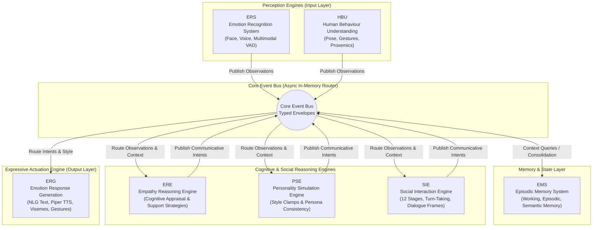

# OVIC EON — Engine Dependency and Interaction Matrix

**Project:** OVIC EON
**Document ID:** `EON-ARCH-DEP-001`
**Phase:** Phase 1 — Technical Research and Feasibility
**Scope:** Synthesis of Sub-phases 1.1 through 1.11
**Status:** Approved Architecture Proposal
**Version:** 1.0.0
**Classification:** System Architecture Specification

---

## 1. Executive Summary

This specification defines the inter-engine dependency topology, functional responsibilities, and event exchange contracts across OVIC EON's seven core intelligence engines:
1. **ERS — Emotion Recognition System:** Multimodal observation and continuous VAD trajectory tracking.
2. **HBU — Human Behaviour Understanding Engine:** Biomechanical tracking, 3D pose, posture, gestures, and proxemics.
3. **EMS — Episodic Memory System:** Governed interaction history, working memory, semantic preferences, and forgetting.
4. **ERE — Empathy Reasoning Engine:** Cognitive appraisal (Scherer CPM), perspective-taking, and supportive intent selection.
5. **PSE — Personality Simulation Engine:** Configurable interaction styles, parameterized persona profiles, and anti-drift guardrails.
6. **SIE — Social Interaction Engine:** 12-stage interaction lifecycle, multimodal turn-taking (TRP), and social proxemics.
7. **ERG — Emotion-aware Response Generation Engine:** Multimodal response planning, local SLM dialogue, neural TTS, and gesture scheduling.

All inter-engine communication is decoupled through OVIC EON's asynchronous, in-memory **Core Event Bus** via strictly typed event envelopes (`EventEnvelope[T]`), guaranteeing failure isolation, backpressure management, and deterministic safety enforcement.

---

## 2. Seven-Engine Responsibility Matrix

---

## 3. Comprehensive Cross-Engine Capability Matrix

The table below delineates the precise functional relationship between each platform capability and the seven engines. Roles are defined as:
- **Core Owner:** The engine responsible for executing the primary algorithmic logic.
- **Direct Input:** The engine subscribes to and directly consumes the data stream.
- **Context Consumer:** The engine uses the data as optional background context.
- **Output Recipient:** The engine receives generated instructions or style constraints.
- **None:** No direct functional interaction.

| Platform Capability | ERS | HBU | EMS | ERE | PSE | SIE | ERG |
|---|---|---|---|---|---|---|---|
| **Facial & Action Unit Analysis** | **Core Owner** | Context Consumer | Input (Episodic) | Direct Input | Context Consumer | Context Consumer | None |
| **Speech Emotion Recognition (SER)**| **Core Owner** | Context Consumer | Input (Episodic) | Direct Input | Context Consumer | Context Consumer | None |
| **Multimodal Gated Fusion** | **Core Owner** | Direct Input | Input (Episodic) | Direct Input | Context Consumer | Direct Input | None |
| **3D Pose & Posture Estimation** | Context Consumer | **Core Owner** | Context Consumer | Direct Input | None | Direct Input | Context Consumer |
| **Fine-Grained Gesture Tracking** | None | **Core Owner** | Context Consumer | Context Consumer | None | Direct Input | None |
| **Spatial Proxemics & Tracking** | None | **Core Owner** | Input (Episodic) | Context Consumer | None | Direct Input | None |
| **Active Working Memory** | None | None | **Core Owner** | Direct Input | Context Consumer | Direct Input | Direct Input |
| **Episodic Interaction History** | Input Context | Input Context | **Core Owner** | Direct Input | Input Context | Direct Input | Context Consumer |
| **Semantic User Preferences** | None | None | **Core Owner** | Direct Input | Direct Input | Direct Input | Direct Input |
| **Cognitive Appraisal (Scherer)** | Input Provider | Input Provider | Context Consumer | **Core Owner** | Context Consumer | Input Provider | None |
| **Perspective-Taking (Theory of Mind)**| None | Input Provider | Input Provider | **Core Owner** | None | Direct Input | None |
| **Supportive Strategy Selection**| None | None | Context Consumer | **Core Owner** | Context Consumer | Direct Input | Direct Input |
| **Persona Style Clamping** | None | None | Context Consumer | Input Provider | **Core Owner** | Input Provider | Direct Input |
| **Anti-Drift Parameter Resolution**| None | None | None | Context Consumer | **Core Owner** | None | Direct Input |
| **12-Stage Interaction Lifecycle** | Context Consumer | Direct Input | Context Consumer | Context Consumer | Context Consumer | **Core Owner** | Direct Input |
| **Conversational Turn-Taking (TRP)**| Input Provider | Input Provider | None | Context Consumer | Input Provider | **Core Owner** | Direct Input |
| **Task Frame & Slot Tracking** | None | None | Input Provider | Context Consumer | None | **Core Owner** | Direct Input |
| **Surface NLG (Qwen2.5-1.5B)** | None | None | Input Context | Input Intent | Style Input | Dialogue Frame | **Core Owner** |
| **Local Neural TTS (Piper)** | None | None | None | None | Prosody Style | Speech Trigger | **Core Owner** |
| **Viseme & Head Gesture Planning** | None | None | None | None | Expressive Style| Timing Input | **Core Owner** |
| **Robot Motor Safety Boundaries** | Non-Authoritative | Non-Authoritative | Non-Authoritative | Non-Authoritative | Non-Authoritative | Non-Authoritative | **Non-Authoritative** |

---

## 4. Primary Event Schemas and Contract Hand-offs

### 4.1 Upstream Perception Hand-off: ERS/HBU $\to$ ERE/SIE
- **Topic:** `observation.multimodal` / `observation.gesture`
- **Envelope Payload:** `ObservationPayload`
- **Contract Guarantees:**
  - Every observation includes calibrated `confidence` ($[0.0, 1.0]$) and `quality` (`GOOD`, `DEGRADED`, `UNRELIABLE`, `MISSING`).
  - Strict safety tag: `is_authoritative_stop: False`.

### 4.2 Cognitive Reasoning Hand-off: ERE/PSE $\to$ SIE/ERG
- **Topic:** `intent.empathy_reasoned` / `persona.style_vector`
- **Envelope Payload:** `ResponseIntentPayload` / `PersonaStylePayload`
- **Contract Guarantees:**
  - `intent_id`: Unique UUID4 causality tracking identifier.
  - `empathy_strategy`: Declarative strategy (`"active_listening"`, `"reflective_clarification"`, `"offer_assistance"`).
  - `style_parameters`: Clamped numerical bounds (formality, verbosity, pitch dynamic range).

### 4.3 Social Coordination Hand-off: SIE $\to$ ERG / Robot Motion
- **Topic:** `interaction.turn_action` / `social.navigation_overlay`
- **Envelope Payload:** `TurnActionPayload` / `SocialCostmapPayload`
- **Contract Guarantees:**
  - `turn_command`: `"take_floor"`, `"yield_floor"`, `"emit_backchannel"`, `"instant_audio_halt"`.
  - Social costmaps are explicitly flagged as soft navigation preferences, strictly prohibited from overriding certified safety obstacles.

### 4.4 Expressive Actuation Hand-off: ERG $\to$ Hardware Interfaces
- **Topic:** `actuation.speech_stream` / `actuation.expressive_gesture`
- **Envelope Payload:** `AudioChunkPayload` / `KinesicIntentPayload`
- **Contract Guarantees:**
  - Streaming 16kHz PCM chunks with timestamped viseme markers.
  - Expressive gesture intents are symbolic coordinates checked by certified motion safety PLCs before motor execution.

---

## 5. Architectural Invariants and Safety Boundaries

1. **The In-Memory Asynchronous Bus Invariant:** No engine communicates directly with another engine via synchronous blocking in-process function calls. All communication flows through the Core Event Bus, preserving fault isolation and bounded queue backpressure.
2. **The Non-Authoritative Motion Invariant:** Every event emitted by ERS, HBU, EMS, ERE, PSE, SIE, or ERG carries `is_authoritative_stop: False`. Physical robot safety is strictly governed by independent, deterministic, hardware-certified safety controllers (ISO 13849-1 [SRC-041] / ISO 10218-1 [SRC-082]).
3. **The Anti-Profiling Privacy Invariant:** EMS is prohibited from persisting psychological profiling, inferred psychiatric labels, or unverified personality scores. Only explicit user-approved preferences may be retained long term.
4. **The Verifiable Erasure Invariant:** When an authorized user executes a deletion request, EMS coordinates hard deletion across SQLite relational tables, vector indices, in-memory caches, and crypto-shreds user-specific encryption keys.
