# OVIC EON — Social Intelligence Architecture Specification

**Project:** OVIC EON
**Document ID:** `EON-ARCH-SOC-001`
**Phase:** Phase 1 — Technical Research and Feasibility
**Scope:** Synthesis of Sub-phases 1.6 through 1.11
**Status:** Approved Architecture Proposal
**Version:** 1.0.0
**Classification:** System Architecture Proposal

---

## 1. Executive Summary

This specification establishes the comprehensive **Social Intelligence Architecture** for OVIC EON, uniting the advanced cognitive, memory, personality, interaction, and expressive capabilities researched across Sub-phases 1.6 through 1.11.

While the Perception Architecture ([`EON_PERCEPTION_ARCHITECTURE.md`](EON_PERCEPTION_ARCHITECTURE.md)) governs how raw sensor streams are transformed on edge CPUs into structured observations, the Social Intelligence Architecture defines how these observations are contextualized, remembered, ethically evaluated, translated into conversational turns, and realized into expressive speech and physical gestures.

Key architectural pillars:
1. **CPU-First Hybrid Intelligence:** Combines deterministic state machines (HFSM), relational databases (SQLite), and cognitive appraisal rules (Scherer CPM) with locally quantized Small Language Models (Qwen2.5-1.5B via `llama.cpp`) and fast neural vocoders (Piper TTS). The entire social intelligence pipeline operates locally on edge CPUs without requiring cloud AI APIs.
2. **Modular Engine Federation:** Unites six specialized engines (HBU, EMS, ERE, PSE, SIE, ERG) coordinated asynchronously across the in-memory Core Event Bus.
3. **Auditable Memory Lifecycle:** Tiered memory architecture separating volatile working memory, encrypted episodic records, and verified semantic user preferences, enforcing verifiable forgetting (GDPR Art. 17) via cryptographic erasure.
4. **Anti-Anthropomorphic Ethical Core:** Enforces cognitive and compassionate empathy while explicitly prohibiting deceptive claims of synthetic human emotions or feelings.
5. **Deterministic Safety Firewall:** Social reasoning and expressive intent generation operate strictly within an advisory capacity (`is_authoritative_stop=False`). Physical robot motion safety, collision avoidance corridors, and emergency stops remain under the exclusive control of independent, certified safety controllers (ISO 13849-1 / ISO 10218-1).

---

## 2. End-to-End Social Intelligence Architecture Diagram

```mermaid
flowchart TD
    subgraph PERCEPTION_IN["1. Upstream Perception Layer (1.1 - 1.6)"]
        ObsFace["ERS: Facial VAD & Action Units"]
        ObsAudio["ERS: Speech Emotion & Prosody"]
        ObsPose["HBU: 3D Body Pose & Posture"]
        ObsGest["HBU: Fine-Grained Hand Gestures"]
        ObsProx["HBU: Spatial Person Tracking"]
    end

    subgraph EVENT_BUS["2. OVIC EON Core Event Bus (Async Router)"]
        Bus(("Core Event Bus\nTyped Envelopes"))
    end

    subgraph MEMORY_SYSTEM["3. Episodic Memory System (EMS)"]
        WorkingMem["Working Memory (RAM)\nActive Turn Context"]
        EpisodicDB["Episodic Store (SQLite / DuckDB)\nInteraction Logs with TTL Decay"]
        SemanticDB["Semantic Store (Encrypted SQL)\nExplicit Verified Preferences"]
        VecIndex["Local Vector Index (Qdrant Embedded)\nSemantic Dialogue Pointers"]
        Crypto["Crypto-Shredder\nPer-User Key Deletion"]

        WorkingMem <--> EpisodicDB
        WorkingMem <--> SemanticDB
        SemanticDB <--> VecIndex
        Crypto -.-> EpisodicDB & SemanticDB
    end

    subgraph COGNITIVE_REASONING["4. Cognitive & Personality Engines"]
        subgraph ERE_BOX["Empathy Reasoning Engine (ERE)"]
            CPM["Scherer CPM Appraisal\nGoal Relevance & Coping"]
            ToM["Theory of Mind\nPerspective-Taking"]
            Strategy["Supportive Policy Selector\n(Active Listening / Assist)"]
            CPM --> ToM --> Strategy
        end

        subgraph PSE_BOX["Personality Simulation Engine (PSE)"]
            PersonaAsset["Base Persona Profile (JSON)"]
            Resolver["Contextual Parameter Resolver"]
            Clamps["Anti-Drift Math Clamps\n[Formality, Verbosity, Pace]"]
            PersonaAsset --> Resolver --> Clamps
        end
    end

    subgraph INTERACTION_MGR["5. Social Interaction Engine (SIE)"]
        HFSM["12-Stage Interaction HFSM\n(Encounter -> Farewell)"]
        TRP["Multimodal TRP Detector\n(Sub-400ms Turn Transitions)"]
        SlotMgr["Frame & Slot Dialogue Tracker"]
        Repair["Conversational Repair Protocol"]

        HFSM --> TRP --> SlotMgr --> Repair
    end

    subgraph EXPRESSIVE_OUT["6. Emotion Response Generation (ERG)"]
        Plan["Multimodal Response Planner"]
        LocalSLM["Local Quantized SLM (Qwen2.5-1.5B)\nGrammar-Constrained Decoding (Outlines)"]
        TemplateLib["Deterministic Safety Template Fallback"]
        PiperTTS["Local Neural TTS (Piper VITS)\n16kHz Expressive Audio"]
        Kinesics["Viseme & Gesture Scheduler"]

        Plan --> LocalSLM & TemplateLib
        LocalSLM --> PiperTTS & Kinesics
        TemplateLib --> PiperTTS & Kinesics
    end

    subgraph HARDWARE_ACTUATION["7. Robot Actuation Interfaces"]
        Loudspeaker["Robot Loudspeaker\n(Streaming Speech Audio)"]
        Screen["Head Screen / Face Display\n(Visemes & Expressions)"]
        SafetyPlc["Robot Certified Safety Controller\n(Independent Collision & E-Stop Monitoring)"]
    end

    ObsFace & ObsAudio & ObsPose & ObsGest & ObsProx -->|Publish Observations| Bus
    Bus <-->|Context Queries & Logging| WorkingMem
    Bus -->|Deliver Observations & Context| ERE_BOX & PSE_BOX & INTERACTION_MGR
    ERE_BOX -->|Publish ResponseIntent| Bus
    PSE_BOX -->|Publish StyleVector| Bus
    INTERACTION_MGR -->|Publish TurnAction & SocialCostmap| Bus
    Bus -->|Deliver Intents & Constraints| Plan
    PiperTTS --> Loudspeaker
    Kinesics --> Screen
    Kinesics -->|Advisory Gesture Intent| SafetyPlc
```



---

## 3. Information Flows and Event Causality

The social intelligence pipeline executes a tightly coordinated causal sequence across five distinct operational phases:

### Phase 1: Spatial & Perceptual Registration
1. Human enters sensor field-of-view ($>4.0\text{m}$). HBU publishes `observation.person_tracked` and `observation.posture` to the Core Event Bus.
2. SIE transitions from `IDLE` to `ENCOUNTER_DETECTED`. If mutual gaze persists ($>1.0\text{s}$), SIE enters `ATTENTION_ENGAGED` and dispatches an advisory approach preference to the robot base navigation stack.

### Phase 2: Contextual Retrieval and Working Memory Activation
1. Upon reaching social distance ($1.5\text{m}$), SIE requests session initialization from EMS.
2. EMS loads authorized user preferences from Semantic Memory (e.g., `preferred_name: "Dr. Rao"`, `language: "te"`, `formality: "high"`), populating Working Memory in volatile RAM.
3. If no consent or prior record exists, EMS operates in anonymous session mode with standard default parameters.

### Phase 3: Cognitive Appraisal and Personality Shaping
1. When user speech is detected, ERS publishes `observation.speech_emotion` and transcribed text hints.
2. ERE receives observations, cross-references active task goals from EMS, and evaluates Scherer CPM appraisal checks (Goal Relevance, Goal Congruence, Coping Potential).
3. If task distress is detected ($\text{Cong} < -0.5$), ERE formulates a supportive intent (`"acknowledge_difficulty_and_assist"`).
4. PSE resolves active style parameters, clamping formality ($[0.60, 0.85]$) and lowering speaking rate to convey calm reassurance.

### Phase 4: Social Coordination and Turn-Taking
1. SIE monitors acoustic prosody ($F_0$ drop), Silero VAD silence, and visual gaze return.
2. Once the multimodal TRP score exceeds $0.75$, SIE takes the conversational floor in $<350\text{ms}$, publishing `interaction.turn_action: "take_floor"`.
3. If the user interrupts while the robot is speaking, SIE immediately emits `interaction.turn_action: "instant_audio_halt"`, cutting TTS output in $<50\text{ms}$.

### Phase 5: Surface Generation and Multimodal Actuation
1. ERG receives the `ResponseIntent`, `PersonaStyleVector`, and EMS facts.
2. The response planner evaluates risk: formulaic confirmations route to instant deterministic templates ($<5\text{ms}$); complex dialogue routes to `Qwen2.5-1.5B` via `llama.cpp` constrained by Outlines JSON grammars ($<350\text{ms}$ TTFS).
3. Piper TTS synthesizes streaming 16kHz PCM audio with embedded viseme markers for display lip-sync.
4. Concurrently, ERG dispatches symbolic head tilt and arm gestures to the robot's motion controller, which executes them within certified kinematic safety corridors.

---

## 4. Common Data Contracts and Event Envelopes

In accordance with Phase 1 data architecture standards, all cross-engine payloads are defined as strongly typed Pydantic v2 models:

### 4.1 ResponseIntent Contract (`eon.schemas.intents`)

```json
{
  "intent_id": "int_7a8b9c0d-1e2f-4a3b-8c5d-6e7f8a9b0c1d",
  "causality_id": "obs_6f8b2d1c-4e3a-4a7b-8912-3c4d5e6f7a8b",
  "source_engine": "ERE",
  "created_at": "2026-11-23T11:05:00.150000Z",
  "category": "supportive_assistance",
  "semantic_goal": "offer_tool_holding_assistance",
  "empathy_strategy": "permission_seeking_intervention",
  "priority": "HIGH",
  "context_references": ["session_01", "task_bracket_assembly"],
  "safety_context": {
    "is_authoritative_stop": false,
    "prohibit_direct_motor_command": true
  }
}
```

### 4.2 PersonaStylePayload Contract (`eon.schemas.persona`)

```json
{
  "style_id": "sty_3c4d5e6f-7a8b-4c1d-9e0f-1a2b3c4d5e6f",
  "source_engine": "PSE",
  "persona_id": "eon_persona_supportive_v1",
  "effective_parameters": {
    "formality": 0.65,
    "verbosity": 0.40,
    "conversational_initiative": 0.50,
    "pitch_mean_offset_semitones": -1.0,
    "speaking_rate_wpm": 140
  },
  "safety_clamps_enforced": true
}
```

### 4.3 MemoryRecord Contract (`eon.schemas.memory`)

```json
{
  "memory_id": "mem_1a2b3c4d-5e6f-7a8b-9c0d-1e2f3a4b5c6d",
  "tier": "SEMANTIC",
  "user_id": "usr_9b1deb4d",
  "created_at": "2026-11-23T10:00:00Z",
  "last_verified_at": "2026-11-23T11:00:00Z",
  "consent_scope": "explicit_user_preference",
  "key": "preferred_language",
  "value": "te",
  "is_user_editable": true,
  "deletion_status": "ACTIVE"
}
```

---

## 5. Security, Privacy, and Ethical Governance

1. **Anti-Profiling Mandate:** EON strictly prohibits inferring or persisting psychological diagnoses, sensitive political beliefs, or permanent personality profiles from sensor observations. Only voluntary, explicit preferences may be stored long term.
2. **Verifiable Hard Forgetting (GDPR Art. 17):** Deletion requests execute a synchronized six-tier purge across relational tables (zero-overwrite via `PRAGMA secure_delete`), vector indices, volatile RAM ring buffers, and crypto-shreds user-specific encryption keys.
3. **Protection Against Memory Poisoning:** Retrieved long-term memories are formatted as read-only JSON data payloads within strict delimiters. Language models treat memories as external untrusted data, never executable system instructions.
4. **Anti-Deception Boundary:** EON strictly enforces cognitive perspective-taking while forbidding simulated emotional suffering or claims of biological feelings.

---

## 6. Robotics Safety Boundaries and Actuation Isolation

1. **The Non-Authoritative Invariant (`is_authoritative_stop=False`):** Every cognitive intent, interaction turn, social costmap, and response gesture carries `is_authoritative_stop=False`. Under no circumstances may social or emotional reasoning trigger emergency stops or alter safety-critical kinematic envelopes.
2. **Deterministic Safety Controller Isolation:** Physical robot safety zones, speed-and-separation monitoring (ISO/TS 15066 [SRC-042]), and protective stops remain under the sole jurisdiction of independent, certified safety PLCs and laser scanners (ISO 13849-1 [SRC-041] / ISO 10218-1 [SRC-082]).
3. **Language Model Motor Isolation:** Generative SLMs are strictly isolated from physical actuator interfaces. SLMs output text tokens and symbolic gesture requests; certified motion planners validate all physical trajectories before motor actuation.

---

## 7. Real-Time Edge Hardware Budget (Consolidated Social Pipeline)

| Component | Engine | Target Architecture | Execution Latency (p50) | Execution Latency (p95) | Resident Memory (RAM) | Feasibility Verdict |
|---|---|---|---|---|---|---|
| **Hand & Gesture Tracking** | HBU | MediaPipe Hands (INT8) | $12.8\text{ms}$ | $16.5\text{ms}$ | $24\text{MB}$ | **QUALIFIED** |
| **DTW & Posture Class** | HBU | Vector Math & DTW | $1.1\text{ms}$ | $1.7\text{ms}$ | $3\text{MB}$ | **QUALIFIED** |
| **Memory Fact Query** | EMS | SQLite WAL Mode | $0.5\text{ms}$ | $1.2\text{ms}$ | $15\text{MB}$ | **QUALIFIED** |
| **Cognitive Appraisal** | ERE | Scherer CPM FSM | $0.4\text{ms}$ | $0.8\text{ms}$ | $<2\text{MB}$ | **QUALIFIED** |
| **Persona Clamping** | PSE | Parameter Resolver | $0.2\text{ms}$ | $0.4\text{ms}$ | $<1\text{MB}$ | **QUALIFIED** |
| **Multimodal TRP Eval** | SIE | Logistic TRP Fusion | $0.8\text{ms}$ | $1.5\text{ms}$ | $4\text{MB}$ | **QUALIFIED** |
| **Local SLM Generation** | ERG | `llama.cpp` (Qwen2.5-1.5B) | $35.0\text{ms/tok}$ | $42.0\text{ms/tok}$ | $1,150\text{MB}$ | **QUALIFIED** |
| **Local Neural TTS** | ERG | Piper VITS (ONNX) | $40.0\text{ms}$ | $65.0\text{ms}$ | $65\text{MB}$ | **QUALIFIED** |
| **Total Social Intelligence**| Full Pipeline | **4-Core CPU** | **TTFS $<350\text{ms}$** | **TTFS $<450\text{ms}$** | **$\sim 1.26\text{GB}$** | **QUALIFIED** |

*Conclusion:* The complete social intelligence stack operates comfortably within a **$1.3\text{GB}$ RAM footprint** on edge CPUs, streaming expressive, calibrated, and safety-verified responses with Time-to-First-Speech under $400\text{ms}$.

---

## 8. References

See [`docs/research/phase-1/RESEARCH_SOURCE_REGISTER.md`](RESEARCH_SOURCE_REGISTER.md) for full verified bibliographic details:
- `SRC-041` (ISO 13849-1:2023 — *Safety of Machinery*)
- `SRC-042` (ISO/TS 15066:2016 — *Collaborative Robots*)
- `SRC-051` (Zhang et al., 2020 — *MediaPipe Hands*)
- `SRC-062` (Hipp et al., 2024 — *SQLite Architecture*)
- `SRC-064` (Qdrant Team, 2024 — *Qdrant Vector Database*)
- `SRC-069` (Scherer, 2001 — *Component Process Model*)
- `SRC-072` (Goldberg, 1990 — *Big-Five Factor Structure*)
- `SRC-077` (Sacks et al., 1974 — *Turn-Taking in Conversation*)
- `SRC-078` (Hall, 1966 — *The Hidden Dimension: Proxemics*)
- `SRC-081` (Kruse et al., 2013 — *Human-Aware Robot Navigation*)
- `SRC-082` (ISO 10218-1:2011 — *Robots and Robotic Devices Safety*)
- `SRC-086` (Qwen Team, 2024 — *Qwen2.5 Technical Report*)
- `SRC-090` (Hansen, 2023 — *Piper Neural TTS*)
- `SRC-092` (European Parliament, 2016 — *GDPR EU 2016/679*)
- `SRC-093` (Gerganov et al., 2024 — *llama.cpp Runtime*)
- `SRC-095` (Normal Computing, 2024 — *Outlines Structured Text Generation*)
- `SRC-100` (Murphy, 2019 — *Asimov's Laws and Modern Robotics Safety*)
