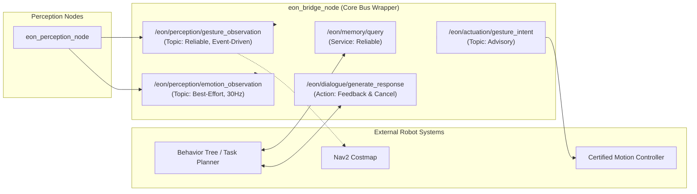
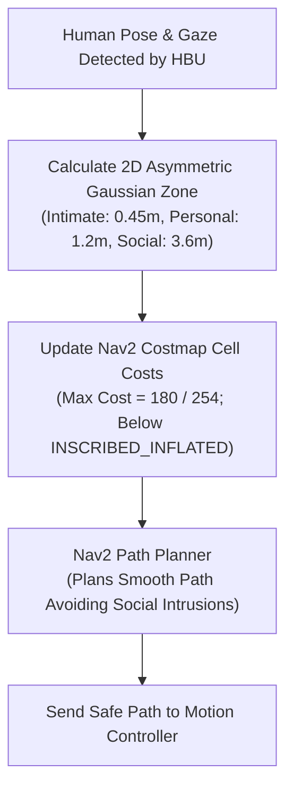

# OVIC EON — ROS 2 Integration Architecture Specification

**Project:** OVIC EON
**Document ID:** `EON-ARCH-ROS2-001`
**Phase:** Phase 1 — Technical Research and Feasibility
**Classification:** Robotics Middleware & Systems Integration Architecture
**Version:** 1.0.0
**Status:** Approved

---

## 1. Overview and Scope

This document specifies the concrete ROS 2 package layout, node interfaces, Quality of Service (QoS) configurations, service contracts, action servers, and safety boundaries for integrating OVIC EON into ROS 2-based robotic systems.

Integration Target:
- **Primary Distribution:** **ROS 2 Jazzy Jalisco** (Ubuntu 24.04 LTS, Python 3.12, CycloneDDS).
- **Secondary / Fallback:** **ROS 2 Humble Hawksbill** (Ubuntu 22.04 LTS, Python 3.10).

---

## 2. ROS 2 Package Workspace Structure

EON integrates with ROS 2 as a modular suite of colcon-buildable packages within the robot's workspace:

```text
eon_ros2_ws/src/
├── eon_msgs/                     # Custom interface definitions (.msg, .srv, .action)
│   ├── msg/
│   │   ├── EmotionObservation.msg
│   │   ├── GestureObservation.msg
│   │   ├── PostureObservation.msg
│   │   ├── ActivityObservation.msg
│   │   ├── InteractionState.msg
│   │   ├── PersonaConfiguration.msg
│   │   └── EngineHealth.msg
│   ├── srv/
│   │   ├── QueryMemory.srv
│   │   ├── PurgeUserData.srv     # GDPR Art. 17 Cryptographic Deletion
│   │   └── SwitchPersona.srv
│   └── action/
│       └── GenerateResponse.action
├── eon_bringup/                  # ROS 2 Launch files and system parameter YAMLs
│   ├── launch/
│   │   ├── eon_core.launch.py
│   │   └── eon_perception.launch.py
│   └── config/
│       ├── jazzy_params.yaml
│       └── qos_profiles.yaml
├── eon_perception/               # ERS and HBU ROS 2 C++/Python nodes
│   ├── src/
│   │   ├── face_mesh_node.cpp
│   │   └── audio_vad_node.py
│   └── include/
├── eon_core_bridge/              # Bridges EON Async Event Bus to ROS 2 DDS Topics
│   └── eon_bridge_node.py
└── eon_nav2_social_layer/        # C++ Nav2 Costmap Plugin for Proxemics
    ├── src/social_costmap_layer.cpp
    └── include/eon_nav2_social_layer/social_costmap_layer.hpp
```

---

## 3. Topic, Service, and Action Interface Directory



### 3.1 Quality of Service (QoS) Profiles
- **Sensor Observation Topics (`/eon/perception/*`):**
  - *Reliability:* `BEST_EFFORT` (Prevents publisher queuing when downstream subscriber is busy).
  - *History / Depth:* `KEEP_LAST`, Depth = 1 (Always process the freshest frame; drop delayed frames).
  - *Durability:* `VOLATILE`.
- **Cognitive Directives & Intent Topics (`/eon/social/*`, `/eon/actuation/*`):**
  - *Reliability:* `RELIABLE` (Guarantees communicative intent reaches execution).
  - *History / Depth:* `KEEP_LAST`, Depth = 10.
  - *Durability:* `TRANSIENT_LOCAL`.

---

## 4. Custom Service and Action Definitions

### 4.1 Memory Query Service (`QueryMemory.srv`)
```text
# Request
string user_id
string query_text
int32 max_results
float32 min_relevance_score
---
# Response
bool success
string error_message
string[] facts
float32[] scores
```

### 4.2 Response Generation Action (`GenerateResponse.action`)
```text
# Goal
string intent_type                   # e.g., "explain_delay", "greeting"
string context_text
string override_persona_id
---
# Result
bool success
string output_text
float32 generation_time_ms
int32 tokens_generated
---
# Feedback
string partial_token_stream
float32 elapsed_time_ms
```

---

## 5. Nav2 Social Costmap Plugin Architecture

EON integrates with the standard ROS 2 Navigation Stack (Nav2) via a custom C++ costmap plugin inheriting from `nav2_costmap_2d::Layer`:



### Safety Cost Constraint
The social layer cell cost is strictly capped at `180 / 254`. This ensures:
1. Nav2 prefers navigating around humans at socially acceptable proxemic distances.
2. If the robot's only escape route in a narrow corridor is to pass closer to a human, the path planner will navigate through the social zone rather than declaring an artificial navigational lock-up.
3. Physical obstacles (walls, drop-offs) always take precedence with lethal costs (`254 / 254`).

---

## 6. SROS2 Security Policy and Topic Access Control

In commercial robotics environments, DDS network traffic must be isolated against unauthorized inspection or spoofing:

```xml
<!-- SROS2 Security Policy Snippet for eon_erg_node -->
<profile name="eon_erg_node">
  <topics publish="ALLOW">
    <topic>/eon/actuation/speech_output</topic>
    <topic>/eon/actuation/gesture_intent</topic>
    <topic>/diagnostics</topic>
  </topics>
  <topics subscribe="ALLOW">
    <topic>/eon/social/interaction_state</topic>
  </topics>
  <!-- STRICTLY FORBIDDEN FROM PUBLISHING TO PHYSICAL MOTOR TOPICS -->
  <topics publish="DENY">
    <topic>/cmd_vel</topic>
    <topic>/joint_trajectory_controller/*</topic>
    <topic>/hardware_emergency_stop</topic>
  </topics>
</profile>
```
Any attempt by a compromised language model or response worker to publish directly to `/cmd_vel` is mathematically dropped and logged at the DDS middleware level.
