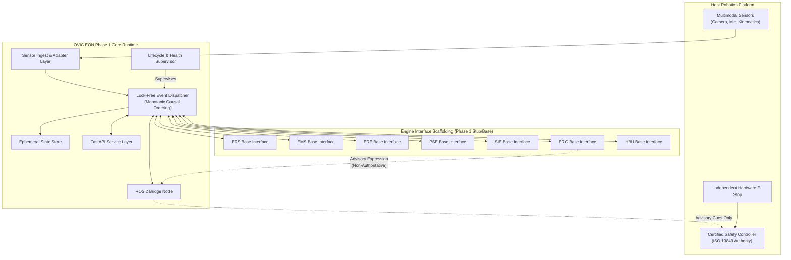

# OVIC EON — Phase 1 Execution Plan: Engineering Infrastructure & Core Runtime Foundation

**Document ID:** EON-PLN-PH1-001  
**Document Title:** Phase 1 Execution Plan  
**Product:** OVIC EON  
**Tagline:** Emotional Intelligence Infrastructure for Robotics  
**Organization:** OVIC Labs  
**Target Milestone:** Phase 1 — Engineering Infrastructure & Core Runtime Foundation  
**Phase Status:** `AUTHORIZED TO BEGIN — NOT YET VERIFIED`  
**Prerequisite:** Phase 0 Baseline (`FOUNDER APPROVED — BASELINE ACCEPTED`)  
**Authorization Date:** 2026-11-23  
**Implementation Coverage:** `NOT STARTED / 0%`  
**Performance Status:** `PROVISIONAL — NOT BENCHMARKED`  
**Production Readiness:** `NOT QUALIFIED`  

---

## 1. Phase 1 Objectives

Phase 1 transitions OVIC EON from approved specifications to foundational engineering infrastructure. The primary objectives are:

1. Establish a high-reliability, modular Core Runtime architecture in Python with C++ extension points where justified.
2. Build the inter-engine event bus, lifecycle coordinator, and message dispatching pipelines with backpressure handling.
3. Implement transport boundaries: local REST/WebSocket interfaces via FastAPI and robotics message routing via ROS 2.
4. Enforce strict failure isolation so engine panics, sensor drops, or model errors cannot crash the core host process.
5. Implement CPU-first processing budgets capable of deterministic execution on edge robotics compute.
6. Build reproducible CI/CD pipelines, test harnesses, mock harnesses, and developer CLI tools.

---

## 2. Scope and Exclusions

### 2.1 In-Scope for Phase 1
- **EON Core Runtime:** Lifecycle state machine (`UNINITIALIZED`, `INITIALIZING`, `READY`, `DEGRADED`, `SHUTTING_DOWN`, `FAILED`), configuration manager, event dispatcher, and plugin registry.
- **Transport Interfaces:** FastAPI REST/WebSocket endpoints and ROS 2 Humble/Iron bridge nodes.
- **Engine Scaffolding:** Base interfaces, abstract classes, and lifecycle hooks for all seven engines (ERS, EMS, ERE, PSE, SIE, ERG, HBU).
- **Core Memory Subsystem Skeleton:** In-memory circular buffer and ephemeral state management.
- **SDK Infrastructure:** Python SDK foundation and typed data transfer objects (DTOs).
- **Verification Harness:** Pytest test suite, mock sensor feeds, synthetic event injection, and local benchmark testbed.

### 2.2 Explicit Exclusions (Deferred to Subsequent Phases)
- **Full Engine Algorithm Implementations:** Proprietary affective neural networks, facial feature extractors, and cognitive empathy reasoning models are deferred to Phase 2+.
- **Hardware-in-the-Loop (HIL) Physical Robot Deployment:** Physical arm/actuator testing is deferred to Phase 3.
- **Cloud Federation & Multi-Tenant Fleet Telemetry:** Deferred to Phase 4+.
- **Direct Physical Actuator Control:** Strictly excluded across all phases; EON never exercises motion authority.

---

## 3. Technical Architecture Foundation

The EON Core Runtime serves as the central coordination hub, decoupling intelligence engines from physical sensors and robot controllers.



---

## 4. Repository Structure and Module Boundaries

Phase 1 establishes strict modularity. The repository layout for source implementation:

```text
eon/
├── src/
│   ├── eon/
│   │   ├── __init__.py
│   │   ├── core/                  # Core runtime, lifecycle, event bus
│   │   │   ├── __init__.py
│   │   │   ├── lifecycle.py       # State machine and health monitoring
│   │   │   ├── event_bus.py       # Event routing and priority queues
│   │   │   ├── context.py         # Thread-safe execution context
│   │   │   └── config.py          # Pydantic v2 settings management
│   │   ├── schemas/               # Universal data contracts (DTOs)
│   │   │   ├── __init__.py
│   │   │   ├── events.py          # Base event envelopes
│   │   │   ├── emotions.py        # Valence-arousal-dominance vectors
│   │   │   └── observations.py    # Perceptual input schemas
│   │   ├── interfaces/            # Abstract base interfaces for 7 engines
│   │   │   ├── __init__.py
│   │   │   ├── base.py            # IEngine contract
│   │   │   ├── ers.py
│   │   │   ├── ems.py
│   │   │   ├── ere.py
│   │   │   ├── pse.py
│   │   │   ├── sie.py
│   │   │   ├── erg.py
│   │   │   └── hbu.py
│   │   ├── transports/            # External protocol bindings
│   │   │   ├── __init__.py
│   │   │   ├── rest/              # FastAPI app and routers
│   │   │   └── ros2/              # ROS 2 node wrappers (rclpy)
│   │   ├── safety/                # Runtime safety boundaries & monitors
│   │   │   ├── __init__.py
│   │   │   ├── boundaries.py      # Motion authority interlocks
│   │   │   └── uncertainty.py     # Probability floor validators
│   │   └── sdk/                   # Embedded client library
│   │       ├── __init__.py
│   │       └── client.py
├── tests/
│   ├── unit/                      # Core and schema tests
│   ├── integration/               # Multi-component and transport tests
│   ├── mocks/                     # Simulated sensor feeds
│   └── benchmarks/                # Provisional latency profiling
├── docs/                          # Verified project documentation
├── scripts/                       # CI validation and utility scripts
├── pyproject.toml                 # Packaging and build specification
└── README.md
```

---

## 5. Python Development Standards

1. **Runtime Target:** Python 3.10, 3.11, and 3.12 support.
2. **Type Safety:** 100% strict type annotations enforced via `mypy --strict`.
3. **Data Modeling:** Pydantic v2 for data parsing, serialization, and schema validation.
4. **Code Quality:** Formatting and linting enforced via `ruff` (`line-length = 100`, zero warnings allowed).
5. **Concurrency:** `asyncio` for non-blocking I/O event loops combined with `concurrent.futures.ThreadPoolExecutor` for CPU-bound observation processing.

---

## 6. C++ Integration Policy

Where microsecond-latency event routing or zero-copy shared memory is required on Tier 2 robot compute:
1. **Standard:** C++20 standard compliance.
2. **Binding Layer:** `pybind11` or `nanobind` for minimal binding overhead.
3. **Boundary Rule:** C++ extensions must never manage Python memory references directly; ownership boundaries must be strictly isolated.
4. **Fallback:** Every C++ acceleration module must have a functionally identical pure-Python fallback implementation.

---

## 7. ROS 2 Integration Strategy

1. **Target Distribution:** ROS 2 Humble Hawksbill (LTS) and Iron Irwini.
2. **Node Scaffolding:** `rclpy` component nodes operating within standard ROS 2 lifecycle conventions.
3. **Interface Isolation:** Standard custom message packages (`eon_msgs`) defining:
   - `eon_msgs/msg/EmotionObservation.msg`
   - `eon_msgs/msg/InteractionState.msg`
   - `eon_msgs/msg/AdvisoryResponsePlan.msg`
4. **Safety Assertion:** All outgoing ROS 2 topics publish exclusively to `/eon/advisory/*`. No publisher may target `/cmd_vel` or actuator controllers.

---

## 8. FastAPI Service Foundation

1. **Protocol:** Local HTTP/2 REST and WebSocket streaming.
2. **Authentication:** Local mTLS or Unix Domain Socket (UDS) file-permission-based access control.
3. **Documentation:** Auto-generated OpenAPI v3 schemas at `/docs`.
4. **Latency Budget:** Health and event endpoints must respond in $\le 10\text{ ms}$ p95.

---

## 9. SDK Architecture Preparation

The Python SDK (`eon-sdk`) will be authored as a modular client:
- Embedded mode: In-process Python API directly invoking EON Core.
- Client/Server mode: Remote client communicating over UDS or local REST/WebSocket.
- Resilience: Exponential backoff with jitter on transport reconnects.

---

## 10. Configuration and Environment Management

1. **Hierarchy:** Configuration resolved in order: Defaults $\rightarrow$ Config File (`/etc/eon/eon.yaml` or `~/.config/eon/config.yaml`) $\rightarrow$ Environment Variables (`EON_*`) $\rightarrow$ Runtime CLI Flags.
2. **Immutability:** Configurations are validated at startup and become immutable during runtime.
3. **Secret Hygiene:** Zero hardcoded API keys or credentials; sensitive parameters loaded via secure environment stores.

---

## 11. Logging, Observability and Health Checks

1. **Structured Logging:** JSON-formatted structured logging via `structlog`.
2. **Health Endpoints:**
   - `/health/live`: Process liveness probe.
   - `/health/ready`: Engine readiness probe.
   - `/metrics`: Prometheus-compatible operational counters and histogram latencies.
3. **Privacy Scrubbing:** Logging pipelines must scrub biometric data, raw audio frames, and person-identifying vectors before writing to disk.

---

## 12. Error Handling and Failure Isolation

1. **Engine Isolation:** Each engine wrapper operates in an isolated worker thread or process boundary.
2. **Panic Recovery:** A crash in one engine (e.g., ERS visual processing failure) triggers a `DEGRADED` core state and safe fallback, preventing runtime termination.
3. **Circuit Breakers:** Upstream sensor feeds exceeding backpressure thresholds are dropped gracefully with warning metrics logged.

---

## 13. Security Baseline

1. **Least Privilege:** Daemons execute under dedicated non-root user `eon-robotics`.
2. **Memory Protection:** Zero persistent storage of ephemeral biometric embeddings without cryptographic salt and signed opt-in.
3. **Dependency Scanning:** Automated daily vulnerability auditing using `pip-audit` and Dependabot.
4. **No Remote Code Execution:** Deserializers strictly prohibit `pickle`; only strongly-typed Pydantic JSON/Protobuf permitted.

---

## 14. Unit, Integration and Contract Testing

1. **Test Runner:** `pytest` with `pytest-asyncio` and `pytest-cov`.
2. **Coverage Minimum:** $\ge 85\%$ statement coverage required for all Core Runtime packages.
3. **Mocking:** Fully synthetic perception simulators emitting timestamped mock observation streams.
4. **Contract Testing:** Pydantic schema validation tests ensuring backward-compatible JSON serialization.

---

## 15. CI/CD Quality Gates

Every pull request must pass the automated GitHub Actions quality gate:

```text
┌────────────────────────────────────────────────────────┐
│               Phase 1 Automated CI Pipeline            │
├─────────────────┬───────────────────┬──────────────────┤
│ Static Analysis │ Test Execution    │ Security & Docs  │
├─────────────────┼───────────────────┼──────────────────┤
│ - ruff check    │ - pytest (unit)   │ - pip-audit      │
│ - ruff format   │ - pytest (integ)  │ - validate_docs  │
│ - mypy --strict │ - cov >= 85%      │ - markdownlint   │
└─────────────────┴───────────────────┴──────────────────┘
```

---

## 16. CPU-First Development Requirements

1. **Edge Profile Baseline:** All Phase 1 Core infrastructure must execute on an 8-core ARM/x86_64 CPU without discrete GPU dependencies.
2. **Memory Budget:** Idle Core Runtime resident memory footprint must remain $\le 250\text{ MB}$.
3. **Startup Readiness:** Cold startup to `READY` state must complete in $\le 3.0\text{ seconds}$.

---

## 17. Developer Setup and Installation

Reproducible developer environment bootstrapping:

```bash
# Clone repository
git clone https://github.com/Ovic-Labs/EON.git
cd EON

# Create virtual environment
python3 -m venv .venv
source .venv/bin/activate  # Or on Windows: .venv\Scripts\Activate.ps1

# Install development dependencies
pip install --upgrade pip
pip install -e ".[dev]"

# Run test suite and doc validation
pytest tests/
python scripts/validate_docs.py
```

---

## 18. Phase 1 Acceptance Criteria

Phase 1 completes when the following objective gates are verified:

- [ ] **AC-PH1-01:** Core Runtime state machine transitions correctly through all lifecycle states.
- [ ] **AC-PH1-02:** Event bus dispatches $\ge 1,000\text{ events/sec}$ with p95 routing latency $\le 5.0\text{ ms}$.
- [ ] **AC-PH1-03:** Base interfaces and DTOs for all seven engines are defined and type-checked.
- [ ] **AC-PH1-04:** FastAPI service initializes and serves OpenAPI documentation.
- [ ] **AC-PH1-05:** ROS 2 lifecycle node initializes and publishes advisory interaction messages.
- [ ] **AC-PH1-06:** Failure isolation verified: mock engine panic does not crash core runtime.
- [ ] **AC-PH1-07:** Zero motion authority verified: no publisher exists capable of commanding actuators.
- [ ] **AC-PH1-08:** Test coverage exceeds $85\%$ across all implemented core modules.
- [ ] **AC-PH1-09:** Memory footprint remains under $250\text{ MB}$ idle resident memory.
- [ ] **AC-PH1-10:** Clean CI execution across Linux (Ubuntu 22.04) and Windows environments.

---

## 19. Verification Evidence Requirements

Every Phase 1 milestone completion must produce concrete evidence logged in `docs/acceptance/TEST_EVIDENCE_REGISTER.md`:
1. Automated test run outputs (`pytest` JUnit XML reports).
2. Coverage reports (`coverage.py` HTML and XML reports).
3. Monitored memory profiling benchmarks.
4. Static analysis logs (`ruff`, `mypy`).
5. Real execution records updating Group A (`EON Core Runtime Testing`) from `PLANNED` to `PASS`.

---

## 20. Phase 1 Completion Checklist

```text
========================================================================================
                      OVIC EON — PHASE 1 EXECUTION CHECKLIST
========================================================================================

[ ] 1. Repository scaffolding and Python package configuration (pyproject.toml).
[ ] 2. Core runtime lifecycle supervisor and state machine.
[ ] 3. In-memory event bus with priority queues and monotonic ordering.
[ ] 4. Universal Pydantic data schemas (emotions, events, observations).
[ ] 5. Abstract base classes (IEngine) for ERS, EMS, ERE, PSE, SIE, ERG, HBU.
[ ] 6. FastAPI local service with health and observation ingestion endpoints.
[ ] 7. ROS 2 lifecycle wrapper node and advisory topics.
[ ] 8. Motion authority interlocks and safety boundary monitors.
[ ] 9. Structured logging with privacy-preserving scrubbing.
[ ] 10. Automated test suite achieving >= 85% code coverage.
[ ] 11. Edge hardware CPU baseline validation (< 250 MB idle RAM).
[ ] 12. Test evidence records logged in TEST_EVIDENCE_REGISTER.md.
[ ] 13. Documentation updated with Phase 1 developer guides.
[ ] 14. Formal Phase 1 review and qualification sign-off.
========================================================================================
```
